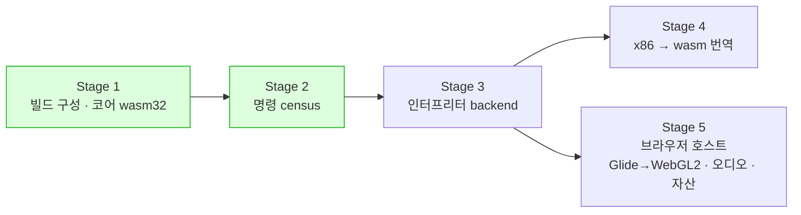

# 웹(WebAssembly) 이식 frontier / Web port frontier

설계: [20260828-513](../design/20260828-513-web-wasm-execution.md) ·
작업 로그: [513 빌드](../work-logs/20260828-513-web-wasm-build.md) ·
[514 명령 census](../work-logs/20260828-514-guest-instruction-census.md)

이 문서는 **웹 이식이 지금 어디까지 왔고 왜 멈춰 있는지**만 유지합니다. 단계별 증거는 작업
로그에, 다섯 단계 계획은 설계에 있습니다.

## 0. 상태 — **재개, 네이티브 `emulated` 모델이 타이틀까지** (2026-10-14, issue #61)

아래 1~6절은 2026-08-28 보류 시점의 기록입니다. 그 뒤 CPU는 [reexec/rex86](https://github.com/reexec/rex86)으로
분리되어, Stage 3(인터프리터)과 Stage 4(번역)의 중심은 rex86으로 옮겨 갔습니다. 3절의 "먼저 정해야 하는 둘" 중
x87 표현은 rex86이 80비트로 구현해 해결됐고, Worker 전제는 단일 Worker로 결정됐습니다.

| 항목 | 상태 | 근거 |
|---|---|---|
| `emulated` 실행 모델(rex86 위, 네이티브 Windows) | **pumpitea가 300초에 타이틀, 355초에 데모 플레이** | [설계 #61](../design/20261014-i061-emulated-execution-model.md), [로그](../work-logs/20261014-i061-emulated-execution-model.md) |
| 실행 규칙 | `dynamic` 백엔드의 HLE 경계 분류(`IsHleBoundary`)와 base 접기를 그대로 씀 | 설계 #61 결정 9, rex86 #69·#70 |
| 처리량 | Windows 인터프리터 약 9.3 MIPS, 약 7.4fps(`dynamic`은 약 59fps) | 로그 2차 |
| **필요 처리량(추정)** | **프레임당 약 125만 명령, 60fps에 약 75 MIPS** (로딩 포함 평균) | 로그 2차 |
| **단일 스레드 호스트 루프** (issue #64 단계 1) | **`emulated`는 게스트·Glide·tick·오디오·입력을 한 스레드에서 번갈아 돌림.** 경계 trace가 첫 벽시계 의존까지 단계 1 이전과 같음 | [설계 #64](../design/20261015-i064-browser-host-single-thread-loop.md), [로그](../work-logs/20261015-i064-browser-host-single-thread-loop.md) |
| 처리량 지표 (추정) | 단일 스레드에서 실행 단계는 29% 줄었지만 화면 교체 수는 같고 HLE 진행은 같거나 앞섬. **실행 단계/초에는 게스트의 대기 루프가 섞여 있어** 위의 75 MIPS는 상한으로 봐야 함 | 로그 #64 |
| **wasm 실행 (Node)** (issue #67 단계 2) | **엔진과 rex86이 wasm32로 빌드되어 Node에서 pumpitea를 실행.** 약 6.1 MIPS(같은 PC의 네이티브 `emulated`와 비슷), 경계 trace가 네이티브와 첫 벽시계 의존까지 같음(재배치 제외). 웹 core probe 36/36 | [설계 #67](../design/20261015-i067-emscripten-headless.md), [로그](../work-logs/20261015-i067-emscripten-headless.md) |
| **GLES 3 / WebGL2 렌더러** (issue #69 단계 3) | **확인됨(네이티브).** Glide 렌더러가 GL 3.3 core와 ES 3.0의 공통 부분집합만 씀: 스트리밍 VBO, shader 투영·알파 테스트, front/back offscreen FBO 쌍. Windows GL 3.3 core에서 결정적 장면 probe 4개가 GL 2.1 호환 렌더러와 화소 일치, pumpit8 vsync OFF 처리량 동일. 웹 빌드는 고정 기능 stub 없이 링크(브라우저 화면은 단계 4) | [설계 #69](../design/20261016-i069-gles3-renderer.md), [로그](../work-logs/20261016-i069-gles3-renderer.md) |
| **브라우저 실행** (issue #72 단계 4 단위 1) | **확인됨(headless Chrome).** 페이지의 Worker에서 pumpitea가 돌아 WebGL2 캔버스에 약 4분에 타이틀, 약 400초에 데모 플레이(CHD에서 428 MB를 메모리에 푸는 55초 포함). Asyncify 양보는 호스트 차례에서만. 소리·입력 없음 | [설계 #72](../design/20261016-i072-browser-page.md), [로그](../work-logs/20261016-i072-browser-page.md) |
| **키보드·게임패드** (issue #76 단계 4 단위 2의 입력) | **구현됨, 브라우저 안 확인은 사용자 몫.** 페이지가 키(`KeyboardEvent.code`)와 표준 매핑 패드를 Worker로 보내고 엔진이 SDL 이벤트로 바꿔 네이티브 키 배치가 그대로 적용됨. 이름 표 core probe 통과(Win32·Linux·웹), headless Edge에서 F5가 새로고침하지 않음. 게임 안 동전·OSD 반응은 이 PC의 브라우저 파일 읽기가 느려진 탓에 headless로 확인하지 못함 | [설계 #76](../design/20261016-i076-browser-input.md), [로그](../work-logs/20261016-i076-browser-input.md) |
| **rex86 wasm 번역** (issue #79) | **확인됨(Node).** 웹 빌드가 rex86의 `kWasm` 번역을 켬. pumpitea 60초: 6 → 21 MIPS(약 3.5배), 부팅 끝(입력 폴링 시작)까지 56 → 18초, 단계의 약 94%가 번역. HLE 경계 trace는 인터프리터와 첫 벽시계 의존까지 같고, 경계의 종류·EIP는 6,240개 모두 같음 | [설계 #79](../design/20261016-i079-rex86-wasm-translation.md), [로그](../work-logs/20261016-i079-rex86-wasm-translation.md) |

**다음 단위:** 단계 4 단위 2의 소리(→ AudioWorklet), 단위 3(OPFS 영구 저장, Pages 배포)
([설계 #64](../design/20261015-i064-browser-host-single-thread-loop.md)). 실시간을 위한 rex86 번역 범위 확대(x87, REP
문자열)는 대기 루프를 뺀 장면별 측정이 우선순위를 정합니다.

## 1. 상태 — **보류 중** (2026-08-28)

**Stage 1~2가 끝났고, Stage 3~5는 의도적으로 보류했습니다.** 보류 이유는 이 작업에 문제가
있어서가 아니라 **Linux 성능 축이 먼저이기 때문**입니다 — 그쪽은 게임이 이미 화면까지
나오고 있고([linux-port-frontier](linux-port-frontier.md)), 웹은 아직 실행 backend가
없습니다.

**브라우저에서 게임은 실행되지 않습니다.** 현재 backend 둘(`legacy`·`dynamic`)이 모두
네이티브 x86 실행 위에 서 있어 wasm에는 대응 형태가 없습니다.

## 2. 확인됨 — 지금 서 있는 것

| 항목 | 값 | 근거 |
|---|---|---|
| 플랫폼 공용 코어가 wasm32로 빌드 | `repiu_exe` 오브젝트 **64개** | Task 513 |
| **코어 소스 수정** | **0줄** | Task 513 |
| 엔진 자신의 미해결 심볼 | **0** (166개는 전부 엔진 밖) | Task 513 |
| `repiu_core_probe` (wasm32) | **9 / 9 통과**, 제외된 6개는 이름을 찍음 | Task 513 |
| 포인터 폭 | 4 / 4 / 4 — i386과 같음 | Task 513 |
| `repiu_glide_issue_probe` (wasm32) | **통과** — Glide 카탈로그 경로는 플랫폼 기능을 쓰지 않음 | Task 513 |
| Windows 회귀 | 15 / 15, 변화 없음 | Task 513 |
| **Stage 3의 크기** | 명령 형태 **320개**(mnemonic 120개), 상위 17개가 **87.89%** | Task 514 |
| 세 호스트 census 일치 | 완전 일치 | Task 514 |

의존성(SDL3·libchdr·miniz·Zydis)은 Emscripten에서 그대로 구성·빌드됩니다.

**AGENTS.md의 "공용 구조를 먼저 설계한다"가 두 번 값을 했습니다** — Task 501이 Linux에서,
513이 **x86이 아닌 호스트**에서 같은 결론에 닿았습니다.

## 3. 재개 조건 — 먼저 정해야 하는 둘

Stage 3(플랫폼 중립 인터프리터)이 다음 단위입니다. 상위 17 mnemonic이 87.89%이므로 **점진적
구축이 가능합니다.** 다만 **인터프리터를 쓰기 전에** 둘을 정해야 하고, 나중에 바꾸면 인터프리터를
다시 쓰는 일이 됩니다.

| 정할 것 | 왜 먼저인가 | 지금 아는 것 |
|---|---|---|
| **x87 표현(80비트인가)** | 레지스터 파일 폭을 나중에 바꾸는 것은 재작성입니다 | 80비트가 관측 가능함은 확인(14곳). 레지스터 파일 전체가 메모리로 노출되는지는 **미확정** — 동적 census 뒤에 정합니다 |
| **Worker 실행 전제** | 실행 루프의 형태를 결정합니다 | CHD가 플레이 내내 열려 있어야 하고, 브라우저의 동기 파일 I/O는 **Worker 안에서만** 성립합니다 (설계 결정 7) |

## 4. 다섯 단계 중 어디인가



**Stage 3이 계획의 중심입니다.** 인터프리터가 플랫폼 중립 C++이므로 **Windows에서 기존
backend와 대조**할 수 있고, 그 대조가 없으면 Stage 4의 번역 버그를 브라우저 안에서 잡아야
합니다.

## 5. 확인되지 않은 것

* **`repiu_chd_cd_probe`는 실행이 확인되지 않았습니다.** 빌드·링크는 되지만 Emscripten 기본
  MEMFS가 호스트 파일시스템을 못 봐서 CHD 경로를 넘길 수 없습니다.
* **브라우저에서 돌린 적이 없습니다.** wasm 산출물은 Node로만 확인했습니다.
* 설계 결정 7의 실행 모델(Worker)은 **추정**입니다 — 브라우저 쪽을 측정하지 않았습니다.
* Stage 4·5는 설계만 있고 구현이 없습니다.

## 6. 재현

```bash
./scripts/build_web_wasm.sh          # Emscripten 필요
node build/web_wasm/repiu_core_probe.js
```

명령 census는 `src/tools/instruction_census/`이고, 절차는
[Task 514 로그](../work-logs/20260828-514-guest-instruction-census.md)의 재현 절에 있습니다.

---

# Web (WebAssembly) port frontier

Design: [20260828-513](../design/20260828-513-web-wasm-execution.md) ·
Work logs: [513, the build](../work-logs/20260828-513-web-wasm-build.md) ·
[514, the instruction census](../work-logs/20260828-514-guest-instruction-census.md)

This document keeps only **how far the web port has come and why it is stopped**. The evidence per
stage is in the work logs, and the five-stage plan is in the design.

## 0. State — **resumed; the native `emulated` model reaches the title** (2026-10-14, issue #61)

Sections 1 to 6 below record the hold of 2026-08-28. Since then the CPU has moved to
[reexec/rex86](https://github.com/reexec/rex86), and Stages 3 (interpreter) and 4 (translation) are centred there. Of
section 3's "two things to settle first", the x87 representation is settled (rex86 implements the 80-bit x87), and the
Worker assumption is decided as a single Worker.

| Item | State | Evidence |
|---|---|---|
| The `emulated` execution model (on rex86, native Windows) | **pumpitea shows the title at 300 s and the demo play at 355 s** | [design #61](../design/20261014-i061-emulated-execution-model.md), [log](../work-logs/20261014-i061-emulated-execution-model.md) |
| Execution rules | the `dynamic` backend's HLE boundary classification (`IsHleBoundary`) and base folds, as they are | design #61 decision 9, rex86 #69 and #70 |
| Throughput | the Windows interpreter at about 9.3 MIPS, about 7.4 fps (`dynamic`: about 59 fps) | the log's second pass |
| **Throughput needed (estimate)** | **about 1.25 million instructions a frame, about 75 MIPS at 60 fps** (averaged with loading) | the log's second pass |
| **The single-threaded host loop** (issue #64 phase 1) | **`emulated` runs the guest, Glide, ticks, audio and input on one thread, taking turns.** The boundary trace matches the one before phase 1 up to the first wall-clock dependence | [design #64](../design/20261015-i064-browser-host-single-thread-loop.md), [log](../work-logs/20261015-i064-browser-host-single-thread-loop.md) |
| Throughput measure (inferred) | on one thread the steps fell by 29% but the buffer swaps are equal and the HLE progress is equal or ahead. **Steps per second include the guest's wait loops**, so the 75 MIPS above is an upper bound | log #64 |
| **Running as wasm (Node)** (issue #67 phase 2) | **the engine and rex86 build for wasm32 and run pumpitea under Node** at about 6.1 MIPS (close to native `emulated` on the same PC); the boundary trace matches native up to the first wall-clock dependence, relocation aside; the web core probe passes 36/36 | [design #67](../design/20261015-i067-emscripten-headless.md), [log](../work-logs/20261015-i067-emscripten-headless.md) |
| **GLES 3 / WebGL2 renderer** (issue #69 phase 3) | **confirmed (natively).** The Glide renderer uses only the subset GL 3.3 core and ES 3.0 share: a streaming VBO, the projection and alpha test in the shader, a front/back pair of offscreen FBOs. On Windows GL 3.3 core the four deterministic probe scenes match the GL 2.1 compatibility renderer pixel for pixel, and pumpit8's vsync-OFF throughput is unchanged. The web build links without fixed-function stubs (the browser picture is phase 4) | [design #69](../design/20261016-i069-gles3-renderer.md), [log](../work-logs/20261016-i069-gles3-renderer.md) |
| **Running in a browser** (issue #72 phase 4 unit 1) | **confirmed (headless Chrome).** pumpitea runs in the page's Worker and draws to a WebGL2 canvas: the title at about 4 minutes, demo play at about 400 s (including the 55 s spent unpacking 428 MB from the CHD into memory). Asyncify yields only at the host turn. No sound or input | [design #72](../design/20261016-i072-browser-page.md), [log](../work-logs/20261016-i072-browser-page.md) |
| **Keyboard and gamepads** (issue #76, the input of phase 4 unit 2) | **implemented; the in-browser check is the user's.** The page sends keys (`KeyboardEvent.code`) and standard-mapping pads to the Worker and the engine turns them into SDL events, so the native key layout applies as it is. The name table passes the core probe (Win32, Linux, web), and in headless Edge F5 does not reload. The coin and the OSD reacting in the game could not be checked headless, because this PC's browser file reads had slowed down | [design #76](../design/20261016-i076-browser-input.md), [log](../work-logs/20261016-i076-browser-input.md) |
| **rex86 wasm translation** (issue #79) | **confirmed (Node).** The web build turns on rex86's `kWasm` translation. pumpitea over 60 s: 6 → 21 MIPS (about 3.5×), the end of the boot (input polling starts) 56 → 18 s, about 94% of steps translated. The HLE boundary trace matches the interpreter up to the first wall-clock dependence, and the kind and EIP of all 6,240 boundaries match | [design #79](../design/20261016-i079-rex86-wasm-translation.md), [log](../work-logs/20261016-i079-rex86-wasm-translation.md) |

**Next units:** phase 4 unit 2's sound (→ AudioWorklet) and unit 3 (OPFS persistence, Pages deployment) ([design #64](../design/20261015-i064-browser-host-single-thread-loop.md)). Wider rex86 translation for real time
(the x87, REP strings) is prioritised by per-scene measurements with the wait loops taken out.

## 1. State — **on hold** (2026-08-28)

**Stages 1 and 2 are done; Stages 3 through 5 are deliberately on hold.** Not because anything is
wrong with the work, but because **the Linux performance axis comes first** -- there the game already
reaches the screen ([linux-port-frontier](linux-port-frontier.md)), while the web has no execution
backend at all yet.

**The game does not run in a browser.** Both present backends (`legacy` and `dynamic`) stand on
native x86 execution, which has no counterpart on wasm.

## 2. Confirmed — what stands today

| Item | Value | Evidence |
|---|---|---|
| The platform-neutral core builds as wasm32 | **64** `repiu_exe` objects | Task 513 |
| **Core sources modified** | **0** | Task 513 |
| Undefined symbols of the engine's own | **none** (all 166 are outside it) | Task 513 |
| `repiu_core_probe` (wasm32) | **9 of 9 passed**, with the 6 excluded ones named | Task 513 |
| Pointer width | 4 / 4 / 4 -- the same as i386 | Task 513 |
| `repiu_glide_issue_probe` (wasm32) | **passes** -- the Glide catalogue path uses no platform facility | Task 513 |
| Windows regression | 15 of 15, unchanged | Task 513 |
| **The size of Stage 3** | **320** instruction forms (120 mnemonics); the top 17 are **87.89%** | Task 514 |
| Census agreement across three hosts | complete | Task 514 |

The dependencies (SDL3, libchdr, miniz, Zydis) configure and build under Emscripten as they are.

**AGENTS.md's "design shared structures first" has now paid twice** -- Task 501 reached the same
conclusion on Linux, and 513 on **a host that is not x86**.

## 3. Resume conditions — two things to settle first

Stage 3, a platform-neutral interpreter, is the next unit. With the top 17 mnemonics at 87.89% it
**can be built incrementally.** But two things have to be settled **before** writing it, because
changing either afterwards means rewriting it.

| To settle | Why first | What is known |
|---|---|---|
| **The x87 representation (80-bit or not)** | changing the register file's width later is a rewrite | 80 bits are observable, confirmed in 14 places. Whether the whole register file is exposed to memory is **unresolved** -- settle it after a dynamic census |
| **Assuming Worker execution** | it decides the shape of the execution loop | the CHD must stay open for the whole session, and synchronous file I/O in a browser exists **only inside a Worker** (design decision 7) |

## 4. Where this sits in the five stages

**Stage 3 is the centre of the plan.** Because the interpreter is platform-neutral C++, it can be
**compared against the existing backends on Windows**; without that comparison, Stage 4's
translation bugs would have to be caught inside a browser.

## 5. What is not confirmed

* **`repiu_chd_cd_probe` has not been run.** It builds and links, but Emscripten's default MEMFS
  cannot see the host filesystem, so no CHD path can be passed to it.
* **Nothing has been run in a browser.** The wasm artefacts were only exercised under Node.
* The execution model in design decision 7 (the Worker) is **inferred** -- the browser side was never
  measured.
* Stages 4 and 5 are designed and unimplemented.

## 6. Reproducing

```bash
./scripts/build_web_wasm.sh          # needs Emscripten
node build/web_wasm/repiu_core_probe.js
```

The instruction census is `src/tools/instruction_census/`; its procedure is in the reproducing
section of [Task 514's log](../work-logs/20260828-514-guest-instruction-census.md).
