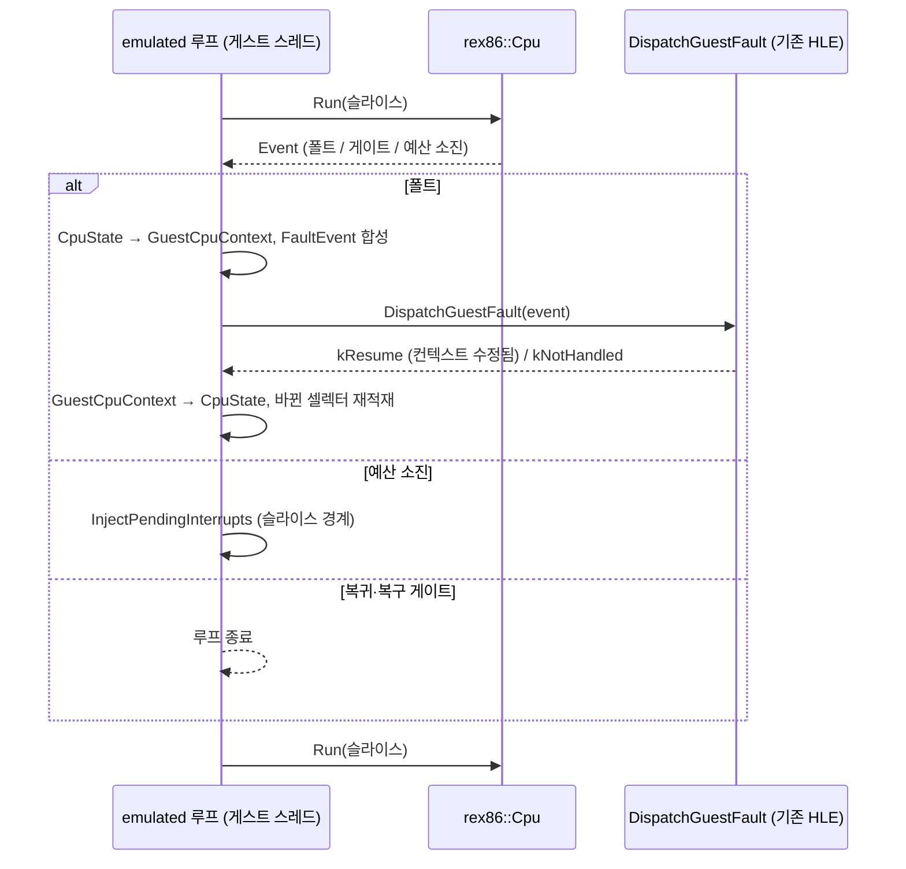
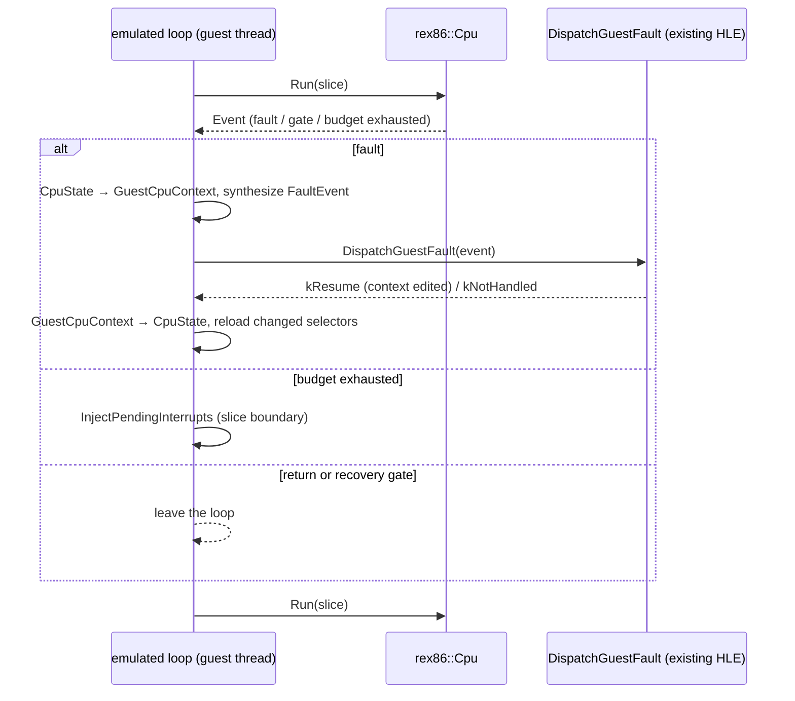

# 설계: rex86 위의 `emulated` 실행 모델, 네이티브 먼저 (issue #61)

관련: [설계 513 — 웹 실행](20260828-513-web-wasm-execution.md),
[웹 이식 frontier](../analysis/web-port-frontier.md),
[rex86 #1 설계 결정 8 — 소비자 접합 지점](https://github.com/reexec/rex86/blob/main/docs/design/20261007-i001-repository-and-public-contract.md),
Task 759(실행 모델 규칙)

## 배경

웹 이식은 2026-08-28 Stage 1~2(코어 wasm32 빌드, 명령 census) 뒤 보류했습니다. 그 사이 CPU는
[reexec/rex86](https://github.com/reexec/rex86)(v0.0.33)으로 분리되어 인터프리터(P6 정수, 80비트 x87,
MMX, SSE)와 wasm 번역 첫 판이 생겼습니다. 설계 513의 Stage 3(인터프리터)과 Stage 4(번역)는 이제 rex86의
몫이고, rePIU에 남은 것은 **rex86을 실행 모델로 붙이는 일**(rex86 단계 2A)과 **브라우저 호스트**(Stage 5)입니다.

rePIU의 실행 모델 둘은 모두 호스트 x86 위에 서 있습니다. `direct`(Win32, Linux i386)는 게스트 바이트를
그대로 실행하고, `cache`(Linux x64)는 long mode 코드 캐시를 실행합니다. 이 작업은 세 번째 모델
**`emulated`**를 만듭니다. 이 모델에서 게스트 명령은 rex86이 실행하고, rePIU 프로세스는 x86 명령을 하나도
실행하지 않습니다.

## 결정 (2026-10-14, 사용자)

| 항목 | 결정 |
|---|---|
| 순서 | 네이티브 Windows에서 `emulated`를 먼저 만들고 `direct`와 차등 대조, 필요 MIPS 측정 → 그 뒤 브라우저 |
| HLE 연결 | rex86의 멈춤을 **네이티브가 받는 것과 같은 폴트**로 바꿔 기존 `DispatchGuestFault`로 보낸다. HLE는 고치지 않는다 |
| 첫 타이틀 | **pumpitea** |
| wasm 게스트 메모리 | identity 매핑(게스트 주소 = 선형 메모리 주소). Emscripten 데이터·힙은 `GLOBAL_BASE`로 게스트 범위 위로 |
| 웹 스레드 모델 | **단일 Worker**: `Run` 슬라이스, Glide 즉시 실행, 오디오 펌프 → AudioWorklet, 입력은 메시지. COOP/COEP 없이 GitHub Pages |
| 자산 | 롬은 호스팅하지 않는다. 사용자가 파일을 골라 OPFS에 저장 |

이 issue의 구현 범위는 **네이티브 `emulated` 모델**까지입니다. 웹 관련 결정은 이 모델의 모양을 제약하므로
여기 함께 적습니다.

## 관찰: HLE는 "폴트 난 명령"을 에뮬레이션한다 (확인됨)

`direct` 모델에서 게스트는 호스트 CPU 위에서 돌다가 사용자 모드에서 허용되지 않는 일을 하면 폴트를 냅니다.
그 폴트가 플랫폼 계층에서 `FaultEvent{kind, access, instruction_address, registers}`로 바뀌어
`DispatchGuestFault`(`execution_trampoline.cpp`)에 도착합니다. 엔진은 **EIP의 바이트를 디코드해 그 명령을
에뮬레이션**하고 EIP를 넘긴 뒤 재개합니다.

| 게스트가 한 일 | 네이티브 Win32의 폴트 | 엔진 처리 |
|---|---|---|
| `INT 21h/2Fh/31h/33h/16h` | #GP → `kAccessViolation`, EIP = `CD xx` | `HandleDosHleInstruction` 등 |
| `CLI`, `STI`, `HLT` | `kPrivilegedInstruction`, EIP = 그 명령 | `HandlePrivilegedTrapInstruction` (cli hold, PIC in-service) |
| `IN`, `OUT` | `kPrivilegedInstruction` | `HandlePortIoInstruction` (JAMMA, PIU10, YMZ280B) |
| DPMI 셀렉터 적재·push, far jmp/ret | #GP | `HandleSegmentLoadInstruction`, `HandleFarJumpInstruction`, mode16 |
| Glide 게이트·LINEXE far transfer | #GP / 접근 위반 | `HandleLinexeFarTransferBoundary`, `HandleGlideGateBoundary` |
| `IRETD`, 세그먼트 override 접근, 세그먼트 REP MOVS/STOS | #GP | 각 `Handle…Instruction` |
| 단일 스텝 기구 | TF → `kSingleStep` (실행 뒤) | `HandleSingleStepTrace` 등 |

IRQ0 주입도 이 경로 안에서 일어납니다. `InjectPendingInterrupts(registers, context, site)`가 폴트를 처리하는
자리에서 **같은 레지스터 컨텍스트에 인터럽트 프레임을 만듭니다.** 그래서 스레드 정지나 컨텍스트 조회가
필요 없습니다.

**결론:** 입구는 이미 플랫폼 중립입니다. rex86이 **네이티브와 같은 지점에서, 같은 종류의 폴트로 멈추면**
HLE 전체가 바뀌지 않고 그대로 동작합니다.

## 결정 1: rex86을 "Win32 사용자 모드의 x86"처럼 동작시킨다 (폴트 동치)

rex86 v0.0.33의 동작과 필요한 동작을 비교했습니다.

| 명령 | rex86 지금 | 필요한 것 |
|---|---|---|
| `INT n` (n≠3) | 실행 뒤 `kSoftwareInterrupt` (EIP = 다음 명령) | **실행 전** #GP (EIP = `CD`) |
| `CLI`, `STI` | 스스로 IF를 바꾸고 이벤트 없음 | **실행 전** 특권 폴트 |
| `HLT` | 실행 뒤 `kHalted` | 실행 전 특권 폴트 |
| `IN`/`OUT`/`INS`/`OUTS` | 호스트가 거절하면 `kPortIo`(IN/OUT은 실행 뒤) | 실행 전 특권 폴트 |
| 호스트가 모르는 셀렉터 적재 | `LoadDescriptor` 거절 → 실행 전 #GP | 그대로 맞음 |
| 매핑 안 된 페이지 접근 | 페이지 속성표 → 실행 전 `kAccessViolation` | 그대로 맞음 |

**rex86에 옵션을 하나 더합니다(rex86 쪽 issue).** 이름은 `Features::user_mode`(가칭)이고 기본값은 꺼짐입니다.
켜면 코어가 **CPL 3, IOPL 0, IDT 게이트 DPL 0인 보호 모드 프로세스**처럼 동작합니다. 이것은 Intel SDM이 정한
실제 CPU 동작입니다: IOPL < CPL이면 CLI/STI는 #GP, I/O 권한 비트맵이 없으면 IN/OUT은 #GP, CPL > 0에서 HLT는
#GP, 게이트 DPL < CPL이면 INT n은 #GP. 우회 장치가 아니라 의미를 하나 더 모델링하는 것이고, 기본값이
꺼짐이므로 기존 테스트와 다른 소비자에 영향이 없습니다.

남은 차이는 어댑터가 흡수합니다.

* **폴트 종류 대응:** rex86 `kGeneralProtection` 중 INT n은 Windows처럼 `kAccessViolation`(접근 정보 없음)으로,
  CLI/STI/HLT/IN/OUT은 `kPrivilegedInstruction`으로, 메모리 위반은 `kAccessViolation` + `access`로 바꿉니다.
  정확한 대응은 `fault_handler_win32.cpp`의 `MakeFaultEventFromWin32`가 싣는 값을 그대로 따릅니다.
* **INT3:** Windows의 `kBreakpoint`와 같은 EIP 규약으로 맞춥니다.
* **TF 단일 스텝:** rex86은 TF 트랩을 내지 않습니다. 어댑터가 재개할 때 `EFlags.TF`가 켜져 있으면
  `Run(1)`로 한 명령만 실행하고 `kSingleStep`을 합성합니다.

## 결정 2: 상태 변환과 재개

* **레지스터:** GPR, EIP, EFLAGS, 세그먼트 셀렉터를 필드별로 복사합니다. 돌아올 때는 셀렉터가 바뀐
  세그먼트만 `LoadDescriptor`로 다시 적재합니다.
* **x87:** `GuestCpuContext::FloatSave`(FNSAVE 형식: CW, SW, TW, 포인터, 80바이트 레지스터)와 rex86
  `X87State`를 변환합니다. HLE가 x87을 만지는 곳은 `x87_context.cpp` 하나입니다. SSE 상태는 컨텍스트에 없고
  HLE도 만지지 않으므로 rex86 안에 그대로 둡니다.
* **`kNotHandled`:** 네이티브에서 처리되지 않은 폴트와 같습니다. 기록하고 게스트 실행을 끝냅니다.

## 결정 3: 셀렉터와 메모리

* **셀렉터:** `LoadDescriptor`는 `direct` 모델이 게스트 진입 때 기록하는 **호스트 셀렉터**
  (`StackSwitchCallState`의 `host_ds/es/ss/gs/fs`와 호스트 CS)만 받아들이고 평탄 디스크립터(base 0,
  limit 4 GiB)를 돌려줍니다. 그 밖의 셀렉터는 모두 거절하므로, 네이티브와 같이 #GP가 HLE로 갑니다. FS는
  Windows에서 TEB를 가리키므로 base를 실제 TEB 주소로 줍니다(게스트가 FS를 읽는지는 **확인 필요**).
* **메모리:** `GuestMemory{base = null, size = 4 GiB}`의 identity 매핑입니다. 32비트 Windows 호스트에서는
  게스트 주소가 곧 호스트 주소라 네이티브와 같습니다. 페이지 속성표에는 런타임 메모리 계획이 게스트에게
  준 구간(이미지, arena, 낮은 주소 예약, HLE 예약, 게스트 스택)만 표시합니다. 그 밖의 접근은
  `kAccessViolation`으로 HLE에 가며, 이것도 네이티브와 같습니다.
* **호스트 페이지 보호 금지:** rex86은 게스트 메모리를 호스트 포인터로 읽고 씁니다. 엔진이 게스트 페이지에
  호스트 보호(`ProtectMemory`: AOT 쓰기 감시, guarded segment, 데이터 감시)를 걸어 두면 **rex86의 C++ 코드
  안에서 진짜 호스트 접근 위반이 납니다.** `emulated`에서는 AOT와 `native_fast_path`가 꺼지고, 남은
  `ProtectMemory` 호출자는 전수 확인해서 끄거나 페이지 속성표로 옮깁니다.
* **SMC:** 2A는 인터프리터만 씁니다(번역 꺼짐). 그래서 무효화할 번역이 없습니다. 번역을 켜는 것은 별도 작업입니다.

## 결정 4: 진입, 복귀, 종료

* **진입:** `EnterGuestWithStack` 자리에 `EnterGuestEmulated`를 둡니다. 초기 상태는 같은
  `StackSwitchCallState`(entry, initial ESP)에서 만들고, 네이티브 스텁처럼 상태 포인터와 복귀 주소를 게스트
  스택에 push합니다.
* **복귀:** 복귀 주소는 rex86 **게이트**로 등록한 센티넬 주소입니다. 게스트가 거기에 닿으면 `kGate`로
  루프가 끝나고 `guest_return_esp`와 결과를 기록합니다.
* **복구 경로:** HLE가 프로세스 종료나 치명적 상황에서 EIP를 호스트 복구 함수(`RecoverGuestStackException`
  등)로 돌리는 경우가 있습니다. 그 주소들도 게이트로 등록해 루프를 끝냅니다. 32비트 호스트라 주소가
  32비트에 들어갑니다.
* **종료 요청:** 호스트 종료는 `Cpu::RequestStop`으로 전달합니다.

## 결정 5: 슬라이스와 타이머

* 루프는 `Run(budget)`을 고정 슬라이스(초기값 10,000 단계, 측정으로 조정)로 반복합니다.
* **IRQ0은 rex86 `RaiseInterrupt`가 아니라 rePIU의 `InjectPendingInterrupts`로 넣습니다.** PIC in-service,
  cli hold, sti 요청, 지연 기록 같은 기존 의미가 모두 그 함수에 있기 때문입니다. 주입 시점은 지금처럼 폴트
  처리 안, 그리고 새 주입 지점인 **슬라이스 경계**(`TimerInjectionSite`에 하나 추가)입니다. 슬라이스
  경계는 네이티브에서 폴트 없이 도는 긴 루프에 해당하는 자리입니다.
* **네이티브 스레드 구조는 바꾸지 않습니다.** 게스트 스레드가 루프를 돌고, Glide rendezvous와 오디오
  워커는 그대로입니다. 웹(단일 Worker)에서는 같은 루프가 호스트 스레드에서 돌고, Glide 백엔드의
  `IsHostThread()` 즉시 실행 경로를 탑니다. 이 경로는 웹 작업에서 확인합니다.

## 결정 6: 빌드

* `REPIU_EXECUTION_MODEL`에 `emulated`를 더합니다. Task 759 규칙대로 바이너리 하나에 모델 하나입니다.
  Windows에서는 별도 빌드 트리(`build/win32_x86_emulated`)로 만들어 `direct` 바이너리와 나란히 둡니다.
  웹(EMSCRIPTEN)의 기본 모델은 `none`에서 `emulated`로 바뀝니다(웹 작업에서).
* 새 파일: `src/runtime/execution_model_emulated.cpp`, `src/engine/execution/execution_trampoline_emulated.cpp`,
  rex86 `Environment` 구현과 상태 변환. 모델별 파일 규칙(`<name>_emulated.cpp`)을 따르고 플랫폼 중립 C++로
  씁니다.
* rex86은 **FetchContent로 release tag를 고정**해 가져옵니다(rex86 결정 6). 두 저장소를 같이 고칠 때는
  `FETCHCONTENT_SOURCE_DIR_REX86=../rex86`을 씁니다.
* **Zydis 중복:** 두 저장소가 같은 Zydis 4.1.1 amalgamation을 각자 정적 라이브러리로 빌드합니다. 한 링크에
  둘이 들어가면 심볼이 겹칩니다. rex86이 있는 구성에서는 rePIU가 rex86의 `rex86_zydis`를 씁니다.

## 결정 7: 차등 대조와 측정

* **HLE 경계 trace 대조:** 두 모델 모두 `DispatchGuestFault`에 들어올 때마다 한 줄씩 기록합니다(폴트 종류,
  EIP, 명령 바이트, GPR, EFLAGS). 그 뒤 첫 불일치를 찾습니다. 첫 IRQ0 주입 전까지(DOS/4G 초기화, 파일 적재)는
  결정적이므로 **완전 일치**해야 합니다. 그 뒤로는 tick 시점이 모델마다 달라서 순서가 갈라질 수 있습니다.
  그래서 그 구간은 HLE 호출 종류별 횟수와 화면 결과(타이틀 도달)로 비교합니다.
* **명령 의미의 정확성**은 rex86이 자체 검증(SingleStepTests, 호스트 CPU 대조 fuzz)으로 책임집니다. 이
  대조는 **접합**(상태 변환, 폴트 동치, 진입·복귀)을 검증합니다.
* **필요 처리량:** `Event::steps`로 버퍼 스왑 사이의 retire 단계 수를 세어, 프레임당 단계 수(p50/p99)와
  실제 fps를 냅니다. 게임이 tick을 기다리며 도는 루프도 단계에 들어가므로, 실시간보다 느리게 도는 구간(대기가
  없는 구간)의 값을 실제 필요량으로 읽습니다. 이 값이 rex86 번역 범위(x87, REP 문자열)를 넓히는 작업의 근거가
  됩니다.

## 결정 8: 구현 전 조사로 바뀐 것 (2026-10-14)

설계 뒤 코드를 더 읽고 아래를 확인했습니다. 결정 3·4의 해당 부분은 이 절이 대신합니다.

* **rex86 쪽은 [rex86 #69](https://github.com/reexec/rex86/issues/69)로 구현했습니다.** `Features::user_mode` 옵션입니다. 조사 중
  하나를 더 찾아 같은 옵션에 넣었습니다. CPL 3·IOPL 0에서 `POPF`/`IRET`는 IF와 IOPL을 **폴트 없이 바꾸지
  않습니다.** 이것을 빼면 게스트의 `PUSHFD`가 네이티브와 다른 값을 봅니다.
* **`legacy` 백엔드는 게스트 전체를 TF 단일 스텝으로 추적합니다.** 게임 실행은
  `AttemptGuestStackTrapExecution`이고, 이 함수는 `enable_single_step_trace = true`로 시작합니다. 단일 스텝
  처리기(`HandleSingleStepTrace`)는 명령마다 HLE 디스패치(세그먼트 override처럼 네이티브에서 폴트가 나지 않는
  명령의 에뮬레이션), IRQ0 주입, native fast path 진입을 시도합니다. `emulated`는 `legacy` 위에서 돌고
  (AOT·Glide 직접 디스패치는 `dynamic` 전용), **TF를 그대로 존중합니다.** TF가 켜져 있으면 `Cpu::Step`으로 한
  명령을 실행하고 `kSingleStep`을 합성합니다. HLE가 TF를 끄면(native fast path) `Run` 슬라이스로 돕니다.
  네이티브 TF 트랩의 커널 왕복이 함수 호출로 바뀝니다. 대조 기준도 그래서 `direct`+`legacy`입니다.
* **페이지 속성은 호스트 보호를 비춥니다.** 처음에는 "게스트 구간만 매핑"을 생각했습니다. 하지만 HLE는
  게스트를 호스트가 만든 페이지로 보냅니다. Glide 게이트 interrupt exit는 호스트 RX 페이지의 x86 코드이고 호스트
  전역 슬롯을 읽습니다. timer return pad는 예약만 하고 커밋하지 않은 접근 불가 페이지입니다. 그래서 페이지
  속성표는 처음에 비워 두고, rex86이 낸 접근 위반이 **아직 비추지 않은 페이지**에서 났으면 그 구간의 호스트
  보호(`QueryMemory`)를 읽어 속성으로 옮긴 뒤 다시 실행합니다. 비춘 뒤에도 접근할 수 없으면 네이티브와 같은
  폴트로 HLE에 갑니다.
* **호스트 메모리 변경 관찰자(플랫폼 계층).** `ProtectMemory`와 `ReleaseMemory`는 보호를 바꾸고,
  `FlushInstructionCacheRange`는 호스트가 코드를 고쳤다는 표시입니다. 플랫폼 계층에 기본 값만 넘기는 관찰자
  콜백 하나를 둡니다. `emulated` 루프는 보호가 바뀐 구간의 속성을 지워 다음 접근 때 다시 비추고, 코드가 바뀐
  구간에는 `Cpu::InvalidateCode`를 부릅니다(rex86은 디코드를 캐시하므로 호스트의 코드 쓰기를 알려야 합니다).
  관찰자는 어느 스레드에서든 불릴 수 있으므로 변경을 큐에 쌓고, 게스트 스레드가 이벤트와 슬라이스 경계에서
  적용합니다.
* **복구 게이트는 하나입니다.** HLE가 EIP를 호스트 함수로 보내는 곳은 `RecoverToHost`
  (`RecoverGuestStackException`) 하나입니다. 이 함수는 TEB와 호스트 스택을 고치므로 **rex86이 절대 실행하면
  안 됩니다.** 게이트로 등록해 루프를 끝냅니다.
* **종료.** 호스트의 종료 경로는 다른 스레드에서 게스트 스레드를 interrupt하고, EIP가 게스트 코드 안일 때만
  복구합니다. `emulated`에서 호스트 EIP는 늘 rex86 안이므로 그 경로는 거절만 반복합니다. 그래서 모델 함수
  `RequestGuestStop`을 하나 더 둡니다. `emulated`는 정지 플래그와 `Cpu::RequestStop`으로 루프를 세우고, 종료
  경로는 Glide 명령을 펌프하면서 스레드를 join합니다. `direct`·`cache`는 거짓을 돌려줘 지금 경로를 그대로 탑니다.
* **스레드 프로시저.** `emulated`는 cache 모델처럼 자기 프로시저 `GuestEmulatedThreadProc`를 갖고,
  `SelectGuestThreadEntry`가 이를 고릅니다. 진입 가능 여부도 Task 578처럼 술어
  `RunsGuestOnEmulatedCpu()`를 더해 disjunction으로 묶습니다. `RunsGuestBytesDirectly()`는 `emulated`에서
  거짓이고, `direct`와 같이 동작해야 하는 지점(timer return pad, Glide 스왑 대기 tick 보류)만 둘을 함께 봅니다.
* **호스트 셀렉터와 FPU 초기값.** 네이티브 게스트는 진입할 때 호스트 스레드의 세그먼트 셀렉터와 x87 제어
  워드(MSVC 기본 0x027F)를 물려받습니다. 플랫폼 계층에서 이 값을 읽어 rex86 초기 상태로 씁니다.
* **x87 변환은 Windows 형식을 따릅니다.** `FloatSave.RegisterArea`는 FNSAVE 형식(ST(i) 순서)이고 rex86은
  물리 슬롯 순서이므로 TOP으로 회전합니다. 덧붙여 `x87_context.cpp`의 `PushX87Float`는 `RegisterArea`를 물리 슬롯
  순서로 다룹니다. 호출하는 곳이 없어 지금은 영향이 없지만, 쓰게 되면 다시 확인해야 합니다.

## 바꾸지 않는 것

* HLE(DOS, DPMI, MSCDEX, Glide, I/O 포트)와 그 입구 `DispatchGuestFault`.
* `direct`·`cache` 모델과 그 빌드.
* 네이티브의 스레드 구조.

## 범위 밖

* 브라우저 호스트(Worker 루프, OPFS, WebGL2, AudioWorklet, 입력): 별도 issue.
* rex86 wasm/IR 번역 켜기와 SMC.
* 셀렉터를 rex86이 직접 처리하는 빠른 경로(HLE가 세그먼트를 에뮬레이션하지 않게 하기). 측정 근거가
  생기면 검토합니다.

## 확인 필요 (구현 중 확인)

| 항목 | 왜 |
|---|---|
| 게스트가 FS(TEB)를 읽는지 | FS 디스크립터의 base를 무엇으로 줄지 |
| `ProtectMemory` 호출자 전수 | 결정 3의 호스트 보호 금지 |
| 단일 스텝 기구가 `direct`에서 어디에 쓰이는지 | `Run(1)` 합성이 충분한지 |
| `RecoverFromHleExit` 계열이 EIP를 보내는 호스트 주소 목록 | 결정 4의 복구 게이트 |
| `CPUID`·`RDTSC` 값 | 네이티브와 같게 호스트 값을 그대로 주는 것으로 시작 |

## 검증

1. rex86: `user_mode` 단위 테스트(각 명령이 실행 전 폴트, EIP 불변). 기존 테스트 전체 통과.
2. rePIU: Win32 `direct` 빌드 회귀 없음(core probe).
3. `build/win32_x86_emulated` 빌드, core probe, 상태 변환 probe(CpuState ↔ GuestCpuContext 왕복).
4. pumpitea를 `emulated`로 실행해 타이틀 화면 도달. HLE 경계 trace가 첫 IRQ0 전까지 `direct`와 일치.
5. 프레임당 단계 수 측정 결과를 작업 로그와 frontier에 기록.

---

# Design: an `emulated` execution model on rex86, native first (issue #61)

Related: [design 513 — web execution](20260828-513-web-wasm-execution.md),
[web port frontier](../analysis/web-port-frontier.md),
[rex86 #1 design decision 8 — where the consumers connect](https://github.com/reexec/rex86/blob/main/docs/design/20261007-i001-repository-and-public-contract.md),
Task 759 (the execution model rule)

## Background

The web port was put on hold on 2026-08-28 after Stages 1 and 2 (the core building for wasm32, the instruction
census). Since then the CPU has moved to [reexec/rex86](https://github.com/reexec/rex86) (v0.0.33). rex86 now has an
interpreter (P6 integer, 80-bit x87, MMX, SSE) and a first wasm translator. Design 513's Stage 3 (interpreter) and
Stage 4 (translation) now belong to rex86. What remains in rePIU is **attaching rex86 as an execution model** (rex86
phase 2A) and **the browser host** (Stage 5).

Both of rePIU's execution models stand on a host x86. `direct` (Win32, Linux i386) runs the guest's own bytes, and
`cache` (Linux x64) runs a long-mode code cache. This task builds a third model, **`emulated`**. In it rex86 executes
the guest's instructions, and the rePIU process executes no x86 instruction of the guest's at all.

## Decisions (2026-10-14, the user)

| Item | Decision |
|---|---|
| Order | Build `emulated` on native Windows first, compare it against `direct`, measure the MIPS needed, then the browser |
| HLE connection | Turn rex86's stops into **the faults a native host would take** and send them down the existing `DispatchGuestFault`. The HLE is not changed |
| First title | **pumpitea** |
| wasm guest memory | Identity mapping (guest address = linear memory address); Emscripten's data and heap pushed above the guest range with `GLOBAL_BASE` |
| Web thread model | **A single Worker**: `Run` slices, Glide executed inline, an audio pump into an AudioWorklet, input as messages; GitHub Pages without COOP/COEP |
| Assets | No ROMs hosted. The user picks the files, which are stored in OPFS |

This issue implements **the native `emulated` model** only. The web decisions are recorded here because they
constrain the model's shape.

## Observation: the HLE emulates "the instruction that faulted" (confirmed)

Under `direct`, the guest runs on the host CPU and faults whenever it does something user mode does not allow. The
platform layer turns that fault into `FaultEvent{kind, access, instruction_address, registers}`, which reaches
`DispatchGuestFault` (`execution_trampoline.cpp`). The engine **decodes the bytes at EIP and emulates that
instruction**, moves EIP past it, and resumes.

| What the guest did | Native Win32 fault | Engine handling |
|---|---|---|
| `INT 21h/2Fh/31h/33h/16h` | #GP → `kAccessViolation`, EIP = `CD xx` | `HandleDosHleInstruction` and kin |
| `CLI`, `STI`, `HLT` | `kPrivilegedInstruction`, EIP = the instruction | `HandlePrivilegedTrapInstruction` (cli hold, PIC in-service) |
| `IN`, `OUT` | `kPrivilegedInstruction` | `HandlePortIoInstruction` (JAMMA, PIU10, YMZ280B) |
| DPMI selector load or push, far jmp/ret | #GP | `HandleSegmentLoadInstruction`, `HandleFarJumpInstruction`, mode16 |
| Glide gate, LINEXE far transfer | #GP / access violation | `HandleLinexeFarTransferBoundary`, `HandleGlideGateBoundary` |
| `IRETD`, segment-override accesses, segmented REP MOVS/STOS | #GP | the `Handle…Instruction` functions |
| The single-step machinery | TF → `kSingleStep` (after the instruction) | `HandleSingleStepTrace` and kin |

IRQ0 injection happens on this path too. `InjectPendingInterrupts(registers, context, site)` **builds the interrupt
frame in the same register context** where a fault is being handled. So no thread suspension and no context query is
needed.

**Conclusion:** the entry is already platform-neutral. If rex86 **stops where a native host would, with the same kind
of fault**, the whole HLE works unchanged.

## Decision 1: make rex86 behave like an x86 in a Win32 user-mode process (fault equivalence)

rex86 v0.0.33's behaviour against what is needed:

| Instruction | rex86 today | Needed |
|---|---|---|
| `INT n` (n≠3) | `kSoftwareInterrupt` after retiring (EIP = next) | #GP **before** retiring (EIP = `CD`) |
| `CLI`, `STI` | changes IF itself, no event | privileged fault **before** retiring |
| `HLT` | `kHalted` after retiring | privileged fault before retiring |
| `IN`/`OUT`/`INS`/`OUTS` | `kPortIo` when the host declines (IN/OUT after retiring) | privileged fault before retiring |
| Loading a selector the host does not know | `LoadDescriptor` declines → #GP before retiring | already right |
| Touching an unmapped page | page attribute table → `kAccessViolation` before retiring | already right |

**rex86 gets one more option (a rex86 issue).** It is `Features::user_mode` (working name), off by default. When on,
the core behaves like **a protected-mode process at CPL 3 with IOPL 0 and IDT gates of DPL 0**. This is the real CPU
as the Intel SDM defines it: CLI/STI #GP when IOPL < CPL, IN/OUT #GP without an I/O permission bitmap, HLT #GP above
CPL 0, and INT n #GP when the gate's DPL is below CPL. It models one more piece of semantics rather than adding a
workaround, and since it is off by default, existing tests and the other consumer are unaffected.

The adapter absorbs the remaining differences.

* **Fault kinds:** a rex86 `kGeneralProtection` from INT n becomes `kAccessViolation` without access information,
  as on Windows. CLI/STI/HLT/IN/OUT become `kPrivilegedInstruction`, and memory violations become `kAccessViolation`
  with `access`. The exact mapping follows what `MakeFaultEventFromWin32` in `fault_handler_win32.cpp` fills in.
* **INT3:** follows Windows' `kBreakpoint` EIP convention.
* **TF single-stepping:** rex86 raises no TF trap. When the adapter resumes with `EFlags.TF` set, it runs `Run(1)`
  for one instruction and synthesizes `kSingleStep`.

## Decision 2: state conversion and resumption

* **Registers:** GPRs, EIP, EFLAGS and segment selectors are copied field by field. On the way back, only segments
  whose selector changed are reloaded through `LoadDescriptor`.
* **x87:** `GuestCpuContext::FloatSave` (FNSAVE layout: CW, SW, TW, pointers, 80 bytes of registers) is converted
  to and from rex86's `X87State`. The only place the HLE touches the x87 is `x87_context.cpp`. SSE state is not in
  the context and the HLE never touches it, so it stays inside rex86.
* **`kNotHandled`:** the same as an unhandled fault natively. It is recorded and guest execution ends.

## Decision 3: selectors and memory

* **Selectors:** `LoadDescriptor` accepts only the **host selectors** the `direct` model records at guest entry
  (`host_ds/es/ss/gs/fs` in `StackSwitchCallState`, and the host CS), and answers with a flat descriptor (base 0,
  limit 4 GiB). Every other selector is declined, so its #GP reaches the HLE as it does natively. On Windows FS
  points at the TEB, so its base is the real TEB address (whether the guest reads FS is **to be confirmed**).
* **Memory:** `GuestMemory{base = null, size = 4 GiB}`, the identity mapping. On a 32-bit Windows host the guest
  address is the host address, as it is natively. The page attribute table marks only the ranges the runtime memory
  plan gives the guest (image, arena, low reservation, HLE reserve, guest stack). Any other access reaches the HLE as
  `kAccessViolation`, also as it does natively.
* **No host page protection:** rex86 reads and writes guest memory through host pointers. If the engine has put a
  host protection (`ProtectMemory`: AOT write watches, guarded segments, data watches) on a guest page, **a real host
  access violation happens inside rex86's C++ code.** Under `emulated`, AOT and `native_fast_path` are off, and the
  remaining `ProtectMemory` callers are audited and either turned off or moved to the page attribute table.
* **SMC:** 2A uses the interpreter only (translation off), so there is no translation to invalidate. Turning
  translation on is a separate task.

## Decision 4: entry, return and exit

* **Entry:** `EnterGuestEmulated` takes the place of `EnterGuestWithStack`. Its initial state comes from the same
  `StackSwitchCallState` (entry, initial ESP). Like the native stub, it pushes the state pointer and a return
  address onto the guest stack.
* **Return:** the return address is a sentinel registered as a rex86 **gate**. When the guest reaches it, `kGate`
  ends the loop and `guest_return_esp` and the result are recorded.
* **Recovery paths:** on process exit or a fatal condition the HLE sometimes points EIP at a host recovery function
  (`RecoverGuestStackException` and others). Those addresses are registered as gates too, and they end the loop. On
  a 32-bit host the addresses fit in 32 bits.
* **Stop requests:** a host shutdown is passed on as `Cpu::RequestStop`.

## Decision 5: slices and the timer

* The loop repeats `Run(budget)` with a fixed slice (10,000 steps to start, tuned by measurement).
* **IRQ0 goes in through rePIU's `InjectPendingInterrupts`, not rex86's `RaiseInterrupt`.** The existing semantics
  (PIC in-service, cli hold, sti requests, latency records) all live in that function. Injection happens where it
  does today, inside fault handling, and at one new injection site, **the slice boundary** (one more
  `TimerInjectionSite`). The slice boundary stands where a long loop that never faults would sit natively.
* **The native thread structure does not change.** The guest thread runs the loop, and the Glide rendezvous and the
  audio workers stay as they are. On the web (a single Worker) the same loop runs on the host thread and takes the
  Glide backend's `IsHostThread()` inline path, which the web task confirms.

## Decision 6: the build

* `REPIU_EXECUTION_MODEL` gains `emulated`. As Task 759 requires, there is one model per binary. On Windows it is a
  separate build tree (`build/win32_x86_emulated`) next to the `direct` binary. The web (EMSCRIPTEN) default moves
  from `none` to `emulated` in the web task.
* New files: `src/runtime/execution_model_emulated.cpp`, `src/engine/execution/execution_trampoline_emulated.cpp`,
  the rex86 `Environment` implementation and the state conversion. They follow the per-model file rule
  (`<name>_emulated.cpp`) and are written as platform-neutral C++.
* rex86 comes in through **FetchContent pinned to a release tag** (rex86 decision 6). When both repositories change
  together, `FETCHCONTENT_SOURCE_DIR_REX86=../rex86` is used.
* **Duplicate Zydis:** both repositories build the same Zydis 4.1.1 amalgamation as their own static library, and
  both in one link collide. In configurations that have rex86, rePIU uses rex86's `rex86_zydis`.

## Decision 7: differential comparison and measurement

* **Comparing HLE boundary traces:** both models write one line on every entry to `DispatchGuestFault` (fault kind,
  EIP, instruction bytes, GPRs, EFLAGS), and the first divergence is located. Up to the first IRQ0 injection (DOS/4G
  initialization, file loading) execution is deterministic and the traces must **match exactly**. After that, tick
  timing differs between the models and the order can diverge. That stretch is compared by the count of each HLE call
  kind and by the visible result (reaching the title).
* **The correctness of instruction semantics** is rex86's responsibility, through its own verification
  (SingleStepTests, the host-CPU comparison fuzz). This comparison verifies **the connection**: state conversion,
  fault equivalence, entry and return.
* **The throughput needed:** `Event::steps` counts the steps retired between buffer swaps, giving steps per frame
  (p50/p99) and the actual fps. Loops the game spins while waiting for ticks count as steps too, so the real need is
  read from stretches that run slower than real time (where nothing waits). That figure is the basis for widening
  rex86's translation coverage (x87, REP strings).

## Decision 8: what changed after reading further (2026-10-14)

Reading more of the code after the design confirmed the following. Where it differs from decisions 3 and 4, this
section replaces them.

* **The rex86 side is done as [rex86 #69](https://github.com/reexec/rex86/issues/69)**, the `Features::user_mode`
  option. The reading found one more thing, now in the same option: at CPL 3 with IOPL 0, `POPF`/`IRET` **leave IF
  and IOPL unchanged without a fault**. Without that, the guest's `PUSHFD` would see a different value than it does
  natively.
* **The `legacy` backend traces the whole guest by TF single-stepping.** A game runs through
  `AttemptGuestStackTrapExecution`, which starts with `enable_single_step_trace = true`. On every instruction the
  single-step handler (`HandleSingleStepTrace`) tries HLE dispatch (emulating instructions that do not fault natively,
  such as segment overrides), IRQ0 injection and native fast path entry. `emulated` runs on `legacy` (AOT and Glide
  direct dispatch belong to `dynamic`) and **honours TF as it is**: with TF set it executes one instruction with
  `Cpu::Step` and synthesizes `kSingleStep`, and when the HLE clears TF (the native fast path) it runs `Run` slices.
  The kernel round trip of a native TF trap becomes a function call. This is also why the comparison baseline is
  `direct` + `legacy`.
* **Page attributes mirror the host's protection.** The first idea was to map only the guest's ranges. But the HLE
  sends the guest into pages the host made: the Glide gate interrupt exit is x86 code in a host RX page that reads
  host global slots, and the timer return pad is a reserved, never-committed, no-access page. So the page attribute
  table starts empty. When rex86 reports an access violation on **a page not yet mirrored**, the host's protection of
  that range (`QueryMemory`) is copied into the attributes and the instruction runs again. If the page is still
  inaccessible after mirroring, the fault goes to the HLE as it would natively.
* **A host memory change observer (in the platform layer).** `ProtectMemory` and `ReleaseMemory` change protection,
  and `FlushInstructionCacheRange` marks that the host wrote code. The platform layer gets one observer callback
  taking plain values. The `emulated` loop clears the attributes of ranges whose protection changed, so they are
  mirrored again on the next access, and calls `Cpu::InvalidateCode` on ranges whose code changed (rex86 caches
  decodes, so it must be told about the host's code writes). The observer can be called from any thread, so changes
  are queued and the guest thread applies them at events and slice boundaries.
* **There is one recovery gate.** The only place the HLE sends EIP to a host function is `RecoverToHost`
  (`RecoverGuestStackException`). That function rewrites the TEB and the host stack, so **rex86 must never execute
  it**. It is registered as a gate that ends the loop.
* **Shutdown.** The host's shutdown path interrupts the guest thread from another thread and recovers only when EIP is
  in guest code. Under `emulated` the host EIP is always inside rex86, so that path would only ever refuse. A model
  function `RequestGuestStop` is added: `emulated` stops the loop with a stop flag and `Cpu::RequestStop`, and the
  shutdown path joins the thread while pumping Glide commands. `direct` and `cache` return false and keep today's path.
* **The thread procedure.** Like the cache model, `emulated` has its own procedure, `GuestEmulatedThreadProc`, chosen
  by `SelectGuestThreadEntry`. As in Task 578, whether a guest can be entered gains a predicate,
  `RunsGuestOnEmulatedCpu()`, joined by disjunction. `RunsGuestBytesDirectly()` is false under `emulated`; only the
  places that must behave as `direct` does (the timer return pad, holding swap-wait ticks for Glide) look at both.
* **Host selectors and the initial FPU state.** A native guest inherits the host thread's segment selectors and x87
  control word (MSVC's default 0x027F) at entry. The platform layer reads them and they become rex86's initial state.
* **The x87 conversion follows the Windows layout.** `FloatSave.RegisterArea` is the FNSAVE layout (ST(i) order) and
  rex86 keeps physical slots, so the conversion rotates by TOP. Incidentally, `PushX87Float` in `x87_context.cpp`
  treats `RegisterArea` as physical-slot order. Nothing calls it, so nothing is affected today, but it should be
  checked again before it is used.

## What does not change

* The HLE (DOS, DPMI, MSCDEX, Glide, I/O ports) and its entry, `DispatchGuestFault`.
* The `direct` and `cache` models and their builds.
* The native thread structure.

## Out of scope

* The browser host (Worker loop, OPFS, WebGL2, AudioWorklet, input): a separate issue.
* Turning on rex86's wasm/IR translation, and SMC.
* A fast path where rex86 handles selectors itself (so the HLE no longer emulates segments). It is considered once
  a measurement calls for it.

## To be confirmed (during implementation)

| Item | Why |
|---|---|
| Whether the guest reads FS (the TEB) | what base to give the FS descriptor |
| Every `ProtectMemory` caller | decision 3's ban on host protection |
| Where `direct` uses the single-step machinery | whether synthesizing with `Run(1)` is enough |
| The host addresses the `RecoverFromHleExit` family sends EIP to | decision 4's recovery gates |
| `CPUID` and `RDTSC` values | start by passing the host's values through, as natively |

## Verification

1. rex86: `user_mode` unit tests (each instruction faults before retiring, EIP unchanged); all existing tests pass.
2. rePIU: no regression in the Win32 `direct` build (core probe).
3. `build/win32_x86_emulated` builds; the core probe and a state conversion probe (CpuState ↔ GuestCpuContext round
   trip) pass.
4. pumpitea runs under `emulated` to its title screen, and its HLE boundary trace matches `direct` up to the first
   IRQ0.
5. The steps-per-frame measurement goes into the work log and the frontier.
