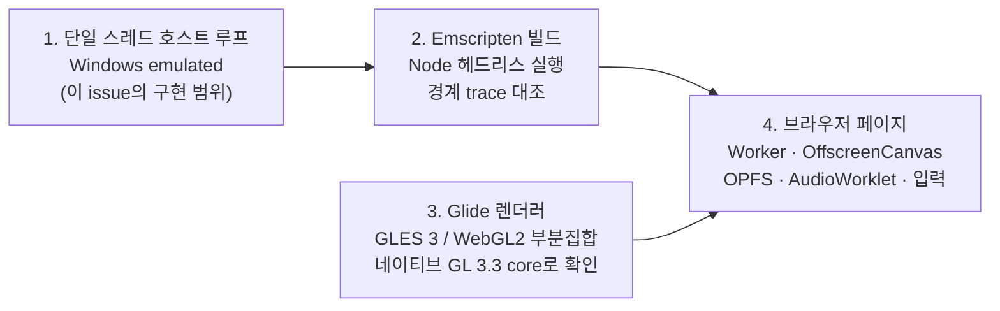
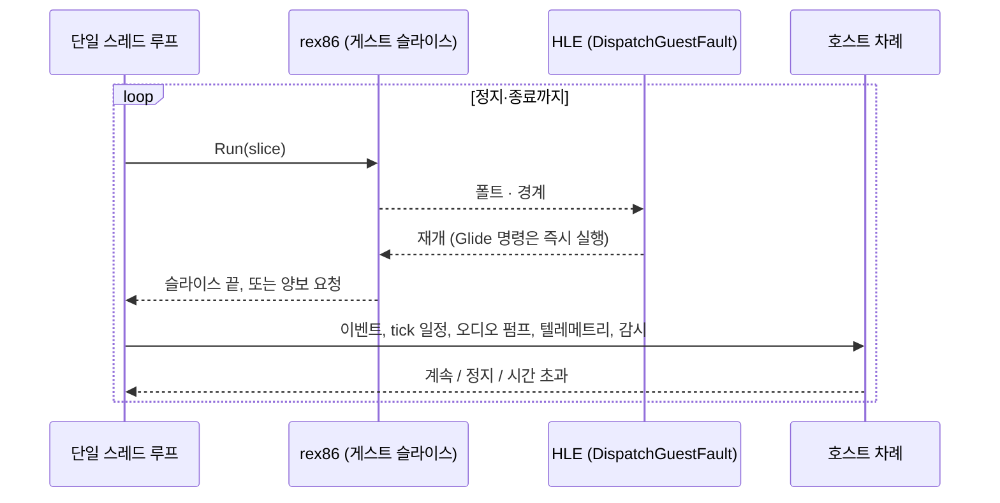
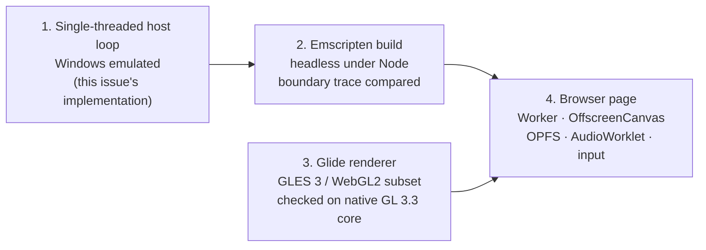
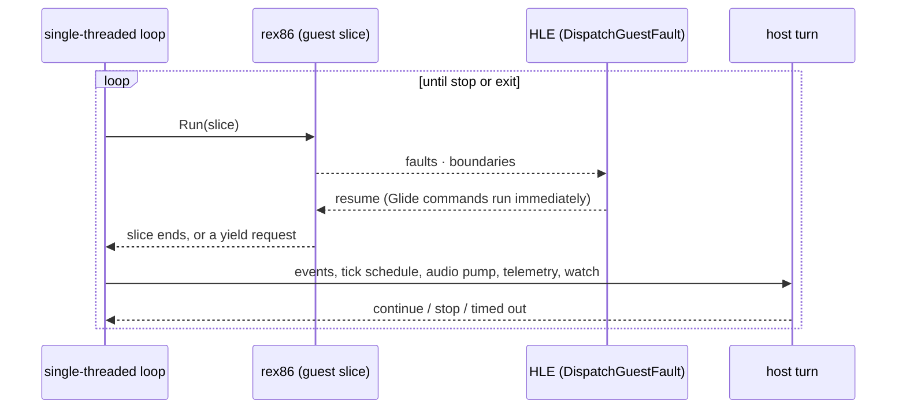

# 설계: 브라우저 호스트, 먼저 `emulated` 모델의 단일 스레드 호스트 루프 (issue #64)

관련: [설계 #61 — `emulated` 실행 모델](20261014-i061-emulated-execution-model.md),
[설계 513 — 웹 실행](20260828-513-web-wasm-execution.md),
[웹 이식 frontier](../analysis/web-port-frontier.md), issue #59(tick 지연과 몰림)

## 배경

#61에서 네이티브 Windows의 `emulated` 모델(rex86 위)로 pumpitea가 300초에 타이틀, 355초에 데모 플레이까지
나왔습니다. 남은 것은 설계 513의 Stage 5, **브라우저 호스트**입니다. 웹에 관한 결정은 #61에서 이미 내렸습니다.

| 항목 | 결정(2026-10-14, #61) |
|---|---|
| 웹 스레드 모델 | **단일 Worker**: `Run` 슬라이스, Glide 즉시 실행, 오디오 펌프 → AudioWorklet, 입력은 메시지 |
| 배포 | COOP/COEP 없이 GitHub Pages |
| 게스트 메모리 | identity 매핑(게스트 주소 = 선형 메모리 주소), Emscripten 데이터·힙은 `GLOBAL_BASE`로 게스트 범위 위로 |
| 자산 | 롬은 호스팅하지 않는다. 사용자가 파일을 골라 OPFS에 저장 |

COOP/COEP가 없으면 `SharedArrayBuffer`가 없고, 그래서 wasm에는 스레드가 없습니다. 그런데 지금 rePIU의 호스트는
여러 스레드로 나뉘어 있습니다(확인됨, 코드 기준).

| 스레드 | 하는 일 | 위치 |
|---|---|---|
| 메인(호스트) | Glide GL 명령 실행(`PumpHostCommands`), SDL 이벤트(`PumpEvents`), PIT tick 일정과 기록(`RecordTimerTicksDue`), 텔레메트리, 시간 제한·정지 감시 | `PollThreadUntilExit`, [live_telemetry_snapshot.cpp](../../src/engine/telemetry/live_telemetry_snapshot.cpp) |
| 게스트 | 게스트 실행. `emulated`에서는 `EnterGuestEmulated`의 슬라이스 반복 | `CreateHostThread(guest_thread_proc)`, [execution_trampoline.cpp](../../src/engine/execution/execution_trampoline.cpp) |
| YMZ280B 오디오 | 디코드 → `SDL_AudioStream` | [ymz280b_audio_out.cpp](../../src/engine/ymz280b_audio_out.cpp) `std::thread` |
| PIU10 MP3 오디오 | 디코드 → `SDL_AudioStream` | [piu10_mp3_audio_out.cpp](../../src/engine/piu10_mp3_audio_out.cpp) `std::thread` |
| CD 오디오 | 재생 워커 | [cd_audio_wave_out.cpp](../../src/engine/cd_audio_wave_out.cpp) |
| 입력 스크립트(진단) | 정해진 입력 재생 | [sdl_input_script.cpp](../../src/engine/sdl_input_script.cpp) `std::thread` |
| AOT 번역 워커 | `dynamic` 번역 | `emulated`에서는 쓰지 않음(#61 작업 지시 7) |

게스트 스레드와 메인 스레드는 Glide 명령을 **랑데부**로 주고받습니다. 게스트가 명령을 올리고 메인이 실행하면,
게스트는 조건 변수에서 기다립니다. 다만 `PostToHostThread`는 호출한 스레드가 이미 호스트 스레드이면
(`IsHostThread()`) 명령을 그 자리에서 실행합니다(확인됨, `glide_opengl_backend.cpp`). **같은 스레드에서 돌면
랑데부가 자연히 즉시 실행이 됩니다.**

Glide 백엔드는 데스크톱 GL 2.x 호환 프로필을 씁니다. 고정 기능 호출이 28곳(`glide_opengl_backend.cpp`)과
4곳(`glide_post_process.cpp`) 있고, 셰이더는 GLSL `#version 110`입니다(확인됨). WebGL2(GLES 3)에는 고정 기능이
없으므로, 렌더러를 옮기는 일은 독립된 단위입니다.

## 단계

브라우저 호스트는 네 단계로 나눕니다. **#61과 같은 원칙으로, 네이티브에서 확인할 수 있는 것은 네이티브에서
먼저 합니다.** 브라우저 안에서는 디버거와 대조 기준이 약하기 때문입니다.



| 단계 | 산출물 | 네이티브에서 확인하는 것 |
|---|---|---|
| 1 | `emulated` 모델이 한 스레드에서 게스트·Glide·tick·오디오·입력을 모두 돈다 | 전부(pumpitea 타이틀·데모, 소리, 입력, 종료) |
| 2 | 엔진 + rex86을 Emscripten으로 빌드, Glide 없이(dummy) Node에서 N 프레임 | 경계 trace가 네이티브 `emulated`와 같은지 |
| 3 | 고정 기능 제거, GLSL ES 3.00 / 3.30 core 셰이더 | GL 3.3 core 문맥에서 화면이 같은지 |
| 4 | 페이지와 Worker, 자산 선택, 소리, 입력, Pages 배포 | — (브라우저에서만) |

이 issue의 구현은 **단계 1**까지입니다. 단계 2~4는 이 설계에 방향만 적고, 시작할 때 각자 작업 지시를 씁니다.

## 결정 1: `emulated` 모델은 언제나 단일 스레드 호스트 루프로 돈다

선택 스위치를 두지 않습니다. `emulated`는 개발용 빌드이고, 그 존재 이유가 웹입니다. 웹에서는 단일 스레드가
유일한 모양이므로, 네이티브 `emulated`가 다른 모양으로 돌면 대조의 의미가 줄어듭니다. 환경 변수 토글을 줄여 온
흐름(#20, #22, #24)과도 맞습니다. `direct`·`cache`는 지금의 스레드 구조를 그대로 둡니다.

공용 코드는 이것을 `include/repiu/runtime/execution_model.h`의 새 질문으로 묻습니다.

```cpp
// Whether the host runs the guest, the Glide commands, the timer schedule and the audio
// on one thread, taking turns. True on the emulated model only.
[[nodiscard]] bool RunsHostOnOneThread();
```

`RunsGuestOnEmulatedCpu()`와 값은 같지만 질문이 다릅니다. 오디오와 Glide 코드는 "CPU가 무엇인가"가 아니라 "스레드가
있는가"를 알아야 하므로 이름을 따로 둡니다.

## 결정 2: 호스트 차례(host turn)를 폴링 루프에서 뽑아 두 루프가 함께 쓴다

`PollThreadUntilExit`의 반복 한 번이 하는 일(Glide 명령 펌프, 이벤트, PIT tick 일정, 텔레메트리, 감시)을
**호스트 차례** 한 번으로 뽑아냅니다. 지금의 스레드 루프는 "호스트 차례 → 기다림"을 반복하고, 단일 스레드
루프는 "게스트 슬라이스 → 호스트 차례"를 반복합니다. 같은 함수를 부르므로 tick 일정과 감시 규칙이 두 모양에서
같습니다.



뽑아내는 것은 오케스트레이션의 이동이고, 규칙은 바꾸지 않습니다. `direct` 빌드로 회귀를 확인합니다.
새 코드는 `src/engine/execution/` 아래 전용 파일(가칭 `host_turn.{h,cpp}`)에 두고, 폴링 루프와 단일 스레드 루프는
그것을 부르는 오케스트레이션만 남깁니다(AGENTS.md 구현 규칙).

## 결정 3: 게스트 슬라이스의 길이는 다음 호스트 일까지

게스트에게 주는 한 차례는 `kSliceSteps`(10,000 단계) 슬라이스를 여러 번 이어 붙인 것입니다. 다음 중 하나가
오면 호스트 차례로 넘어갑니다.

* 다음 PIT tick의 기한(`NanosecondsUntilNextTick`)이 지났을 때.
* 호스트 차례 사이 간격의 상한(처음 값 2 ms, 측정으로 조정)을 넘었을 때. 이벤트와 오디오가 굶지 않게 합니다.
* HLE가 양보를 요청했을 때(결정 4).
* 게스트가 끝나거나 정지 요청이 있을 때.

`emulated`는 실시간의 약 1/8 속도라 tick이 쌓입니다. 쌓인 tick을 다루는 방법은 지금 `emulated`와 같습니다
(`RecordTimerTicksDue`의 상한과 슬라이스 경계 주입). #59의 tick 지연·몰림 문제를 이 issue에서 고치지는
않습니다. 다만 단일 루프에서는 tick 일정과 주입이 같은 스레드에서 일어나므로, #59를 볼 때 비교 기준이 됩니다.

## 결정 4: 게스트 쪽의 대기는 양보가 된다

한 스레드에서는 게스트 쪽 코드가 호스트를 기다리며 잠들면, 그 호스트는 영영 오지 않습니다. 게스트 쪽 대기
지점을 전수 조사했습니다(확인됨, `src/engine`, `src/hle`, `src/sound`, `src/runtime`의 `wait`·`sleep_for`).

| 지점 | 지금 | 단일 스레드에서 |
|---|---|---|
| Glide 동기 명령 랑데부(`glide_opengl_backend.cpp` 573·597행) | 조건 변수에서 기다림 | `IsHostThread()`가 참이라 즉시 실행. 대기에 닿지 않음 |
| Glide 비동기 명령의 back pressure(643행) | 큐가 차면 기다림 | 즉시 실행이라 큐에 쌓이지 않음 |
| Glide 호스트의 일 기다림(831행) | 호스트가 일을 기다림 | 호스트 차례에서는 기다리지 않는 호출만 씀 |
| INT 21h getch(`dos_int21_services.cpp` 1677행) | 키가 없으면 1 ms 자고 같은 명령을 다시 실행 | 자지 않고 **양보 요청**. 루프가 호스트 차례로 넘어가 키를 펌프 |

양보는 HLE에서 부를 수 있는 작은 함수(가칭 `RequestHostTurn(context)`)로 둡니다. `direct`에서는 지금처럼 잠깐
자고, 단일 스레드에서는 플래그를 세워 슬라이스를 끝냅니다. 그래서 HLE 쪽 코드는 모델을 몰라도 됩니다.

랑데부의 즉시 실행이 실제로 모든 Glide 경로에서 일어나는지는 구현 중에 계수로 확인합니다. 단일 스레드에서
조건 변수 대기에 닿으면 그것은 교착이므로, 닿는 순간 진단을 남기고 실패하게 합니다.

## 결정 5: 오디오 워커는 스레드가 아니라 펌프가 된다

세 오디오 출력(YMZ280B, PIU10 MP3, CD 오디오)은 지금 각자의 스레드에서 "디코드 → 출력 큐 → 잠깐 잠"을
반복합니다. 그 반복의 몸통을 `Pump()` 한 번으로 뽑습니다.

* 스레드가 있는 모델: 지금처럼 스레드가 `Pump()`와 잠을 반복합니다. 동작은 같습니다.
* 단일 스레드: 호스트 차례가 `Pump()`를 부릅니다. 출력 큐의 목표 수위만큼 채우고 돌아옵니다.

네이티브의 출력은 그대로 `SDL_AudioStream`입니다. 웹에서는 단계 4에서 같은 `Pump()`의 출력이 AudioWorklet으로
갑니다. 출력 장치를 바꾸는 일은 이 issue에 들지 않습니다.

`emulated`는 실시간보다 느리므로 소리가 끊기거나 늘어지는 것은 예상된 일이고, 단계 1의 확인 대상은 "소리가
나오고 교착이 없다"입니다.

## 결정 6: 입력 스크립트(진단)도 펌프가 된다

`SdlInputScriptPlayer`는 정해진 시각에 입력을 넣는 진단입니다. 스레드의 반복을 `Pump(now)`로 뽑아 호스트 차례가
부릅니다. 펌프로 바꾸기 어려운 것이 구현 중에 드러나면, 단일 스레드에서는 이 진단을 거절하고 이유를 출력하는
쪽으로 물러섭니다(작업 로그에 기록).

## 결정 7: 정지, 시간 제한, 정체 감시는 루프가 직접 한다

스레드 루프는 게스트 스레드를 다른 스레드에서 멈춰야 해서 복잡합니다(`InterruptHostThread`, 복구 진입, 재시도).
단일 스레드 루프에서는 호스트 차례가 "정지"를 돌려주면 루프가 다음 슬라이스를 돌리지 않을 뿐입니다. 종료 보고와
종료 코드는 지금 `emulated`와 같게 둡니다. 창 닫기, 종료 조합(LT+RT+L3+R3), 시간 제한(`timeout_milliseconds`),
정체 감시(stall)는 모두 호스트 차례의 결과로 처리합니다.

## 바꾸지 않는 것

* HLE(DOS, DPMI, MSCDEX, Glide, I/O 포트)와 그 입구 `DispatchGuestFault`.
* `direct`·`cache` 모델과 그 스레드 구조. 호스트 차례 추출은 규칙을 옮기기만 합니다.
* `emulated`의 실행 규칙(#61 결정 9: `dynamic`의 HLE 경계 분류).
* 오디오의 출력 장치(SDL)와 Glide 렌더러(GL 2.x 호환)는 단계 1에서 그대로입니다.

## 단계 2~4의 방향 (이 issue에서 구현하지 않음)

| 단계 | 방향 | 확인 필요 |
|---|---|---|
| 2. Emscripten 빌드 | 단계 1의 루프를 그대로 `main` 없이 내보내는 모듈(rex86 데모처럼 `-sMODULARIZE`, `-sEXIT_RUNTIME=0`). Node에서 NODEFS로 자산을 읽고 Glide dummy로 N 프레임. `REPIU_HLE_BOUNDARY_TRACE`를 네이티브 `emulated`와 대조 | 플랫폼 계층 `src/platform/web/`의 가상 메모리 identity 배치와 `GLOBAL_BASE` 값, rex86의 wasm 번역을 켤지(SMC) |
| 3. GLES 3 렌더러 | 고정 기능 호출을 VBO와 셰이더로, GLSL을 ES 3.00과 3.30 core 쌍으로. 네이티브 GL 3.3 core 문맥에서 먼저 확인 | ImGui OSD 백엔드의 GLES 3 경로, 후처리 셰이더 카탈로그의 GLSL 버전 |
| 4. 브라우저 페이지 | Worker가 루프를 슬라이스 단위로 돌리고 이벤트 고리에 차례를 넘김. OffscreenCanvas의 WebGL2, OPFS 동기 접근 핸들로 CHD 읽기, 오디오는 메시지로 AudioWorklet에, 입력은 페이지 → Worker 메시지 | SDL3를 Worker 안에서 쓸지 웹 플랫폼 계층을 따로 둘지, 스레드 없이 OPFS 동기 접근을 Emscripten 파일 계층에 붙이는 방법(WasmFS OPFS 백엔드는 pthread를 요구하는 것으로 알려져 있어 미확정), 사이트에 둘 위치 |

## 확인 필요 (단계 1 구현 중)

| 항목 | 왜 |
|---|---|
| `PollThreadUntilExit`의 상태 중 반복을 넘어 이어지는 것(마지막 진행 스냅샷, 조용한 구간 시작 시각 등) | 호스트 차례 객체가 무엇을 지녀야 하는지 |
| CD 오디오 워커의 출력 장치와 반복 구조 | 결정 5의 `Pump()`로 뽑을 수 있는지 |
| `emulated`의 SEH `__try`와 vectored handler가 단일 스레드에서도 필요한지 | 게스트 바이트를 실행하지 않으므로 Win32 예외 진입이 필요 없을 수 있음. 엔진 코드의 접근 위반 보고는 남겨야 함 |
| 호스트 차례 간격 상한(2 ms)과 처리량 | 너무 짧으면 호스트 비용이 MIPS를 깎음. 9.3 MIPS 대비로 측정 |
| live 텔레메트리(공유 메모리)와 supervisor | 단일 스레드에서 같은 값을 쓰는지 |

## 검증

1. Win32 `direct` Debug·Release: 빌드, core probe 44/44, pumpitea(`dynamic`) 타이틀·데모 플레이. 회귀 없음.
2. Win32 `emulated` Release: 빌드, core probe, pumpitea 타이틀·데모 플레이. 게스트 실행 중 프로세스가 만든 스레드가
   메인 하나뿐임을 최종 보고의 한 줄(가칭 `host loop: one thread`)과 스레드 수로 확인.
3. HLE 경계 trace: 단계 1 전후의 `emulated` trace가 첫 벽시계 의존(INT 21h AH=2Ch)까지 같은지.
4. 소리가 나오고, 코인·시작 입력이 들어가고, 창 닫기·종료 조합·시간 제한으로 정상 종료.
5. 처리량: 단계 1 전 `emulated`(약 9.3 MIPS)보다 크게 떨어지지 않는지(같은 360초 실행으로 비교).

---

# Design: the browser host, starting with a single-threaded host loop for the `emulated` model (issue #64)

Related: [design #61 — the `emulated` execution model](20261014-i061-emulated-execution-model.md),
[design 513 — web execution](20260828-513-web-wasm-execution.md),
[web port frontier](../analysis/web-port-frontier.md), issue #59 (late and bunched ticks)

## Background

In #61 pumpitea reached its title at 300 s and its demo play at 355 s on the `emulated` model (on rex86) on native
Windows. What remains is design 513's Stage 5, **the browser host**. The web decisions were already made in #61.

| Item | Decision (2026-10-14, #61) |
|---|---|
| Web thread model | **a single Worker**: `Run` slices, Glide run immediately, an audio pump into an AudioWorklet, input as messages |
| Deployment | GitHub Pages without COOP/COEP |
| Guest memory | identity mapping (guest address = linear-memory address), Emscripten's data and heap above the guest range through `GLOBAL_BASE` |
| Assets | ROMs are not hosted; the user picks files, kept in OPFS |

Without COOP/COEP there is no `SharedArrayBuffer`, and so no threads in wasm. rePIU's host today, however, is split
across threads (confirmed, from the code).

| Thread | What it does | Where |
|---|---|---|
| Main (host) | runs the Glide GL commands (`PumpHostCommands`), SDL events (`PumpEvents`), the PIT tick schedule and its records (`RecordTimerTicksDue`), telemetry, the timeout and stop watch | `PollThreadUntilExit`, [live_telemetry_snapshot.cpp](../../src/engine/telemetry/live_telemetry_snapshot.cpp) |
| Guest | runs the guest; on `emulated`, the slice loop of `EnterGuestEmulated` | `CreateHostThread(guest_thread_proc)`, [execution_trampoline.cpp](../../src/engine/execution/execution_trampoline.cpp) |
| YMZ280B audio | decodes into an `SDL_AudioStream` | [ymz280b_audio_out.cpp](../../src/engine/ymz280b_audio_out.cpp) `std::thread` |
| PIU10 MP3 audio | decodes into an `SDL_AudioStream` | [piu10_mp3_audio_out.cpp](../../src/engine/piu10_mp3_audio_out.cpp) `std::thread` |
| CD audio | the playback worker | [cd_audio_wave_out.cpp](../../src/engine/cd_audio_wave_out.cpp) |
| Input script (diagnostic) | plays fixed input | [sdl_input_script.cpp](../../src/engine/sdl_input_script.cpp) `std::thread` |
| AOT translation worker | `dynamic` translation | unused on `emulated` (#61 work order 7) |

The guest and main threads exchange Glide commands by **rendezvous**: the guest posts a command, the main thread runs
it, and the guest waits on a condition variable. `PostToHostThread`, however, runs the command in place when the caller
already is the host thread (`IsHostThread()`) (confirmed, `glide_opengl_backend.cpp`). **On one thread the rendezvous
becomes immediate execution by itself.**

The Glide backend uses a desktop GL 2.x compatibility profile: 28 fixed-function calls in `glide_opengl_backend.cpp`
and 4 in `glide_post_process.cpp`, with GLSL `#version 110` shaders (confirmed). WebGL2 (GLES 3) has no fixed
function, so moving the renderer is a unit of its own.

## Phases

The browser host comes in four phases. **On #61's principle, whatever can be checked natively is done natively first**,
because inside a browser the debugger and the comparison baseline are weak.



| Phase | Deliverable | Checked natively |
|---|---|---|
| 1 | the `emulated` model runs the guest, Glide, ticks, audio and input on one thread | everything (pumpitea title and demo, sound, input, exit) |
| 2 | the engine and rex86 built with Emscripten, N frames under Node with no Glide (dummy) | whether the boundary trace matches native `emulated` |
| 3 | fixed function removed, GLSL ES 3.00 / 3.30 core shaders | whether a GL 3.3 core context shows the same screen |
| 4 | the page and the Worker, asset picking, sound, input, Pages deployment | — (browser only) |

This issue implements **phase 1**. Phases 2 to 4 get only a direction here and each gets its own work order when it
starts.

## Decision 1: the `emulated` model always runs on a single-threaded host loop

No switch. `emulated` is a development build whose reason to exist is the web, where one thread is the only shape; a
native `emulated` running another shape would compare for less. It also fits the trend of removing environment toggles
(#20, #22, #24). `direct` and `cache` keep today's thread structure.

Shared code asks through a new question in `include/repiu/runtime/execution_model.h`:

```cpp
// Whether the host runs the guest, the Glide commands, the timer schedule and the audio
// on one thread, taking turns. True on the emulated model only.
[[nodiscard]] bool RunsHostOnOneThread();
```

It has the value of `RunsGuestOnEmulatedCpu()` but asks a different question: the audio and Glide code needs to know
"are there threads", not "what is the CPU", so it gets its own name.

## Decision 2: the host turn is taken out of the poll loop, and both loops use it

What one iteration of `PollThreadUntilExit` does (the Glide command pump, events, the PIT tick schedule, telemetry, the
watch) is taken out as one **host turn**. The threaded loop repeats "host turn → wait"; the single-threaded loop
repeats "guest slice → host turn". Calling the same function keeps the tick schedule and the watch rules the same in
both shapes.



The extraction moves orchestration and changes no rule; the `direct` build checks for regressions. The new code goes
into dedicated files under `src/engine/execution/` (working name `host_turn.{h,cpp}`), leaving the poll loop and the
single-threaded loop only the orchestration that calls it (AGENTS.md implementation rules).

## Decision 3: a guest turn lasts until the host's next job

A guest turn strings together `kSliceSteps` (10,000-step) slices, and passes to the host turn when one of these comes:

* the next PIT tick's due time (`NanosecondsUntilNextTick`) has passed;
* the cap on the gap between host turns (2 ms to start, tuned by measurement) is exceeded, so events and audio are not
  starved;
* the HLE asks to yield (decision 4);
* the guest ends or a stop is requested.

`emulated` runs at about an eighth of real time, so ticks pile up; they are handled as on `emulated` today (the cap in
`RecordTimerTicksDue` and injection at slice boundaries). This issue does not fix #59's late and bunched ticks, but on
the single loop the tick schedule and its injection happen on the same thread, which gives #59 a comparison baseline.

## Decision 4: guest-side waits become yields

On one thread, guest-side code that sleeps waiting for the host waits for a host that never comes. The guest-side wait
sites were surveyed (confirmed: `wait` and `sleep_for` in `src/engine`, `src/hle`, `src/sound` and `src/runtime`).

| Site | Today | On one thread |
|---|---|---|
| Glide synchronous rendezvous (`glide_opengl_backend.cpp` lines 573 and 597) | waits on a condition variable | `IsHostThread()` holds, so it runs in place and never reaches the wait |
| Glide asynchronous back pressure (line 643) | waits while the queue is full | runs in place, so nothing queues |
| The Glide host waiting for work (line 831) | the host waits for work | the host turn uses only calls that do not wait |
| INT 21h getch (`dos_int21_services.cpp` line 1677) | without a key, sleeps 1 ms and re-runs the instruction | does not sleep; **asks to yield**, so the loop takes a host turn and pumps the key in |

The yield is a small function the HLE can call (working name `RequestHostTurn(context)`): on `direct` it sleeps briefly
as today, on one thread it raises a flag that ends the slice, so the HLE code need not know the model.

Whether the in-place rendezvous really happens on every Glide path is checked by counting during implementation.
Reaching a condition-variable wait on one thread is a deadlock, so reaching one leaves a diagnostic and fails at once.

## Decision 5: the audio workers become pumps, not threads

The three audio outputs (YMZ280B, PIU10 MP3, CD audio) each repeat "decode → output queue → sleep briefly" on their own
thread. The body of that repetition is taken out as one `Pump()`.

* On a model with threads: the thread repeats `Pump()` and sleep as today; behaviour is the same.
* On one thread: the host turn calls `Pump()`, which fills the output queue to its target level and returns.

The native output stays `SDL_AudioStream`; on the web, phase 4 sends the same `Pump()`'s output to an AudioWorklet.
Changing the output device is not part of this issue.

`emulated` runs slower than real time, so sound that breaks up or stretches is expected; phase 1 checks that "sound
comes out and nothing deadlocks".

## Decision 6: the input script (a diagnostic) becomes a pump too

`SdlInputScriptPlayer` is a diagnostic that feeds input at fixed times. Its thread's repetition is taken out as
`Pump(now)`, called by the host turn. If implementation shows it hard to turn into a pump, the single-threaded loop
falls back to refusing this diagnostic with a printed reason (recorded in the work log).

## Decision 7: the loop handles stop, timeout and stall itself

The threaded loop is complicated because it has to stop the guest thread from another thread (`InterruptHostThread`,
the recovery entry, retries). On the single-threaded loop, when the host turn returns "stop" the loop simply runs no
further slice. The exit report and exit code stay as on `emulated` today. Closing the window, the exit chord
(LT+RT+L3+R3), the timeout (`timeout_milliseconds`) and the stall watch are all handled as results of the host turn.

## What does not change

* The HLE (DOS, DPMI, MSCDEX, Glide, I/O ports) and its entry, `DispatchGuestFault`.
* The `direct` and `cache` models and their thread structure; extracting the host turn only moves the rules.
* `emulated`'s execution rules (#61 decision 9: the `dynamic` HLE boundary classification).
* The audio output device (SDL) and the Glide renderer (GL 2.x compatibility) stay as they are in phase 1.

## Direction for phases 2 to 4 (not implemented in this issue)

| Phase | Direction | To be confirmed |
|---|---|---|
| 2. Emscripten build | phase 1's loop exported as a module with no `main` (`-sMODULARIZE`, `-sEXIT_RUNTIME=0`, like the rex86 demo); assets read through NODEFS under Node, N frames with the Glide dummy; `REPIU_HLE_BOUNDARY_TRACE` compared against native `emulated` | the identity placement in the platform layer's virtual memory (`src/platform/web/`) and the `GLOBAL_BASE` value; whether to turn on rex86's wasm translation (SMC) |
| 3. GLES 3 renderer | fixed-function calls replaced by VBOs and shaders, GLSL as an ES 3.00 and 3.30 core pair, checked first on a native GL 3.3 core context | the ImGui OSD backend's GLES 3 path; the GLSL version of the post-process shader catalog |
| 4. Browser page | the Worker runs the loop slice by slice and yields to the event loop; WebGL2 on an OffscreenCanvas; the CHD read through OPFS synchronous access handles; audio to an AudioWorklet by message; input from the page to the Worker by message | whether to use SDL3 inside the Worker or a web platform layer of its own; how to attach synchronous OPFS access to Emscripten's file layer without threads (the WasmFS OPFS backend is understood to need pthreads; unconfirmed); where on the site it lives |

## To be confirmed (during phase 1)

| Item | Why |
|---|---|
| What state of `PollThreadUntilExit` carries across iterations (the last progress snapshot, the quiet-period start, and so on) | what the host-turn object must hold |
| The CD audio worker's output device and loop structure | whether decision 5's `Pump()` can be taken out of it |
| Whether `emulated` still needs the SEH `__try` and the vectored handler on one thread | no guest bytes run, so the Win32 exception entry may not be needed; reports of access violations in engine code must stay |
| The host-turn gap cap (2 ms) against throughput | too short and host cost eats MIPS; measured against 9.3 MIPS |
| Live telemetry (shared memory) and the supervisor | whether the single thread writes the same values |

## Verification

1. Win32 `direct` Debug and Release: build, core probe 44/44, pumpitea (`dynamic`) title and demo play, no regression.
2. Win32 `emulated` Release: build, core probe, pumpitea title and demo play; while the guest runs, the process has
   created only the main thread, checked by a final-report line (working name `host loop: one thread`) and the thread
   count.
3. The HLE boundary trace: `emulated` before and after phase 1 agree up to the first wall-clock dependence
   (INT 21h AH=2Ch).
4. Sound comes out, coin and start input arrive, and closing the window, the exit chord and the timeout exit cleanly.
5. Throughput: no large drop from `emulated` before phase 1 (about 9.3 MIPS), compared over the same 360 s run.
