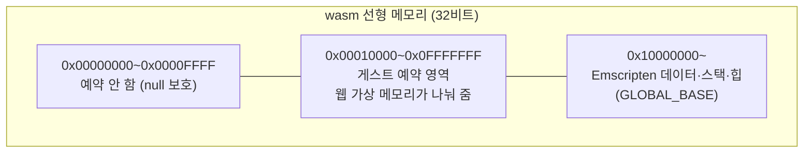
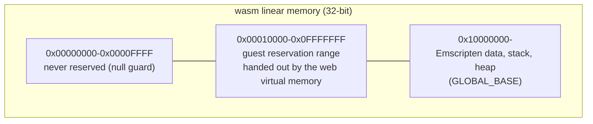

# 설계: 브라우저 호스트 단계 2 — `emulated` 엔진과 rex86의 Emscripten 빌드, Node 헤드리스 실행 (issue #67)

관련: [설계 #64 — 브라우저 호스트](20261015-i064-browser-host-single-thread-loop.md) 단계 2,
[설계 #61 — `emulated` 실행 모델](20261014-i061-emulated-execution-model.md),
[설계 513 — 웹 실행](20260828-513-web-wasm-execution.md), [웹 이식 frontier](../analysis/web-port-frontier.md)

## 배경

#64에서 `emulated` 모델은 게스트·Glide·tick·오디오·입력을 한 스레드에서 번갈아 돌게 됐습니다. 브라우저에 가기 전
마지막 네이티브 쪽 확인은 **같은 엔진을 wasm32로 빌드해 돌려 보는 것**입니다. Node는 디버깅과 대조가 쉬운 첫
실행지입니다. 창도 소리도 없으므로 Glide는 dummy로 둡니다.

지금의 웹 빌드(Task 513)는 엔진을 빼고 플랫폼 공용 코어만 빌드합니다(`CMakeLists.txt`의 `if(NOT EMSCRIPTEN)` 엔진
목록, 실행 모델 `none`). 웹 플랫폼 계층(`src/platform/web/`)의 가상 메모리, 폴트 핸들러, 게스트 CPU 컨텍스트는
실패를 돌려주는 stub입니다.

조사한 사실(확인됨):

| 항목 | 값 |
|---|---|
| 게스트 영역 (Win32 `emulated`, pumpitea) | `0x04000000`~`0x0C5D7000` (이미지 `0x005D7000` + 확장 여유 `0x08000000`), 재배치 후보 주소에 놓임 |
| 고정 낮은 주소 예약 | `0x00010000`~`0x005E7000`을 먼저 시도하고 실패하면 재배치 |
| 엔진의 x86 전용 구문 | `execution_trampoline.cpp`의 `<windows.h>`(이미 `_WIN32`로 막힘), `glide_opengl_backend.cpp`의 `_mm_pause` |
| 단일 스레드에서 만드는 스레드 | 없음(#64): 게스트 스레드, 오디오 워커, 입력 스크립트, AOT 워커 모두 만들지 않음 |
| 호스트 진입 상태 | Linux 구현은 x86 인라인 어셈블리로 셀렉터를 읽고, x86이 아니면 `valid=false`이므로 `emulated` 진입이 실패함 |

## 결정 1: 웹 빌드의 실행 모델은 `emulated`

Emscripten 구성의 실행 모델을 `none`에서 `emulated`로 바꾸고, 엔진 목록을 웹에서도 빌드합니다. `emulated`가 웹을
위해 만든 모델이고, `none`은 "엔진이 없다"는 Stage 1의 임시 답이었습니다. 코어만 빌드하던 probe(`repiu_core_probe`)도
그대로 빌드합니다. `execution_model_none.cpp`는 쓰는 곳이 없어지면 지웁니다.

## 결정 2: 게스트 영역은 선형 메모리의 같은 주소에, Emscripten은 그 위에

#61의 결정대로 identity 매핑입니다: 게스트 주소 = 선형 메모리 주소 = 호스트 포인터. HLE와 rex86 모두 지금처럼
포인터로 게스트 메모리에 접근하므로 엔진 코드가 바뀌지 않습니다.

* 링크 옵션: `-sGLOBAL_BASE=0x10000000`, 처음 메모리는 그 위의 힙까지(가칭 512 MB), `-sALLOW_MEMORY_GROWTH`.
* **웹 가상 메모리**(`src/platform/web/virtual_memory.cpp`, stub → 구현): `[0x00010000, 0x10000000)`을 페이지 단위로
  나눠 주는 예약기와 페이지 보호 표. 원하는 주소가 비어 있으면 그 주소에(고정 낮은 주소 예약이 그대로 성공함), 아니면
  빈 자리에 줍니다. `QueryMemory`는 이 표로 답하고, 보호 변경은 #61의 메모리 변경 알림을 그대로 보냅니다. wasm에는 하드웨어
  보호가 없으므로 **보호를 실제로 지키는 것은 rex86의 페이지 속성표**입니다. 호스트(HLE) 코드는 지금처럼 보호와 무관하게
  씁니다.
* 해제와 decommit은 표에서 지우고 0으로 채웁니다.

## 결정 3: 호스트 진입 상태는 합성한다

wasm 호스트에는 x86 셀렉터가 없습니다. 웹 구현(`src/platform/web/host_cpu_entry_state.cpp`)은 **WOW64 스레드가
보이는 값**을 돌려줍니다: CS `0x23`, DS·ES·SS·GS `0x2B`, FS `0x53`(base는 웹 가상 메모리에서 받은 0으로 채운 한
페이지, 가짜 TEB), x87 제어 워드 `0x027F`, MXCSR `0x1F80`. 네이티브 trace의 셀렉터 칸이
`0023/002B/002B/002B/0053/002B`이므로 trace를 그대로 대조할 수 있습니다.

CPUID는 고정 표로 답합니다(가칭 GenuineIntel, family 6, rex86이 구현한 기능만). 네이티브 `emulated`는 호스트의 값을
쓰므로, 게스트가 CPUID를 읽는 곳이 첫 차이가 될 수 있습니다. 대조할 때 그 줄을 따로 봅니다.

## 결정 4: 스레드가 없는 플랫폼 계층

`host_thread`의 웹 구현은 스레드를 만들지 않고 실패를 돌려줍니다(웹 README의 "stub은 조용히 성공하지 않는다" 원칙).
#64 이후 `emulated`는 스레드를 부르지 않으므로 실행 경로에는 닿지 않습니다. 시각(`host_time`)은 Emscripten의
`clock_gettime`으로 Linux 구현을 그대로 씁니다(Task 513의 `host_environment`와 같은 판단). `_mm_pause`는 x86에서만
쓰고 다른 곳에서는 빈 hint로 둡니다.

## 결정 5: Node 실행은 평소의 로더 `main` 그대로

* 링크: `-sNODERAWFS=1`(Node에서 호스트 파일시스템을 그대로 읽음), `-sEXIT_RUNTIME=1`. 실행은 저장소 루트에서
  `node build/web_wasm/repiu.js pumpitea`. 로더가 지금처럼 `roms/`와 `cfg/`를 찾습니다.
* 창: Node에는 SDL 비디오가 없으므로 Glide 백엔드는 이미 있는 dummy로 떨어집니다. 소리: 오디오 장치가 없으므로
  `Open`이 실패하고 소리 없이 돕니다(#61의 "no sound는 치명적이 아니다" 규칙).
* 환경 변수(`REPIU_EXECUTION_TIMEOUT_MS`, `REPIU_HLE_BOUNDARY_TRACE`): Emscripten의 `getenv`는 Node의
  `process.env`를 자동으로 보지 않는 것으로 압니다(미확정). 그러면 `--pre-js`로 `process.env`를 `ENV`에 복사합니다.
* rex86은 인터프리터만 씁니다. wasm 번역과 SMC 처리는 단계 2 범위 밖입니다(설계 #64).

## 결정 6: 빌드 스크립트

`scripts/build_web_wasm.sh`가 `repiu`도 빌드합니다. rex86은 지금처럼 FetchContent의 tag(v0.0.34)이고, 로컬 소스는
`FETCHCONTENT_SOURCE_DIR_REX86`으로 덮어씁니다. 빌드는 WSL의 emsdk(`~/emsdk`)에서 합니다. CI에 웹 빌드를 넣는 일은
범위 밖입니다.

## 바꾸지 않는 것

* HLE와 그 입구 `DispatchGuestFault`, `emulated`의 실행 규칙(#61 결정 9), 단일 스레드 루프(#64).
* Win32·Linux의 실행 모델과 빌드. 공용 코드에 들어가는 변경은 `_mm_pause` 분기 정도입니다.

## 범위 밖

* 브라우저 페이지, OPFS, WebGL2 렌더러, AudioWorklet(단계 3·4).
* rex86 wasm 번역 켜기, 처리량 최적화.
* CI의 웹 빌드.

## 확인 필요 (구현 중 확인)

| 항목 | 왜 |
|---|---|
| Emscripten 메모리 배치(스택이 데이터 앞인지 뒤인지)와 `GLOBAL_BASE`의 효과 | 결정 2의 경계가 실제로 지켜지는지 |
| `getenv`가 Node의 환경 변수를 보는지 | 결정 5의 `--pre-js`가 필요한지 |
| 엔진 목록 중 wasm32에서 컴파일되지 않는 것 | 대부분 x86 호스트에서만 빌드되던 코드라, 32비트 포인터지만 x86이 아닌 첫 대상 |
| SDL3가 Node에서 비디오·오디오 초기화를 깨끗이 실패하는지 | dummy와 무음으로 떨어지는지 |
| 게스트가 FS(TEB)를 읽는지 | 가짜 TEB 페이지의 내용이 필요한지 |
| libchdr의 CHD 읽기가 `NODERAWFS`에서 되는지 | Task 513에서 `repiu_chd_cd_probe`는 MEMFS 때문에 확인하지 못함 |

## 검증

1. Win32 `direct`·`emulated`와 Linux i386·x64: 빌드와 core probe, 회귀 없음.
2. 웹: `repiu_core_probe`(wasm32, Node) 통과, `repiu` 빌드.
3. Node에서 pumpitea를 `emulated`로 30초 실행: 정상 정지, Glide dummy, 무음.
4. HLE 경계 trace가 네이티브 Win32 `emulated`와 첫 벽시계 의존까지 같음(진입 ECX와 CPUID 줄은 따로 표시).
5. Node에서의 처리량(실행 단계/초, 디스패치 진행)을 기록.

---

# Design: browser host phase 2 — the `emulated` engine and rex86 built with Emscripten, run headless under Node (issue #67)

Related: [design #64 — the browser host](20261015-i064-browser-host-single-thread-loop.md) phase 2,
[design #61 — the `emulated` execution model](20261014-i061-emulated-execution-model.md),
[design 513 — web execution](20260828-513-web-wasm-execution.md), [web port frontier](../analysis/web-port-frontier.md)

## Background

Since #64 the `emulated` model runs the guest, Glide, ticks, audio and input on one thread, taking turns. The last check
before the browser is **building the same engine for wasm32 and running it**. Node is the first place to run it, where
debugging and comparison are easy; with no window and no sound, Glide stays on its dummy.

Today's web build (Task 513) leaves the engine out and builds the platform-neutral core alone (the engine list under
`if(NOT EMSCRIPTEN)` in `CMakeLists.txt`, execution model `none`). The web platform layer's (`src/platform/web/`) virtual
memory, fault handler and guest CPU context are stubs that return failure.

Facts gathered (confirmed):

| Item | Value |
|---|---|
| The guest range (Win32 `emulated`, pumpitea) | `0x04000000` to `0x0C5D7000` (image `0x005D7000` plus expansion slack `0x08000000`), placed at a relocation candidate |
| The fixed low-address reservation | `0x00010000` to `0x005E7000` tried first, relocated when it fails |
| x86-only constructs in the engine | `<windows.h>` in `execution_trampoline.cpp` (already fenced by `_WIN32`) and `_mm_pause` in `glide_opengl_backend.cpp` |
| Threads made on one thread | none (#64): no guest thread, audio workers, input script or AOT worker |
| The host entry state | the Linux implementation reads selectors with x86 inline assembly and answers `valid=false` elsewhere, so the `emulated` entry fails |

## Decision 1: the web build's execution model is `emulated`

The Emscripten configuration's model changes from `none` to `emulated`, and the engine list is built for the web too.
`emulated` is the model made for the web, and `none` was Stage 1's interim answer of "no engine". The core-only probe
(`repiu_core_probe`) is still built. `execution_model_none.cpp` is deleted once nothing uses it.

## Decision 2: the guest range at the same addresses in linear memory, Emscripten above it

Identity mapping, as #61 decided: guest address = linear-memory address = host pointer. The HLE and rex86 both reach
guest memory through pointers as today, so the engine code does not change.

* Link options: `-sGLOBAL_BASE=0x10000000`, initial memory up to a heap above it (512 MB working figure),
  `-sALLOW_MEMORY_GROWTH`.
* **Web virtual memory** (`src/platform/web/virtual_memory.cpp`, stub → implementation): a page-granular reserver over
  `[0x00010000, 0x10000000)` with a page-protection table. A wanted address is given if free (so the fixed low-address
  reservation simply succeeds), otherwise a free place. `QueryMemory` answers from the table, and protection changes send
  #61's memory-change notifications as they are. wasm has no hardware protection, so **what enforces protection is
  rex86's page attribute table**; host (HLE) code writes regardless of protection, as today.
* Release and decommit clear the table and zero-fill.

## Decision 3: the host entry state is synthesised

A wasm host has no x86 selectors. The web implementation (`src/platform/web/host_cpu_entry_state.cpp`) answers **what a
WOW64 thread sees**: CS `0x23`, DS, ES, SS and GS `0x2B`, FS `0x53` (its base a zero-filled page from the web virtual
memory, a stand-in TEB), x87 control word `0x027F`, MXCSR `0x1F80`. The native trace's selector field reads
`0023/002B/002B/002B/0053/002B`, so the traces compare as they are.

CPUID answers from a fixed table (working figures: GenuineIntel, family 6, only the features rex86 implements). Native
`emulated` gives the host's values, so where the guest reads CPUID may be the first difference; the comparison looks at
that line separately.

## Decision 4: a platform layer without threads

The web `host_thread` makes no thread and returns failure (the web README's "a stub does not quietly succeed"). Since #64
`emulated` calls no thread, so the run never reaches it. Time (`host_time`) uses the Linux implementation through
Emscripten's `clock_gettime`, the same judgement as Task 513's `host_environment`. `_mm_pause` is used on x86 only and is
an empty hint elsewhere.

## Decision 5: the Node run is the usual loader `main`

* Linking: `-sNODERAWFS=1` (Node reads the host filesystem as it is) and `-sEXIT_RUNTIME=1`. Run from the repository
  root as `node build/web_wasm/repiu.js pumpitea`; the loader finds `roms/` and `cfg/` as today.
* Window: Node has no SDL video, so the Glide backend falls back to its existing dummy. Sound: with no audio device,
  `Open` fails and the run goes on silent (#61's rule that no sound is not fatal).
* Environment variables (`REPIU_EXECUTION_TIMEOUT_MS`, `REPIU_HLE_BOUNDARY_TRACE`): Emscripten's `getenv` is understood
  not to see Node's `process.env` by itself (unconfirmed). If so, a `--pre-js` copies `process.env` into `ENV`.
* rex86 runs its interpreter only; wasm translation and SMC handling are outside phase 2 (design #64).

## Decision 6: the build script

`scripts/build_web_wasm.sh` builds `repiu` too. rex86 comes from the FetchContent tag (v0.0.34) as today, overridden by a
local source through `FETCHCONTENT_SOURCE_DIR_REX86`. Builds run on WSL's emsdk (`~/emsdk`). Adding the web build to CI is
out of scope.

## What does not change

* The HLE and its entry `DispatchGuestFault`, `emulated`'s execution rules (#61 decision 9), the single-threaded loop
  (#64).
* The Win32 and Linux execution models and builds. Shared code gains little more than the `_mm_pause` branch.

## Out of scope

* The browser page, OPFS, the WebGL2 renderer, AudioWorklet (phases 3 and 4).
* Turning on rex86's wasm translation; throughput work.
* The web build in CI.

## To be confirmed (during implementation)

| Item | Why |
|---|---|
| Emscripten's memory layout (stack before or after the data) and what `GLOBAL_BASE` does | whether decision 2's boundary really holds |
| Whether `getenv` sees Node's environment | whether decision 5's `--pre-js` is needed |
| Which engine sources do not compile for wasm32 | the first 32-bit target that is not x86; most of the list was only ever built on x86 hosts |
| Whether SDL3 fails video and audio initialisation cleanly under Node | that the run falls back to the dummy and silence |
| Whether the guest reads FS (the TEB) | whether the stand-in TEB page needs contents |
| Whether libchdr reads the CHD under `NODERAWFS` | Task 513 could not check `repiu_chd_cd_probe` because of MEMFS |

## Verification

1. Win32 `direct` and `emulated`, Linux i386 and x64: build and core probe, no regression.
2. Web: `repiu_core_probe` (wasm32, Node) passes; `repiu` builds.
3. pumpitea on `emulated` under Node for 30 s: a clean stop, the Glide dummy, silence.
4. The HLE boundary trace matches native Win32 `emulated` up to the first wall-clock dependence (the entry ECX and CPUID
   lines marked separately).
5. Throughput under Node (steps per second, dispatch progress) recorded.
