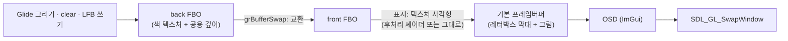
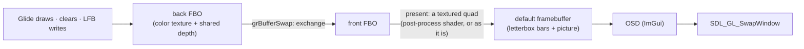

# 설계: 브라우저 호스트 단계 3 — Glide 렌더러를 GLES 3 / WebGL2 부분집합으로 (issue #69)

관련: [설계 #64 — 브라우저 호스트](20261015-i064-browser-host-single-thread-loop.md),
[설계 #67 — Emscripten 빌드와 Node 실행](20261015-i067-emscripten-headless.md),
[설계 729 — LFB buffer 쌍 shadow](20260922-729-lfb-lock-interval-and-buffer-pair-shadow.md),
[설계 768 — 후처리 셰이더](20261004-768-post-process-shaders.md),
[웹 이식 frontier](../analysis/web-port-frontier.md)

## 배경

#67에서 엔진과 rex86이 wasm으로 빌드되어 Node에서 pumpitea를 돌렸습니다. Node에는 SDL 비디오가 없어 Glide는 dummy였고,
웹 빌드는 Glide 백엔드가 아직 부르는 고정 기능 GL 11개를 "불리면 멈춤" stub(`src/platform/web/legacy_gl_stubs.cpp`)으로
링크했습니다. 브라우저(단계 4)에서 화면을 내려면 렌더러가 WebGL2(GLES 3.0)의 부분집합만 써야 합니다.

조사한 고정 기능·데스크톱 전용 사용처(확인됨, 2026-10-16 main `942f60b`):

| 사용 | 위치 | WebGL2에서 |
|---|---|---|
| 즉시 모드 `glBegin`/`glColor4f`/`glTexCoord4f`/`glVertex3f`/`glEnd` | 백엔드 `DrawPrimitive`·`DrawPrimitiveBatch`·`PresentLfbSurface`, 후처리 `Apply` | 없음 |
| `glMatrixMode`/`glLoadIdentity`/`glOrtho`, 셰이더의 `ftransform()` | `OpenWindowed` | 없음 |
| `glAlphaFunc`, `GL_ALPHA_TEST` | `SetAlphaTest…`, LFB 블릿의 저장·복원 | 없음 |
| `glPushAttrib`/`glPopAttrib` | 레터박스 막대, 후처리 | 없음 |
| `glDrawBuffer(GL_FRONT/GL_BACK)`, `glGetIntegerv(GL_DRAW_BUFFER)` | `SetRenderBuffer`, LFB 블릿, 막대, 후처리 | 기본 프레임버퍼의 front 그리기 없음 |
| `glReadPixels(…, GL_RGB, …)` | 진단(`REPIU_GLIDE_PIXEL_DIAG*`, `REPIU_GLIDE_DRAW_DIAG`) | `GL_RGBA`만 보장 |
| `GL_CLAMP`, `glClearDepth`, `glDisable(GL_FOG)`, `glGetFloatv(GL_PROJECTION_MATRIX)` | LFB 텍스처, `Clear`, 안개, 진단 | 없음 / `glClearDepthf` |
| GLSL `#version 110`(`gl_Color`, `gl_MultiTexCoord0`, `gl_FragColor`, `texture2D`) | Glide 결합 셰이더, 후처리 셰이더(내장·사용자) | ES 3.00이 아님 |
| ImGui `opengl3` 백엔드 `"#version 130"` | OSD | 문자열만 바꾸면 됨 |

텍스처는 이미 CPU에서 RGBA8로 풀어 `GL_RGBA`/`GL_UNSIGNED_BYTE`로 올리고, `GL_REPEAT`는 GLES 3에서 NPOT에도 됩니다.
게임은 그리기 대상을 back으로 고정해 씁니다(설계 729의 계수).

WebGL에는 렌더러 바깥의 제약도 둘 있습니다. **내보낸(composite) 뒤 기본 프레임버퍼는 지워지고**(`preserveDrawingBuffer`
기본값 false), **Worker가 이벤트 고리에 차례를 넘기면 그때까지 그린 것이 화면에 나갑니다**(OffscreenCanvas). 단일 Worker는
슬라이스마다 차례를 넘기므로 그리던 중인 프레임이 나갈 수 있습니다.

## 결정 (2026-10-16, 사용자 확정)

1. **네이티브도 GL 3.3 core 문맥만 만든다.** GL 2.1 호환 경로는 남기지 않습니다. 고정 기능이 남아 있으면 core가 오류를
   내므로 웹과 같은 제약을 네이티브에서 강제로 확인합니다. GL 3.3을 못 만드는 GPU는 지금처럼 dummy로 떨어지고 이유를
   찍습니다.
2. **게임은 오프스크린 프레임버퍼(FBO) 쌍에 그린다.** front/back 두 장에 그리고 스왑 때 창으로 옮깁니다. 단계 4가 아니라
   이번 단계에 넣습니다.

## 결정 3: 렌더러는 하나, 문맥만 둘

렌더러 코드는 GL 3.3 core와 GLES 3.0의 **공통 부분집합**만 씁니다. 차이는 둘뿐입니다.

| | 네이티브 | 웹 |
|---|---|---|
| 문맥 요청 | GL 3.3 core | GLES 3.0 (WebGL2) |
| GLSL 머리말 | `#version 330 core` | `#version 300 es` + `precision highp float;` |

문맥 요청은 플랫폼이 정합니다. `include/repiu/platform/host_gpu_driver.h`에 값 하나를 돌려주는 함수를 더합니다.

```cpp
struct GlContextRequest { bool es; int major; int minor; };
GlContextRequest RequestedGlContext();  // Win32·Linux: {false, 3, 3}, web: {true, 3, 0}
```

GLSL 머리말은 엔진이 **만들어진 문맥에서** 정합니다(`GL_VERSION`이 `OpenGL ES`로 시작하는지). 그래서 엔진에는 플랫폼
분기가 없습니다. ImGui는 같은 머리말 문자열을 받습니다.

GL 1.1을 넘는 함수(VAO, 버퍼, FBO, 셰이더)는 지금처럼 `SDL_GL_GetProcAddress`로 찾습니다. 지금은 셰이더, 후처리, 백엔드가
각자 함수 표를 가지고 있으므로 **공용 함수 표 하나**(`src/engine/gl_api.{h,cpp}`, `GlApi`)로 모읍니다. 웹은 링크 옵션
`-sGL_ENABLE_GET_PROC_ADDRESS`, `-sMIN_WEBGL_VERSION=2`, `-sMAX_WEBGL_VERSION=2`로 같은 경로를 씁니다.

## 결정 4: 즉시 모드는 스트리밍 VBO로

`EmitDrawVertex`가 하던 일을 그대로 CPU 배열에 씁니다. 꼭짓점 하나는 위치(`x`, `y`, `GlideOozToOrthoEyeZ(ooz)`),
색(`r,g,b,a`), 텍스처·안개 좌표(`s/w`, `t/w`, `fog_oow`, `texture_oow`)로 지금 즉시 모드에 넘기는 값과 **같은 float**입니다.
그리기 한 번마다 배열을 버퍼 하나(`GlideVertexStream`, 전용 파일)의 다음 자리에 `glBufferSubData`로 올리고 `glDrawArrays`
합니다. 버퍼 끝에 닿으면 `glBufferData(nullptr)`로 버리고(orphan) 처음부터 씁니다. VAO는 하나이고 core가 요구하므로 문맥을
만든 뒤 늘 묶어 둡니다.

* 기본형: `GL_TRIANGLES`, `GL_TRIANGLE_FAN`(볼록 다각형), `GL_LINES`, `GL_POINTS`. 넷 다 GLES 3에 있습니다.
* 점 크기: `glPointSize` 대신 uniform을 정점 셰이더의 `gl_PointSize`로. 데스크톱 core는 `GL_PROGRAM_POINT_SIZE`를 켭니다.
* 선 굵기는 지금도 1이므로 그대로 둡니다(GLES는 1만 보장).

## 결정 5: 투영과 알파 테스트는 셰이더로

* 투영: `glOrtho(0, w, h, 0, -1, 1)`(원점 아래면 `0, w, 0, h`)과 **같은 행렬**을 `OpenWindowed`에서 계산해 uniform으로
  넘깁니다. 정점 셰이더는 `gl_Position = projection * position`. `ftransform()`과 같은 곱입니다.
* 알파 테스트: Glide `GR_CMP_*`(0..7, `GL_NEVER..GL_ALWAYS`와 같은 순서)와 기준값을 uniform으로 넘기고 결합 셰이더의 마지막
  알파에 비교해 `discard`합니다. 고정 기능 알파 테스트도 프래그먼트 셰이더의 출력 알파를 비교하므로 의미가 같습니다.
  켜짐 여부는 `glIsEnabled(GL_ALPHA_TEST)` 대신 백엔드가 지닙니다. LFB 블릿 모드에서는 비교하지 않습니다(지금도 블릿 동안
  끕니다).
* 안개는 이미 셰이더(`repiuFogMode`)이므로 `glDisable(GL_FOG)`만 지웁니다.

## 결정 6: 프레임버퍼 쌍과 화면 표시



* FBO 두 장. 색은 RGBA8 텍스처, 크기는 그림 사각형(`content_rect_`)과 같아 지금의 배율 렌더링(창 크기에 맞춘 해상도)을
  그대로 지킵니다. 깊이는 Glide처럼 **한 장**(depth 24 renderbuffer)을 두 FBO가 같이 붙입니다. 창 크기가 바뀌면 다시 만들고
  검게 지웁니다.
* `grRenderBuffer(BACK/FRONT)`는 `glDrawBuffer` 대신 그 FBO를 묶습니다. front에 그린 것은 다음 표시에 보입니다(실제
  하드웨어는 즉시 보임). 게임은 back만 쓰므로 front 그리기는 계수 한 줄로 남깁니다.
* `grBufferSwap`: 두 FBO를 **교환**한 뒤, 새 front를 기본 프레임버퍼에 그립니다. 그래서 스왑 뒤 back은 직전 front입니다.
  설계 729의 shadow 쌍이 기대는 "하드웨어 모델"이 드라이버와 무관하게 성립합니다.
* 표시는 텍스처 사각형 하나입니다. 후처리 셰이더가 골라져 있으면 그것으로, 아니면 그대로 옮기는 프로그램으로 그립니다.
  후처리는 지금처럼 `glCopyTexSubImage2D`로 복사할 필요가 없어집니다. 막대는 기본 프레임버퍼를 먼저 검게 지우는 것으로
  끝납니다. 알파는 쓰지 않습니다(창 합성기에 반투명이 새지 않게, 지금 후처리와 같은 규칙).
* 읽기(`ReadbackFramebuffer`, 진단)는 back FBO에서 읽습니다. 레터박스와 무관해지고 `GL_RGBA`/`GL_UNSIGNED_BYTE`만 씁니다.
* 진단의 스왑 시점 표본(`REPIU_GLIDE_PIXEL_DIAG*`)은 지금처럼 **교환 전 back**(= 막 끝난 프레임)에서 뜹니다.

WebGL에서는 게임이 기본 프레임버퍼에 손대지 않으므로, 슬라이스 중간에 차례를 넘겨도 화면에 나가는 것은 직전에 완성된
프레임입니다. 단계 4에서 `preserveDrawingBuffer`가 필요 없게 됩니다.

## 결정 7: 셰이더 방언

| 셰이더 | 지금 | 바꾼 뒤 |
|---|---|---|
| Glide 결합 | `#version 110`, `ftransform`, `gl_Color`, `gl_MultiTexCoord0` | 속성 3개(`repiuPosition`, `repiuColor`, `repiuTexCoord`), `in`/`out`, `texture()`, 출력 `repiuFragColor`. 몸통의 결합·안개 식은 그대로 |
| 블릿·표시(새) | 결합 셰이더의 `repiuBlitMode` | 결합 셰이더의 블릿 모드는 LFB 블릿에 남기고, 표시는 후처리와 같은 "그대로" 프로그램 |
| 후처리(내장·사용자) | 버전 없는 GLSL 110(`attribute`/`varying`/`texture2D`/`gl_FragColor`) | 엔진이 머리말과 **호환 매크로**를 앞에 붙임: `attribute`→`in`, `varying`→`out`/`in`, `texture2D`→`texture`, `gl_FragColor`→출력 변수. 파일의 `#version` 줄은 엔진 머리말로 바꿉니다(RetroArch GLSL 셰이더가 흔히 쓰는 방식) |
| OSD | `"#version 130"` | 같은 머리말 문자열 |

머리말과 매크로는 `src/engine/gl_shader_dialect.{h,cpp}` 한 곳에서 만듭니다. 내장 crt·scanline은 이미 `#ifdef GL_ES`
정밀도 줄을 가지고 있어 매크로만으로 컴파일될 것으로 봅니다(확인 필요).

## 결정 8: 상태 저장·복원은 백엔드가 지닌 값으로

`glPushAttrib`/`glGetIntegerv`로 되읽던 상태(깊이·블렌드·컬·시저 켜짐, 색 마스크, 그리기 대상, 알파 테스트)를 LFB 블릿과
표시 경로가 명시적으로 저장·복원합니다. 표시는 기본 프레임버퍼에서 일어나고 게임 상태는 FBO 쪽이라, 표시 경로는 바꾼 것
(프로그램, 뷰포트, 시저, 블렌드·깊이, 묶은 FBO와 텍스처)을 끝에 되돌리기만 하면 됩니다.

## 파일 배치

| 파일 | 내용 |
|---|---|
| `src/engine/gl_api.{h,cpp}` (새) | GL 1.1을 넘는 함수 표, 문맥이 ES인지 |
| `src/engine/gl_shader_dialect.{h,cpp}` (새) | GLSL 머리말과 110 호환 매크로 |
| `src/engine/glide_vertex_stream.{h,cpp}` (새) | 스트리밍 VBO·VAO, 꼭짓점 배치 |
| `src/engine/glide_framebuffer_pair.{h,cpp}` (새) | FBO 쌍, 공용 깊이, 교환, 읽기, 표시 사각형 |
| `glide_opengl_backend.cpp` | 위를 부르는 오케스트레이션. 고정 기능 호출 제거 |
| `glide_opengl_shader.cpp`, `glide_post_process.cpp` | 방언 적용, 공용 함수 표 사용 |
| `glide_osd.cpp` | 머리말 문자열 |
| `include/repiu/platform/host_gpu_driver.h` + 플랫폼 구현 | `RequestedGlContext()` |
| `src/platform/web/legacy_gl_stubs.cpp` | 삭제 |

## 바꾸지 않는 것

* Glide HLE와 경계(`linexe_glide_boundary.cpp`)의 의미, 텍스처 디코드, 결합·안개 식.
* 렌더 해상도 정책(창 배율, 레터박스, keep-aspect)과 OSD 기능.
* 런처(별도 창·문맥, 웹에서는 쓰지 않음).

## 검증

1. **결정적 렌더 probe:** `repiu_glide_render_probe`에 장면 모드를 더합니다. 백엔드 API로 정해진 장면(결합 함수 조합, 텍스처
   샘플·반복·고정, 안개 표, 알파 테스트, 깊이 비교, 블렌드, 점·선·다각형, LFB 블릿)을 그려 읽은 RGBA를 파일로 씁니다.
   **이 모드를 먼저 지금 렌더러(GL 2.1 호환)에 커밋해 기준 이미지를 뜨고**, 포팅 뒤 같은 장면을 비교합니다. 기대는 화소
   일치이고, 다르면 화소 수와 최대 차이를 작업 로그에 남겨 원인을 설명합니다.
2. 기존 probe: `--opengl-post-shader`, `--opengl-lfb`, core probe 44/44.
3. 게임: Win32 `direct` Release로 pumpitea·pumpit8의 타이틀·곡 선택·플레이 화면을 단계 3 전후로 캡처 비교, 후처리 crt·scanline,
   OSD, 창 크기 변경·전체 화면·keep-aspect. 사용자 플레이 확인.
4. 처리량: pumpit8 플레이 구간 fps를 vsync OFF로 전후 비교(즉시 모드 → VBO에서 떨어지지 않는지).
5. Linux i386·x64(WSL): 빌드, core probe, 짧은 실행으로 GL 3.3 core 문맥 생성 확인(`[repiu-glide] GL renderer` 줄).
6. 웹: `legacy_gl_stubs.cpp` 없이 `repiu`와 `repiu_core_probe`가 링크되고 Node 실행(#67 재현)이 그대로 돕니다. 브라우저 화면은
   단계 4.

## 확인 필요 (구현 중)

| 항목 | 왜 |
|---|---|
| 그리기 호출당 `glBufferSubData`의 비용 | 즉시 모드보다 느리면 그리기를 상태 변경 때까지 모으는 쪽을 검토 |
| 셰이더 알파 테스트와 고정 기능의 경계값 일치 | 기준값과 같은 알파의 `GR_CMP_GREATER` 등. probe에 경계 화소를 넣음 |
| Emscripten의 `glClearDepth` | 없으면 공용 함수 표에서 `glClearDepthf` |
| 사용자 후처리 셰이더 중 `#version 1xx` 고유 문법(`gl_TexCoord` 등)을 쓰는 것 | 매크로로 안 되면 이유를 찍고 "없음"으로(지금의 컴파일 실패 경로) |
| WSL Mesa d3d12의 3.3 core | Linux 검증 경로 |

---

# Design: browser host phase 3 — the Glide renderer on the GLES 3 / WebGL2 subset (issue #69)

Related: [design #64 — the browser host](20261015-i064-browser-host-single-thread-loop.md),
[design #67 — the Emscripten build and Node run](20261015-i067-emscripten-headless.md),
[design 729 — the LFB buffer-pair shadow](20260922-729-lfb-lock-interval-and-buffer-pair-shadow.md),
[design 768 — post-process shaders](20261004-768-post-process-shaders.md),
[web port frontier](../analysis/web-port-frontier.md)

## Background

In #67 the engine and rex86 were built for wasm and ran pumpitea under Node. Node has no SDL video, so Glide ran as its
dummy, and the web build linked the 11 fixed-function GL calls the Glide backend still makes as stubs that stop the run
if reached (`src/platform/web/legacy_gl_stubs.cpp`). To put a picture in a browser (phase 4) the renderer must use only
the WebGL2 (GLES 3.0) subset.

Fixed-function and desktop-only uses found (confirmed, 2026-10-16, main `942f60b`):

| Use | Where | On WebGL2 |
|---|---|---|
| Immediate mode `glBegin`/`glColor4f`/`glTexCoord4f`/`glVertex3f`/`glEnd` | backend `DrawPrimitive`, `DrawPrimitiveBatch`, `PresentLfbSurface`; post-process `Apply` | absent |
| `glMatrixMode`/`glLoadIdentity`/`glOrtho`, `ftransform()` in the shader | `OpenWindowed` | absent |
| `glAlphaFunc`, `GL_ALPHA_TEST` | the alpha-test setters, the LFB blit's save and restore | absent |
| `glPushAttrib`/`glPopAttrib` | letterbox bars, post-process | absent |
| `glDrawBuffer(GL_FRONT/GL_BACK)`, `glGetIntegerv(GL_DRAW_BUFFER)` | `SetRenderBuffer`, the LFB blit, bars, post-process | no front drawing on the default framebuffer |
| `glReadPixels(…, GL_RGB, …)` | diagnostics (`REPIU_GLIDE_PIXEL_DIAG*`, `REPIU_GLIDE_DRAW_DIAG`) | only `GL_RGBA` is guaranteed |
| `GL_CLAMP`, `glClearDepth`, `glDisable(GL_FOG)`, `glGetFloatv(GL_PROJECTION_MATRIX)` | the LFB texture, `Clear`, fog, a diagnostic | absent / `glClearDepthf` |
| GLSL `#version 110` (`gl_Color`, `gl_MultiTexCoord0`, `gl_FragColor`, `texture2D`) | the Glide combine shader, post-process shaders (built-in and user) | not ES 3.00 |
| ImGui's `opengl3` backend with `"#version 130"` | OSD | only the string changes |

Textures are already decoded to RGBA8 on the CPU and uploaded as `GL_RGBA`/`GL_UNSIGNED_BYTE`, and `GL_REPEAT` works on
NPOT textures in GLES 3. The game keeps its draw target fixed on back (design 729's counts).

WebGL has two constraints outside the renderer too: **the default framebuffer is cleared after it is composited**
(`preserveDrawingBuffer` defaults to false), and **whatever has been drawn reaches the screen when the Worker yields to
the event loop** (OffscreenCanvas). The single Worker yields every slice, so a half-drawn frame can reach the screen.

## Decisions (2026-10-16, settled by the user)

1. **Native builds create only a GL 3.3 core context.** No GL 2.1 compatibility path is kept. Core raises errors on any
   fixed function left behind, so the web's constraint is enforced and checked natively. A GPU that cannot create GL
   3.3 falls back to the dummy as today, with the reason printed.
2. **The game draws into a pair of offscreen framebuffers (FBOs)**, front and back, moved to the window at the swap. This
   goes into this phase rather than phase 4.

## Decision 3: one renderer, two contexts

The renderer uses only the **common subset** of GL 3.3 core and GLES 3.0. Two things differ:

| | Native | Web |
|---|---|---|
| Context request | GL 3.3 core | GLES 3.0 (WebGL2) |
| GLSL header | `#version 330 core` | `#version 300 es` + `precision highp float;` |

The platform decides the context request, through one value-returning function added to
`include/repiu/platform/host_gpu_driver.h`:

```cpp
struct GlContextRequest { bool es; int major; int minor; };
GlContextRequest RequestedGlContext();  // Win32, Linux: {false, 3, 3}; web: {true, 3, 0}
```

The engine picks the GLSL header **from the context it got** (whether `GL_VERSION` starts with `OpenGL ES`), so the
engine holds no platform branch. ImGui receives the same header string.

Functions beyond GL 1.1 (VAOs, buffers, FBOs, shaders) are found through `SDL_GL_GetProcAddress` as today. The shader,
the post-process pass and the backend each keep their own function table today; they are gathered into **one shared
table** (`src/engine/gl_api.{h,cpp}`, `GlApi`). The web takes the same path with the link options
`-sGL_ENABLE_GET_PROC_ADDRESS`, `-sMIN_WEBGL_VERSION=2` and `-sMAX_WEBGL_VERSION=2`.

## Decision 4: immediate mode becomes a streaming VBO

What `EmitDrawVertex` did is written to a CPU array as it is: a vertex is the position (`x`, `y`,
`GlideOozToOrthoEyeZ(ooz)`), the color (`r,g,b,a`) and the texture/fog coordinate (`s/w`, `t/w`, `fog_oow`,
`texture_oow`) — **the same floats** immediate mode receives today. Each draw uploads the array to the next free part of
one buffer (`GlideVertexStream`, a file of its own) with `glBufferSubData` and calls `glDrawArrays`. At the buffer's end
it is orphaned with `glBufferData(nullptr)` and written from the start. There is one VAO, kept bound after the context
is created, as core requires.

* Primitives: `GL_TRIANGLES`, `GL_TRIANGLE_FAN` (convex polygons), `GL_LINES`, `GL_POINTS`; all four exist in GLES 3.
* Point size: a uniform written to `gl_PointSize` in the vertex shader instead of `glPointSize`; desktop core enables
  `GL_PROGRAM_POINT_SIZE`.
* Line width is 1 today and stays so (GLES guarantees only 1).

## Decision 5: projection and alpha test move into the shader

* Projection: the **same matrix** as `glOrtho(0, w, h, 0, -1, 1)` (`0, w, 0, h` for a lower-left origin) is computed in
  `OpenWindowed` and passed as a uniform; the vertex shader does `gl_Position = projection * position`, the product
  `ftransform()` computed.
* Alpha test: Glide's `GR_CMP_*` (0..7, in the order of `GL_NEVER..GL_ALWAYS`) and the reference go in as uniforms, and
  the combine shader compares its final alpha and `discard`s. Fixed-function alpha test compares the fragment shader's
  output alpha too, so the meaning is the same. Whether it is on is held by the backend instead of
  `glIsEnabled(GL_ALPHA_TEST)`. LFB blit mode does not compare (the blit turns it off today).
* Fog is already in the shader (`repiuFogMode`); only `glDisable(GL_FOG)` goes.

## Decision 6: the framebuffer pair and presentation



* Two FBOs. Color is an RGBA8 texture the size of the picture rectangle (`content_rect_`), which keeps today's scaled
  rendering (resolution following the window). Depth is **one** depth-24 renderbuffer attached to both, as in Glide. A
  window size change recreates them, cleared to black.
* `grRenderBuffer(BACK/FRONT)` binds that FBO instead of calling `glDrawBuffer`. What is drawn to front shows at the next
  present (real hardware shows it at once). The game uses only back, so a front draw is left as a counted line.
* `grBufferSwap` **exchanges** the two FBOs, then draws the new front to the default framebuffer. After a swap back is
  therefore the previous front: the "hardware model" design 729's shadow pair relies on holds whatever the driver does.
* Presentation is one textured quad, drawn with the selected post-process shader or a pass-through program. The
  post-process pass no longer needs `glCopyTexSubImage2D`. The bars are just the default framebuffer cleared black first.
  Alpha is not written (so no translucency reaches a compositor, the post-process pass's rule today).
* Readback (`ReadbackFramebuffer`, diagnostics) reads the back FBO, independent of the letterbox, with
  `GL_RGBA`/`GL_UNSIGNED_BYTE` only.
* The swap-time diagnostic samples (`REPIU_GLIDE_PIXEL_DIAG*`) are taken, as today, from **back before the exchange**
  (the frame just finished).

On WebGL the game never touches the default framebuffer, so a yield in the middle of a slice shows the last finished
frame. Phase 4 then needs no `preserveDrawingBuffer`.

## Decision 7: shader dialect

| Shader | Today | After |
|---|---|---|
| Glide combine | `#version 110`, `ftransform`, `gl_Color`, `gl_MultiTexCoord0` | three attributes (`repiuPosition`, `repiuColor`, `repiuTexCoord`), `in`/`out`, `texture()`, output `repiuFragColor`; the combine and fog expressions unchanged |
| Blit and present (new) | the combine shader's `repiuBlitMode` | blit mode stays in the combine shader for the LFB blit; presentation uses the same pass-through program as post-process |
| Post-process (built-in and user) | unversioned GLSL 110 (`attribute`/`varying`/`texture2D`/`gl_FragColor`) | the engine prepends the header and **compatibility macros**: `attribute`→`in`, `varying`→`out`/`in`, `texture2D`→`texture`, `gl_FragColor`→an output variable. A file's `#version` line is replaced by the engine's header (a common way with RetroArch GLSL shaders) |
| OSD | `"#version 130"` | the same header string |

The header and macros are built in one place, `src/engine/gl_shader_dialect.{h,cpp}`. The built-in crt and scanline
shaders already carry a `#ifdef GL_ES` precision line and are expected to compile with the macros alone (to be
confirmed).

## Decision 8: save and restore from values the backend holds

State read back today through `glPushAttrib`/`glGetIntegerv` (depth, blend, cull and scissor enables, the color mask,
the draw target, alpha test) is saved and restored explicitly by the LFB blit and the present path. Presentation happens
on the default framebuffer while the game's state lives with the FBOs, so the present path only puts back what it changed
(program, viewport, scissor, blend and depth, the bound FBO and texture).

## Files

| File | Content |
|---|---|
| `src/engine/gl_api.{h,cpp}` (new) | the table of functions beyond GL 1.1; whether the context is ES |
| `src/engine/gl_shader_dialect.{h,cpp}` (new) | the GLSL header and the 110 compatibility macros |
| `src/engine/glide_vertex_stream.{h,cpp}` (new) | the streaming VBO and VAO, vertex layout |
| `src/engine/glide_framebuffer_pair.{h,cpp}` (new) | the FBO pair, shared depth, exchange, readback, the present quad |
| `glide_opengl_backend.cpp` | orchestration calling the above; fixed-function calls removed |
| `glide_opengl_shader.cpp`, `glide_post_process.cpp` | the dialect applied, the shared function table used |
| `glide_osd.cpp` | the header string |
| `include/repiu/platform/host_gpu_driver.h` + platform implementations | `RequestedGlContext()` |
| `src/platform/web/legacy_gl_stubs.cpp` | deleted |

## What does not change

* The meaning of the Glide HLE and its boundary (`linexe_glide_boundary.cpp`), texture decoding, the combine and fog
  expressions.
* The render resolution policy (window scale, letterbox, keep-aspect) and the OSD's features.
* The launcher (its own window and context; unused on the web).

## Verification

1. **A deterministic render probe:** a scene mode in `repiu_glide_render_probe` draws a fixed scene through the backend
   API (combine-function mixes, texture sampling with repeat and clamp, a fog table, alpha test, depth compare, blending,
   points, lines and polygons, an LFB blit) and writes the read-back RGBA to a file. **This mode is committed first
   against today's renderer (GL 2.1 compatibility) to capture a reference image**, and the same scene is compared after
   the port. Pixel equality is expected; any difference is logged with its pixel count and largest delta and explained.
2. Existing probes: `--opengl-post-shader`, `--opengl-lfb`, core probe 44/44.
3. The game: Win32 `direct` Release, pumpitea and pumpit8 title, song select and play captured before and after phase 3;
   the crt and scanline post-process, the OSD, window resize, fullscreen and keep-aspect; a play check by the user.
4. Throughput: pumpit8 play fps with vsync OFF before and after (immediate mode → VBO must not lose ground).
5. Linux i386 and x64 (WSL): build, core probe, a short run confirming a GL 3.3 core context (the `[repiu-glide] GL
   renderer` line).
6. Web: `repiu` and `repiu_core_probe` link without `legacy_gl_stubs.cpp`, and the Node run (#67's repro) still works.
   The browser picture is phase 4.

## To be confirmed (during implementation)

| Item | Why |
|---|---|
| The cost of one `glBufferSubData` per draw | if slower than immediate mode, consider gathering draws until a state change |
| Shader alpha test agreeing with fixed function at the boundary | e.g. `GR_CMP_GREATER` with alpha equal to the reference; the probe includes boundary pixels |
| `glClearDepth` under Emscripten | if absent, `glClearDepthf` through the shared table |
| User post-process shaders using `#version 1xx`-only syntax (`gl_TexCoord` and the like) | if the macros cannot carry them, print why and fall back to "none" (today's compile-failure path) |
| GL 3.3 core on WSL's Mesa d3d12 | the Linux verification path |
