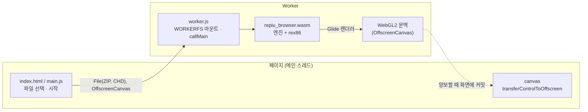
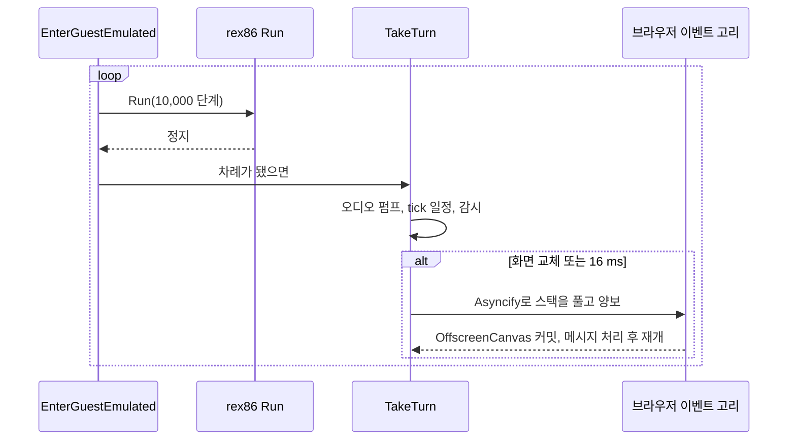
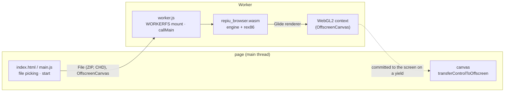
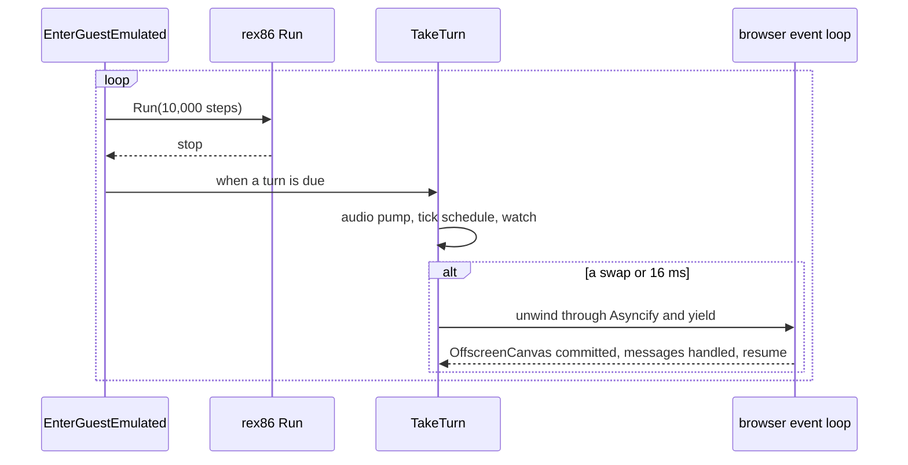

# 설계: 브라우저 호스트 단계 4 — 브라우저 페이지, 먼저 Worker의 엔진이 WebGL2 캔버스에 그리기 (issue #72)

관련: [설계 #64 — 브라우저 호스트](20261015-i064-browser-host-single-thread-loop.md),
[설계 #67 — Emscripten 빌드와 Node 실행](20261015-i067-emscripten-headless.md),
[설계 #69 — GLES 3 렌더러](20261016-i069-gles3-renderer.md), [웹 이식 frontier](../analysis/web-port-frontier.md)

## 배경

단계 1~3으로 `emulated` 엔진은 한 스레드에서 돌고(#64), wasm으로 빌드되어 Node에서 실행되며(#67), 렌더러는 WebGL2
부분집합만 씁니다(#69). 남은 것은 브라우저 페이지입니다. 조사한 사실(확인됨, 2026-10-16 main `3896d4c`):

| 사실 | 영향 |
|---|---|
| pumpitea 롬은 ZIP 1.9 MB + CHD 475 MB. 로더가 첫 실행에 CHD에서 게임 파일 약 411 MB를 `build/runtime_mounts/`에 풀고 게스트는 그것을 읽음 | 브라우저에 큰 파일 둘. CHD는 필요한 부분만 읽고, 푼 파일은 어디 둘지 정해야 함 |
| SDL3의 Emscripten 비디오·오디오는 `window`·DOM·`AudioContext`를 씀. Worker에는 없음(Node에서 `window is not defined`로 멈춘 것과 같음) | Worker에서는 화면·소리·입력을 SDL 없이 |
| 백엔드의 창·GL 문맥·스왑·크기·전체 화면·제목은 SDL 호출 약 30곳 | 이것을 경계 하나로 뽑아야 브라우저 구현을 꽂을 수 있음 |
| 단일 스레드 루프는 게스트가 끝날 때까지 C++ 호출 안에 있음. 호스트 차례는 `EnterGuestEmulated`가 rex86 `Run` 호출 **사이**에 부름 | 프레임마다 스택을 둔 채 브라우저에 양보할 방법이 필요. 양보 지점에는 rex86 해석기가 스택에 없음 |
| 로더는 키보드 배치 확인에 `SDL_InitSubSystem(SDL_INIT_VIDEO)`를 부름 | Worker에서도 Node처럼 SDL dummy 드라이버를 기본으로 |

## 결정 (2026-10-16, 사용자 확정)

1. **엔진은 단일 Worker에서 돈다**(#61 결정 유지). 화면·소리·입력은 웹 플랫폼 계층이 맡는다.
2. **CHD에서 푼 게임 파일은 우선 실행마다 메모리(MEMFS)에.** OPFS 영구 저장은 다음 단위.
3. **양보는 Asyncify, 계측 범위 제한.** 양보는 호스트 차례에서만 하므로 rex86 해석기는 계측하지 않는다.

## 단위

| 단위 | 내용 | issue |
|---|---|---|
| 1 | Worker, Asyncify 양보, WebGL2 화면, 롬 파일 선택(WORKERFS) → 타이틀·데모가 브라우저에 | #72 (이 설계의 구현 범위) |
| 2 | 입력(키보드·패드 → 메시지), 소리(PCM → AudioWorklet) | 이후 |
| 3 | OPFS 영구 저장, GitHub Pages 배포 | 이후 |

## 구조

## 결정 4: 브라우저용 링크 타깃을 따로 둔다

`repiu`(Node용)와 같은 오브젝트로 `repiu_browser`를 링크합니다. 차이는 링크 옵션뿐입니다.

| 옵션 | 왜 |
|---|---|
| `-sENVIRONMENT=worker` | Worker에서 `importScripts`로 불러 씀 |
| `-sMODULARIZE -sEXPORT_NAME=createRepiu -sINVOKE_RUN=0` | worker.js가 파일을 마운트한 뒤 `callMain(['pumpitea'])` |
| `-lworkerfs.js -sFORCE_FILESYSTEM`, `FS`·`WORKERFS`·`callMain` 내보내기 | 사용자가 고른 `File`을 마운트 |
| `-sASYNCIFY -sASYNCIFY_IGNORE_INDIRECT=1 -sASYNCIFY_ADD=[양보 경로]` | 결정 3. 간접 호출을 무시해 rex86의 HLE 콜백과 해석기가 계측되지 않게 하고, 양보 경로에 있는 간접 호출 위쪽 함수만 더함 |
| `repiu_link_web_engine`의 메모리 배치 | #67과 같음 |

Asyncify는 링크 단계의 변환이므로 Node 타깃과 네이티브는 영향을 받지 않습니다. 처리량은 Node 실행(같은 엔진, Asyncify 없음)과
비교해 떨어지는지 봅니다.

## 결정 5: 창·GL 문맥은 `GlideHostWindow` 경계 뒤로

백엔드가 SDL로 하던 창 일(열기·닫기, GL 문맥, drawable 크기, 스왑, 스왑 간격, 제목, 배율, 전체 화면, 화면 주사율)을
엔진의 인터페이스 `GlideHostWindow`(`include/repiu/engine/glide_host_window.h`)로 뽑습니다. 구현은 둘입니다.

| 구현 | 파일 | 쓰는 곳 |
|---|---|---|
| SDL | `src/engine/glide_host_window_sdl.cpp` | Win32·Linux(지금 코드를 옮김), Node(SDL dummy → 백엔드 dummy) |
| 브라우저 캔버스 | `src/engine/glide_host_window_browser.cpp` → 플랫폼 함수 | 브라우저 Worker |

어느 것을 쓸지는 실행 중에 정합니다. 플랫폼 헤더 `include/repiu/platform/browser_host.h`가 값만 주고받는 함수를 둡니다:
`BrowserCanvasAvailable()`, `CreateBrowserGlContext(...)`, `BrowserCanvasSize(...)`, `DestroyBrowserGlContext()`,
`BrowserGlProcAddress(...)`(결정 6의 `YieldToHostEventLoop()`도 같은 헤더). Win32·Linux는
"없음"을 돌려주고, 웹은 `Module.repiuCanvas`(worker.js가 넘긴 OffscreenCanvas)가 있으면 `getContext('webgl2', {alpha:false,
depth:false, stencil:false, antialias:false})`로 문맥을 만들어 Emscripten GL에 등록합니다(`GL.registerContext`,
`GL.makeContextCurrent`). 엔진에는 플랫폼 분기가 없고, Node에는 캔버스가 없으므로 지금처럼 SDL → dummy입니다.

브라우저 구현의 성질:
* 깊이·스텐실·안티에일리어싱 없음: 깊이는 #69의 FBO 쌍에 있음.
* GL 함수는 Emscripten으로 찾습니다(`emscripten_webgl_get_proc_address`). SDL 비디오가 없어 `SDL_GL_GetProcAddress`가 답하지
  않기 때문이며, `GlApi`가 쓰는 조회 함수를 창 구현이 정합니다(`SetGlProcAddressLoader`). 구현 중 처음 확인한 실패였습니다.
* 스왑은 할 일이 없음: Worker가 양보할 때 OffscreenCanvas가 그 시점의 그림을 커밋합니다. #69 결정 6 덕분에 창 framebuffer에는
  완성된 그림만 있습니다.
* 스왑 간격은 "적용됨"으로 답합니다. 그렇지 않으면 백엔드가 직접 박자를 맞추려 바쁜 대기를 하는데(Task 745), Worker에서는
  양보가 박자를 대신합니다.
* 제목·배율·전체 화면은 페이지의 일이므로 아무것도 하지 않음. OSD(ImGui)는 SDL 창이 필요해 단위 1에서는 끔.
* SDL 이벤트 펌프는 그대로 두며, Worker에서는 SDL 비디오가 없으므로 이벤트가 없습니다(입력은 단위 2).

## 결정 6: 양보는 호스트 차례에서, 프레임마다

`OneThreadHostLoop::TakeTurn`이 차례를 마친 뒤 플랫폼 함수 `YieldToHostEventLoop()`(`include/repiu/platform/browser_host.h`)를
부릅니다. 언제 부를지는 엔진이 정합니다: **마지막 양보 뒤 화면 교체가 있었거나, 16 ms가 지났을 때.** Win32·Linux 구현은 아무것도
하지 않습니다. 웹 구현은 worker.js가 양보를 켰을 때만(`Module.repiuYield`) Asyncify로 한 번 비웁니다. 빈 시간은 `setTimeout(0)`이
아니라 `MessageChannel` 한 번으로 둡니다. Worker의 `setTimeout`은 중첩되면 4 ms로 늘어나 16 ms마다 20 %를 잃기 때문입니다.

## 결정 7: 파일

worker.js가 사용자가 고른 두 `File`을 WORKERFS로 `/roms`에 마운트합니다: `pumpitea.zip`, `pumpitea/<이름>.chd`. WORKERFS는
`FileReaderSync`로 필요한 범위만 동기로 읽으므로(Worker 전용) CHD 475 MB를 통째로 올리지 않습니다. 로더가 푸는
`build/runtime_mounts/`와 게임이 쓰는 `eeprom.dat`·`nvram`은 MEMFS(메모리)에 갑니다(결정 2). 작업 디렉터리는 `/`입니다.

## 결정 8: 페이지 파일과 실행

페이지는 `src/platform/web/page/`(`index.html`, `main.js`, `worker.js`)에 두고, 빌드 스크립트가 `repiu_browser.{js,wasm}` 옆에
복사합니다. 단위 1은 로컬에서 엽니다: `python3 -m http.server`(COOP/COEP 불필요). 엔진의 표준 출력·오류는 페이지의 로그
영역과 콘솔로 보냅니다. Worker에서도 SDL이 `window`를 찾지 않도록 #67의 `--pre-js`가 Node뿐 아니라 `window`가 없는 모든
환경에서 SDL 비디오를 dummy로, 오디오는 **없음**으로 합니다. SDL의 Emscripten dummy 오디오는 `setInterval` 콜백으로 도는데 Worker에서
`function signature mismatch`로 멈췄습니다(구현 중 확인). 오디오 출력은 장치를 못 열면 무음으로 계속하므로 결과는 dummy와 같습니다.

## 바꾸지 않는 것

* HLE, 실행 규칙, 렌더러(#69), 단일 스레드 루프의 규칙(#64).
* Win32·Linux의 창 동작: SDL 구현은 지금 코드를 옮기기만 합니다.
* Node 타깃(`repiu`)의 링크 옵션과 동작.

## 검증

1. Win32 `direct` Debug·Release: 빌드, 렌더 probe(장면 4개 화소 일치, 후처리·레터박스·전체 화면), core probe, pumpitea 실행.
   창 경계를 옮긴 것이 회귀를 내지 않는지.
2. Win32 `emulated`, Linux x64·i386(WSL): 빌드, core probe.
3. 웹 Node(`repiu`): core probe, pumpitea 30초(#67 재현). 처리량을 이 단위 전과 비교.
4. 브라우저(`repiu_browser`, Chrome·Firefox): 로컬 서버의 페이지에서 ZIP·CHD를 고르면 pumpitea가 돌고 타이틀·데모가 캔버스에
   나옴. 처리량(초당 실행 단계)을 Node와 비교. 페이지가 멈추지 않는지(양보 간격).

## 확인 필요 (구현 중)

| 항목 | 왜 |
|---|---|
| `ASYNCIFY_ADD`에 넣을 함수(로더 `main`에서 `RunGuestOnThisThread`의 간접 호출 `entry(context)`를 지나 `TakeTurn`까지) | 빠지면 양보가 실행 중 오류로 멈춤. 넓으면 느려짐 |
| Worker에서 양보마다 OffscreenCanvas가 커밋되는지 | 아니면 Worker의 `requestAnimationFrame`으로 양보 |
| WORKERFS가 이름의 `/`로 하위 디렉터리를 만드는지 | 아니면 마운트를 둘로 |
| MEMFS에 411 MB를 푸는 시간과 메모리 | 단위 3(OPFS)의 우선순위 |
| 브라우저의 처리량 | Node 약 6~12 MIPS 대비 |

---

# Design: browser host phase 4 — the browser page, starting with the engine in a Worker drawing to a WebGL2 canvas (issue #72)

Related: [design #64 — the browser host](20261015-i064-browser-host-single-thread-loop.md),
[design #67 — the Emscripten build and Node run](20261015-i067-emscripten-headless.md),
[design #69 — the GLES 3 renderer](20261016-i069-gles3-renderer.md), [web port frontier](../analysis/web-port-frontier.md)

## Background

After phases 1 to 3 the `emulated` engine runs on one thread (#64), builds for wasm and runs under Node (#67), and draws
with only the WebGL2 subset (#69). What remains is the browser page. Facts found (confirmed, 2026-10-16, main `3896d4c`):

| Fact | Consequence |
|---|---|
| pumpitea's ROMs are a 1.9 MB ZIP plus a 475 MB CHD; on the first run the loader unpacks about 411 MB of game files from the CHD into `build/runtime_mounts/`, which the guest then reads | two large files in a browser: the CHD should be read on demand, and the unpacked files need a place |
| SDL3's Emscripten video and audio use `window`, the DOM and `AudioContext`, none of which a Worker has (the same way Node stopped with `window is not defined`) | in a Worker, the picture, sound and input go without SDL |
| The backend's window, GL context, swap, size, fullscreen and title are about 30 SDL calls | they must come out behind one boundary for a browser implementation to plug in |
| The single-threaded loop stays inside C++ calls until the guest ends; `EnterGuestEmulated` takes host turns **between** rex86 `Run` calls | yielding to the browser every frame needs a way to keep the stack; at the yield the rex86 interpreter is not on it |
| The loader calls `SDL_InitSubSystem(SDL_INIT_VIDEO)` to check the keyboard layout | in a Worker, as under Node, SDL's dummy drivers are the default |

## Decisions (2026-10-16, settled by the user)

1. **The engine runs in a single Worker** (#61's decision kept). The web platform layer handles the picture, sound and
   input.
2. **The game files unpacked from the CHD go into memory (MEMFS) on every run for now.** OPFS persistence is a later unit.
3. **Yielding uses Asyncify with a limited scope.** The yield happens only at the host turn, so the rex86 interpreter is
   not instrumented.

## Units

| Unit | Content | issue |
|---|---|---|
| 1 | the Worker, Asyncify yields, the WebGL2 picture, picking the ROM files (WORKERFS) → title and demo in the browser | #72 (what this design implements) |
| 2 | input (keyboard and pad → messages), sound (PCM → AudioWorklet) | later |
| 3 | OPFS persistence, GitHub Pages deployment | later |

## Structure

## Decision 4: a link target of its own for the browser

`repiu_browser` is linked from the same objects as `repiu` (for Node); only the link options differ.

| Option | Why |
|---|---|
| `-sENVIRONMENT=worker` | loaded by `importScripts` in a Worker |
| `-sMODULARIZE -sEXPORT_NAME=createRepiu -sINVOKE_RUN=0` | worker.js mounts the files, then `callMain(['pumpitea'])` |
| `-lworkerfs.js -sFORCE_FILESYSTEM`, exporting `FS`, `WORKERFS`, `callMain` | mounting the `File`s the user picked |
| `-sASYNCIFY -sASYNCIFY_IGNORE_INDIRECT=1 -sASYNCIFY_ADD=[the yield path]` | decision 3: ignoring indirect calls keeps rex86's HLE callbacks and the interpreter uninstrumented, and only the functions above the indirect calls on the yield path are added |
| `repiu_link_web_engine`'s memory layout | as in #67 |

Asyncify is a link-time transform, so the Node target and the native builds are untouched. Throughput is compared with
the Node run (the same engine without Asyncify).

## Decision 5: the window and GL context behind `GlideHostWindow`

The window work the backend did through SDL (open, close, the GL context, the drawable size, the swap, the swap interval,
the title, the scale, fullscreen, the refresh rate) moves behind an engine interface, `GlideHostWindow`
(`include/repiu/engine/glide_host_window.h`), with two implementations.

| Implementation | File | Used by |
|---|---|---|
| SDL | `src/engine/glide_host_window_sdl.cpp` | Win32 and Linux (today's code, moved), Node (SDL dummy → backend dummy) |
| Browser canvas | `src/engine/glide_host_window_browser.cpp` → platform functions | the browser Worker |

Which one is chosen at run time. A platform header, `include/repiu/platform/browser_host.h`, holds value-only functions:
`BrowserCanvasAvailable()`, `CreateBrowserGlContext(...)`, `BrowserCanvasSize(...)`, `DestroyBrowserGlContext()`,
`BrowserGlProcAddress(...)` (and decision 6's `YieldToHostEventLoop()`). Win32 and
Linux answer "none"; the web, when `Module.repiuCanvas` (the OffscreenCanvas worker.js passed in) is there, makes a context
with `getContext('webgl2', {alpha:false, depth:false, stencil:false, antialias:false})` and registers it with Emscripten's
GL (`GL.registerContext`, `GL.makeContextCurrent`). The engine holds no platform branch, and Node, having no canvas, goes
SDL → dummy as today.

The browser implementation:
* No depth, stencil or antialiasing: depth lives in #69's FBO pair.
* GL functions are found through Emscripten (`emscripten_webgl_get_proc_address`): with no SDL video,
  `SDL_GL_GetProcAddress` does not answer, so the window implementation sets the lookup `GlApi` uses
  (`SetGlProcAddressLoader`). This was the first failure found during implementation.
* The swap has nothing to do: when the Worker yields, the OffscreenCanvas commits what is there, and thanks to #69's
  decision 6 the window's framebuffer only ever holds finished pictures.
* The swap interval answers "applied". Otherwise the backend would pace swaps itself with a busy wait (Task 745); in a
  Worker the yield does the pacing.
* The title, scale and fullscreen are the page's business and do nothing. The OSD (ImGui) needs an SDL window and is off
  in unit 1.
* The SDL event pump stays; in a Worker there is no SDL video, so there are no events (input is unit 2).

## Decision 6: yield at the host turn, once a frame

After `OneThreadHostLoop::TakeTurn` finishes a turn it calls a platform function, `YieldToHostEventLoop()`
(`include/repiu/platform/browser_host.h`). The engine decides when: **when a picture was swapped since the last yield,
or 16 ms have passed.** Win32 and Linux do nothing. The web yields once through Asyncify, and only when worker.js turned
yields on (`Module.repiuYield`). The yield is one `MessageChannel` round rather than `setTimeout(0)`: nested `setTimeout`
in a Worker is clamped to 4 ms, which would lose 20 % every 16 ms.

## Decision 7: files

worker.js mounts the two `File`s the user picked with WORKERFS at `/roms`: `pumpitea.zip` and `pumpitea/<name>.chd`.
WORKERFS reads only the ranges asked for, synchronously, through `FileReaderSync` (Worker only), so the 475 MB CHD is
never loaded whole. The loader's `build/runtime_mounts/` and the `eeprom.dat` and `nvram` the game writes go to MEMFS
(memory) (decision 2). The working directory is `/`.

## Decision 8: page files and running

The page lives in `src/platform/web/page/` (`index.html`, `main.js`, `worker.js`), copied next to `repiu_browser.{js,wasm}`
by the build script. Unit 1 is opened locally: `python3 -m http.server` (no COOP/COEP needed). The engine's standard output
and error go to the page's log area and the console. So that SDL does not look for `window` in a Worker either, #67's
`--pre-js` makes SDL's video dummy and its audio **none** in every environment without `window`, not only Node. SDL's
Emscripten dummy audio runs on a `setInterval` callback, which stopped in a Worker with `function signature mismatch`
(found during implementation); an audio output that cannot open its device carries on silent, so the result is what the
dummy gave.

## What does not change

* The HLE, the execution rules, the renderer (#69), the single-threaded loop's rules (#64).
* The Win32 and Linux window behaviour: the SDL implementation only moves today's code.
* The Node target's (`repiu`) link options and behaviour.

## Verification

1. Win32 `direct` Debug and Release: build, the render probe (the four scenes pixel for pixel, post-process, letterbox,
   fullscreen), the core probe, a pumpitea run; moving the window boundary must not regress anything.
2. Win32 `emulated`, Linux x64 and i386 (WSL): build, core probe.
3. Web under Node (`repiu`): core probe, pumpitea for 30 s (#67's repro); throughput compared with before this unit.
4. Browser (`repiu_browser`, Chrome and Firefox): on the local server's page, picking the ZIP and the CHD runs pumpitea and
   its title and demo appear on the canvas; throughput (steps per second) compared with Node; the page stays responsive
   (the yield cadence).

## To be confirmed (during implementation)

| Item | Why |
|---|---|
| What goes in `ASYNCIFY_ADD` (from the loader's `main` through `RunGuestOnThisThread`'s indirect call `entry(context)` to `TakeTurn`) | missing one stops the yield with a run-time error; too wide costs speed |
| Whether the OffscreenCanvas commits at every yield from a Worker | if not, yield through the Worker's `requestAnimationFrame` |
| Whether WORKERFS makes subdirectories from a `/` in a name | if not, two mounts |
| The time and memory to unpack 411 MB into MEMFS | the priority of unit 3 (OPFS) |
| Browser throughput | against Node's 6 to 12 MIPS |
