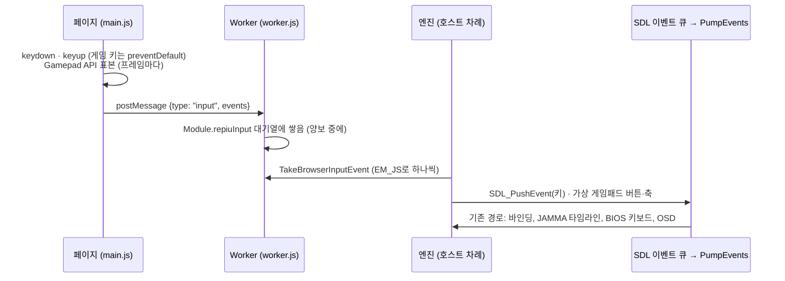
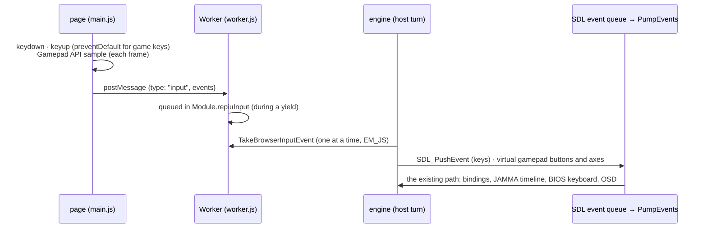

# 설계: 브라우저 호스트 단계 4 단위 2 — 페이지의 키보드·게임패드 입력 (issue #76)

관련: [설계 #72 — 브라우저 페이지](20261016-i072-browser-page.md)(단위 1), [설계 #64](20261015-i064-browser-host-single-thread-loop.md),
Task 748(입력 스크립트), issue #34(게임패드), issue #52·#55(게임패드 chord)

## 배경

단위 1의 페이지는 Worker의 엔진이 캔버스에 그리지만 입력이 없습니다. 사용자가 게임 실행을 확인했고, F5(기본 배치의 COIN1)를
누르자 브라우저가 새로고침했습니다(사용자 보고, 2026-10-16).

조사한 사실(확인됨):

| 항목 | 값 |
|---|---|
| 네이티브 입력 경로 | 모두 `GlideOpenGlBackend::PumpEvents`의 `SDL_PollEvent`에서 시작: Tab(OSD), Alt+Enter, ImGui, 게임패드(`SdlPadInput`), BIOS 키보드, JAMMA 입력 타임라인(바인딩은 SDL 키코드) |
| Worker의 SDL | 로더가 `SDL_INIT_VIDEO`를 dummy 드라이버로 올리므로 SDL 이벤트 큐가 있음. `PumpEvents`도 브라우저 창 구현에서 그대로 돎 |
| 합성 이벤트 | 입력 스크립트(Task 748)가 `SDL_PushEvent`로 키 이벤트를 넣어 같은 경로를 탐 |
| 게임패드 | `SdlPadInput`은 SDL 게임패드가 연결되면 열어 씀. 이 웹 빌드의 SDL에는 가상 조이스틱 드라이버가 있음(`SDL_JOYSTICK_VIRTUAL 1`) |
| 브라우저 쪽 | 키보드 이벤트와 Gamepad API(`navigator.getGamepads`)는 페이지(메인 스레드)에만 있음. Worker는 메시지를 엔진이 양보할 때(프레임마다) 처리함 |

## 결정 1: 브라우저 입력은 SDL 이벤트가 된다

엔진의 입력 경로를 바꾸지 않습니다. 브라우저의 키와 게임패드를 SDL 키 이벤트와 SDL 가상 게임패드로 바꿔 넣으면, 바인딩·JAMMA
타임라인·BIOS 키보드·OSD·chord가 네이티브와 똑같이 동작합니다. 키 배치도 그대로입니다.

## 결정 2: 키는 `KeyboardEvent.code`로, 변환은 엔진의 표 하나

페이지는 물리 키 이름 `KeyboardEvent.code`(`"KeyQ"`, `"F5"`, `"Numpad7"`, `"Home"`)와 누름·뗌, 반복 여부, 수정 키(Shift·Ctrl·Alt·Meta)를
보냅니다. `code`는 자판 배열과 NumLock에 상관없는 위치 이름이라 바인딩(키패드 7과 Home)이 그대로 맞습니다. 이름 → SDL scancode
표는 플랫폼 중립 코드(`src/input/browser_key_codes.cpp`)에 두고 core probe로 시험합니다. SDL 키코드는 지금처럼
`SDL_GetKeyFromScancode`가 정합니다.

**시각:** 페이지는 이벤트가 일어난 때를 `performance.timeOrigin + event.timeStamp`(밀리초)로 보내고, 엔진은 받은 순간과의 차이만큼
`SDL_GetTicksNS()`에서 빼 SDL 이벤트 시각으로 씁니다. Worker가 메시지를 프레임마다만 처리하므로, 이렇게 하지 않으면 JAMMA
타임라인의 edge가 최대 한 프레임 늦게 찍힙니다.

## 결정 3: 페이지는 게임 키의 브라우저 기본 동작을 막는다

게임이 도는 동안 페이지는 키보드 이벤트를 받아 Worker로 보내고, 다음을 뺀 모든 키에서 `preventDefault`합니다.

* Ctrl 또는 Meta(⌘)를 함께 누른 키: 브라우저의 단축키(탭 닫기, 복사 등)는 그대로 둡니다.
* F11(전체 화면), F12(개발자 도구).

그래서 F5(새로고침), F1(도움말), F3(찾기), Tab(포커스 이동), Home·End·PgUp·PgDn(스크롤)은 게임 키가 됩니다. 브라우저가 페이지에
넘기지 않는 키(Ctrl+W 등)는 막을 수 없지만 게임 키와 겹치지 않습니다.

**포커스:** 페이지가 포커스를 잃거나 가려지면(`blur`, `visibilitychange`) "포커스 잃음"을 보내고, 엔진은
`SDL_EVENT_WINDOW_FOCUS_LOST`를 넣습니다. 그러면 기존 경로가 눌린 키와 게임패드를 모두 뗍니다(네이티브의 창 포커스와 같음).

## 결정 4: 게임패드는 SDL 가상 게임패드로

페이지는 `requestAnimationFrame`마다 `navigator.getGamepads()`를 표본해, 표준 배치(`mapping === "standard"`)인 패드의 버튼 17개와
축 4개가 바뀌면 보냅니다. 엔진은 패드마다 SDL 가상 조이스틱(`SDL_AttachVirtualJoystick`, 종류 gamepad)을 붙이고 버튼·축 값을
넣습니다. SDL이 그것을 게임패드 이벤트로 내보내므로 `SdlPadInput`의 Pad1·Pad2, 바인딩, 종료 chord(LT+RT+L3+R3), OSD chord(LT+RT+Y)가
그대로 동작합니다. 패드가 빠지면 가상 조이스틱을 뗍니다.

| 표준 배치 | SDL |
|---|---|
| 버튼 0~3 (A, B, X, Y) | SOUTH, EAST, WEST, NORTH |
| 4, 5 (LB, RB) | LEFT_SHOULDER, RIGHT_SHOULDER |
| 6, 7 (LT, RT, 0~1 값) | 축 LEFT_TRIGGER, RIGHT_TRIGGER |
| 8, 9 (Back, Start) | BACK, START |
| 10, 11 (L3, R3) | LEFT_STICK, RIGHT_STICK |
| 12~15 (십자) | DPAD_UP, DOWN, LEFT, RIGHT |
| 16 (Guide) | GUIDE |
| 축 0~3 | LEFTX, LEFTY, RIGHTX, RIGHTY |

## 결정 5: 플랫폼 경계

* `browser_host.h`에 `TakeBrowserInputEvent(BrowserInputEvent*)`: 페이지가 보낸 입력 하나를 꺼냄. Win32·Linux와 Node는 "없음".
* 엔진의 `src/engine/input/browser_input_bridge.{h,cpp}`: 꺼낸 입력을 SDL 이벤트와 가상 게임패드로 바꿈. `PumpEvents`의
  `SDL_PollEvent` 고리 앞에서 부름. 네이티브에서는 꺼낼 것이 없어 아무것도 하지 않습니다.

## 바꾸지 않는 것

* 엔진의 입력 경로, 키·패드 바인딩과 기본 배치, `cfg/` 설정.
* Win32·Linux의 동작.

## 확인 필요 (구현 중)

| 항목 | 왜 |
|---|---|
| Worker에서 `SDL_INIT_GAMEPAD`가 성공하는지(Emscripten 조이스틱 드라이버는 `window`의 Gamepad API를 씀) | 실패하면 가상 게임패드도 없음 |
| 가상 게임패드가 `SDL_IsGamepad`로 잡히고 버튼 번호가 SDL 게임패드 버튼과 같은지 | 결정 4의 표 |
| 브라우저가 F5·F1·F3·Tab의 기본 동작을 페이지에 막게 해 주는지(Chrome·Edge·Firefox) | 결정 3 |

## 검증

1. core probe: `code` → scancode 표(글자, 숫자, F1~F12, 키패드, 편집 키, 방향 키, 수정 키, 모르는 이름).
2. Win32 `direct` Release·Debug, Linux i386·x64: 빌드, core probe. 웹 Node: 빌드, 실행.
3. 브라우저(헤드리스, DevTools 프로토콜로 키 입력): F5가 새로고침하지 않고 COIN1이 들어감(로그의 JAMMA edge·크레딧), Tab으로 OSD.
4. 게임패드는 사용자 확인(헤드리스에서는 Gamepad API를 흉내 내기 어려움).

## 후속 (2026-10-17): 브라우저의 OSD와 마우스

사용자 확인에서 브라우저의 Tab이 OSD를 열지 않았습니다. 원인은 입력이 아니라 OSD가 만들어지지 않은 것입니다: `GlideOsd`는
ImGui SDL3 백엔드를 SDL 창에 붙여 초기화하는데, #72의 브라우저 캔버스에는 SDL 창이 없어 "OSD needs a window"로 꺼집니다. 또
네이티브 OSD는 키보드 탐색을 끄고(#55) 마우스나 패드로 조작하는데, 페이지는 마우스를 넘기지 않았습니다.

* **결정 6: OSD는 SDL 창 없이 연다.** ImGui SDL3 백엔드를 창 없이(null) 초기화합니다. SDL은 없는 창에 대한 호출을 실패로만 돌려주고,
  백엔드의 창 ID는 0이 되어 브리지가 보내는 이벤트(창 ID 0)와 맞습니다. 화면 크기는 백엔드가 창에서 읽지 못하므로 캔버스의 drawable
  크기를 매 프레임 넣습니다(배율 1). 렌더러(ImGui OpenGL3)는 #69의 머리말(`#version 300 es`)로 WebGL2에서 그대로 돕니다. 패드
  조작은 백엔드가 SDL 게임패드(브리지의 가상 게임패드)를 직접 읽으므로 그대로입니다.
* **결정 7: 페이지는 캔버스 위의 마우스를 넘긴다.** 이동·버튼·휠을 캔버스 화소 좌표(표시 크기와 캔버스 크기의 비로 환산)로 보내고,
  브리지가 창 ID 0의 SDL 마우스 이벤트로 넣습니다. 백엔드의 이벤트 처리는 그대로(OSD가 열려 있으면 ImGui에, 아니면 더블클릭 =
  전체 화면, 브라우저 창 구현에서는 아무것도 안 함).

---

# Design: browser host phase 4 unit 2 — keyboard and gamepad input on the page (issue #76)

Related: [design #72 — the browser page](20261016-i072-browser-page.md) (unit 1),
[design #64](20261015-i064-browser-host-single-thread-loop.md), Task 748 (input scripts), issue #34 (gamepads), issues #52
and #55 (gamepad chords)

## Background

Unit 1's page has the engine in a Worker drawing to a canvas, but takes no input. The user confirmed the game runs, and
pressing F5 (COIN1 in the default layout) reloaded the page (reported by the user, 2026-10-16).

Facts gathered (confirmed):

| Item | Value |
|---|---|
| The native input path | all starts from `SDL_PollEvent` in `GlideOpenGlBackend::PumpEvents`: Tab (OSD), Alt+Enter, ImGui, gamepads (`SdlPadInput`), the BIOS keyboard, the JAMMA input timeline (bindings are SDL keycodes) |
| SDL in the Worker | the loader brings up `SDL_INIT_VIDEO` with the dummy driver, so there is an SDL event queue; `PumpEvents` runs with the browser window implementation too |
| Synthetic events | input scripts (Task 748) put key events in with `SDL_PushEvent` and they take the same path |
| Gamepads | `SdlPadInput` opens an SDL gamepad when one is connected; this web build's SDL has the virtual joystick driver (`SDL_JOYSTICK_VIRTUAL 1`) |
| The browser side | keyboard events and the Gamepad API (`navigator.getGamepads`) exist on the page (the main thread) only; the Worker handles messages when the engine yields (once a frame) |

## Decision 1: browser input becomes SDL events

The engine's input path does not change. Browser keys and gamepads turned into SDL key events and SDL virtual gamepads make
the bindings, the JAMMA timeline, the BIOS keyboard, the OSD and the chords work exactly as natively, and the layout is the
same.

## Decision 2: keys by `KeyboardEvent.code`, translated by one table in the engine

The page sends the physical key name `KeyboardEvent.code` (`"KeyQ"`, `"F5"`, `"Numpad7"`, `"Home"`), down or up, whether
it repeats, and the modifiers (Shift, Ctrl, Alt, Meta). `code` names a position regardless of the keyboard layout and
NumLock, so the bindings (keypad 7 and Home) match as they are. The name → SDL scancode table is platform-neutral code
(`src/input/browser_key_codes.cpp`), tested by the core probe. The SDL keycode comes from `SDL_GetKeyFromScancode` as
today.

**Time:** the page sends when the event happened as `performance.timeOrigin + event.timeStamp` (milliseconds), and the
engine takes the difference from the moment it receives it off `SDL_GetTicksNS()` for the SDL event's time. The Worker
handles messages only once a frame, so without this the JAMMA timeline's edges would land up to a frame late.

## Decision 3: the page stops the browser's default for game keys

While the game runs the page takes keyboard events, sends them to the Worker, and calls `preventDefault` for every key
except:

* keys pressed with Ctrl or Meta (⌘): the browser's shortcuts (close tab, copy and so on) stay;
* F11 (fullscreen) and F12 (developer tools).

So F5 (reload), F1 (help), F3 (find), Tab (focus) and Home, End, PgUp, PgDn (scrolling) become game keys. Keys the
browser does not give the page (Ctrl+W and the like) cannot be stopped, but none is a game key.

**Focus:** when the page loses focus or is hidden (`blur`, `visibilitychange`) it sends "focus lost", and the engine puts
in `SDL_EVENT_WINDOW_FOCUS_LOST`, so the existing path lets go of every key and pad (as a native window's focus does).

## Decision 4: gamepads as SDL virtual gamepads

On every `requestAnimationFrame` the page samples `navigator.getGamepads()` and sends a pad with the standard mapping
(`mapping === "standard"`) when its 17 buttons or 4 axes change. The engine attaches an SDL virtual joystick of the gamepad
type per pad (`SDL_AttachVirtualJoystick`) and sets its buttons and axes. SDL turns that into gamepad events, so
`SdlPadInput`'s Pad1 and Pad2, the bindings, the exit chord (LT+RT+L3+R3) and the OSD chord (LT+RT+Y) work as they are. A
pad that goes away has its virtual joystick detached.

| Standard mapping | SDL |
|---|---|
| buttons 0-3 (A, B, X, Y) | SOUTH, EAST, WEST, NORTH |
| 4, 5 (LB, RB) | LEFT_SHOULDER, RIGHT_SHOULDER |
| 6, 7 (LT, RT, values 0-1) | axes LEFT_TRIGGER, RIGHT_TRIGGER |
| 8, 9 (Back, Start) | BACK, START |
| 10, 11 (L3, R3) | LEFT_STICK, RIGHT_STICK |
| 12-15 (D-pad) | DPAD_UP, DOWN, LEFT, RIGHT |
| 16 (Guide) | GUIDE |
| axes 0-3 | LEFTX, LEFTY, RIGHTX, RIGHTY |

## Decision 5: the platform boundary

* `TakeBrowserInputEvent(BrowserInputEvent*)` in `browser_host.h`: takes one input the page sent. Win32, Linux and Node
  answer "none".
* The engine's `src/engine/input/browser_input_bridge.{h,cpp}`: turns what was taken into SDL events and virtual
  gamepads, called before `PumpEvents`'s `SDL_PollEvent` loop. Natively there is nothing to take, so it does nothing.

## Follow-up (2026-10-17): the OSD and the mouse in the browser

In the user's check, Tab did not open the OSD in the browser. The cause is not the input: the OSD is never made.
`GlideOsd` initialises ImGui's SDL3 backend on an SDL window, and #72's browser canvas has none, so it turns itself off
with "OSD needs a window". The native OSD also keeps keyboard navigation off (#55) and is driven by mouse or pad, and the
page sent no mouse.

* **Decision 6: the OSD opens without an SDL window.** ImGui's SDL3 backend is initialised with no window (null). SDL
  only answers failure for calls on a missing window, and the backend's window id becomes 0, which matches the events the
  bridge sends (window id 0). The backend cannot read the display size from a window, so the canvas's drawable size is
  put in every frame (scale 1). The renderer (ImGui OpenGL3) runs on WebGL2 with #69's header (`#version 300 es`). Pad
  navigation is unchanged: the backend reads SDL gamepads (the bridge's virtual gamepads) itself.
* **Decision 7: the page forwards the mouse over the canvas.** Moves, buttons and the wheel go in canvas pixels (scaled by
  the canvas size over the displayed size), and the bridge pushes them as SDL mouse events with window id 0. The backend's
  event handling stays as it is (to ImGui while the OSD is open; otherwise a double click means fullscreen, which the
  browser window implementation ignores).

## What does not change

* The engine's input path, the key and pad bindings and their defaults, the `cfg/` settings.
* Win32 and Linux behaviour.

## To be confirmed (during implementation)

| Item | Why |
|---|---|
| Whether `SDL_INIT_GAMEPAD` succeeds in a Worker (Emscripten's joystick driver uses the Gamepad API on `window`) | without it there are no virtual gamepads either |
| Whether a virtual gamepad passes `SDL_IsGamepad` and its button numbers are SDL's gamepad buttons | the table in decision 4 |
| Whether browsers let the page stop F5, F1, F3 and Tab (Chrome, Edge, Firefox) | decision 3 |

## Verification

1. Core probe: the `code` → scancode table (letters, digits, F1-F12, keypad, editing keys, arrows, modifiers, an unknown
   name).
2. Win32 `direct` Release and Debug, Linux i386 and x64: build, core probe. Web under Node: build, run.
3. Browser (headless, keys sent over the DevTools protocol): F5 does not reload and COIN1 arrives (the log's JAMMA edges
   and credits); Tab opens the OSD.
4. Gamepads checked by the user (the Gamepad API is hard to imitate headless).
