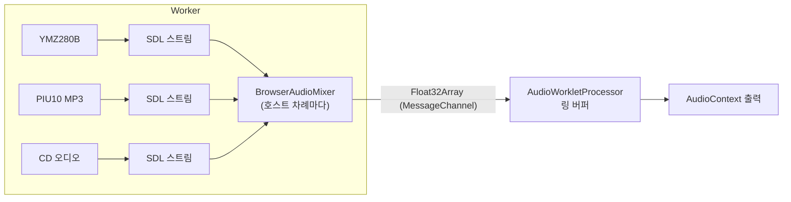
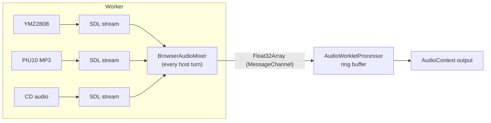

# 설계: 브라우저 페이지의 소리 — 세 오디오 출력을 섞어 AudioWorklet으로 (issue #81)

관련: [설계 #64 — 브라우저 호스트](20261015-i064-browser-host-single-thread-loop.md),
[설계 #72 — 브라우저 페이지](20261016-i072-browser-page.md), [설계 #76 — 브라우저 입력](20261016-i076-browser-input.md)

## 배경

웹 빌드는 지금 무음입니다. 확인한 사실(2026-10-17 main `7539353`):

| 사실 | 영향 |
|---|---|
| 오디오 출력은 셋: YMZ280B(효과음), PIU10 MP3(음악), CD 오디오. 모두 `SDL_OpenAudioDeviceStream`으로 장치에 묶인 SDL 스트림을 만들고 `SDL_PutAudioStreamData`로 PCM을 넣으며, 큐 잔량(`SDL_GetAudioStreamQueued`)으로 생성 속도를 맞춤 | 출력 쪽 로직은 "스트림 하나에 넣고 잔량을 본다"는 것만 알면 됨 |
| PIU10 MP3는 `SDL_SetAudioStreamFormat`으로 원본 형식을 바꾸고 `SDL_SetAudioStreamGain`으로 음량을 맞춤. 장치 번호(`SDL_GetAudioStreamDevice`)가 0이면 장치 형식 조회를 건너뜀 | 장치 없는 스트림에서도 그대로 동작 |
| SDL3의 Emscripten 오디오는 `AudioContext`가 필요해 Worker에서 동작하지 않음. dummy 드라이버는 Worker에서 `function signature mismatch`로 멈췄음(#72). 지금은 드라이버 `none`이라 세 출력이 장치를 못 열고 무음으로 계속 | SDL 장치 대신 다른 길이 필요 |
| 단일 스레드 루프는 호스트 차례마다 세 출력의 `Pump()`를 부름(#64), 차례 사이 간격은 2 ms 이하, 페이지 양보는 16 ms마다(#72) | 섞어 보내는 일도 호스트 차례에서 |
| COOP/COEP가 없어 `SharedArrayBuffer`가 없음 | Worker와 Worklet 사이는 메시지로 |

## 결정 1: 출력은 SDL 스트림을 그대로 쓰고, 브라우저에서는 장치에 묶지 않는다

세 출력이 스트림을 열고 닫는 곳을 엔진의 작은 도우미 하나(`host_audio_stream.{h,cpp}`)로 모읍니다.

```cpp
// The stream an audio output puts its PCM into: bound to SDL's default
// playback device natively, bound to no device in a browser page's Worker,
// where the browser audio mixer takes from it.
SDL_AudioStream* OpenHostAudioStream(const SDL_AudioSpec& source, std::string* failure);
void CloseHostAudioStream(SDL_AudioStream* stream);
```

* 네이티브: 지금 코드 그대로(`SDL_InitSubSystem(SDL_INIT_AUDIO)` + `SDL_OpenAudioDeviceStream`, 닫을 때 반대로).
* 브라우저: `SDL_CreateAudioStream(source, 믹서 형식)`으로 장치 없는 스트림을 만들어 믹서에 등록합니다. 믹서 형식은 float 스테레오,
  페이지의 샘플률입니다. 형식·샘플률 변환과 음량은 SDL이 지금처럼 스트림 안에서 합니다.

장치 일시 정지·재개(`SDL_PauseAudioStreamDevice` 등)는 장치 없는 스트림에서 실패만 돌려줄 뿐 해가 없습니다. 일시 정지하는 곳(CD
오디오)은 함께 스트림을 비우므로 결과는 무음으로 같습니다.

## 결정 2: 엔진의 믹서가 실시간만큼 꺼내 섞는다

`BrowserAudioMixer`(`browser_audio_mixer.{h,cpp}`)가 등록된 스트림들에서 꺼내 섞습니다. 호스트 차례마다(세 출력의 `Pump()` 뒤에)
부릅니다.

* **얼마나:** 시작 시각부터 지난 실시간 × 샘플률에서 이미 보낸 프레임을 뺀 만큼. 그래서 출력의 큐는 실시간 속도로 줄고, 출력은
  지금처럼 잔량을 보고 채웁니다. 게임이 실시간보다 느려도 소리의 높이와 속도는 맞습니다(음악이 끊길 수는 있음).
* **앞서 보내기:** 처음에 100 ms를 앞서 보내 Worklet 쪽 버퍼를 채웁니다.
* **오래 멈춘 뒤:** 엔진이 250 ms 넘게 차례를 못 가졌으면(로딩, CHD 풀기) 밀린 만큼 한꺼번에 보내지 않고 기준 시각을 지금으로 옮깁니다.
* **섞기:** 각 스트림에서 그만큼(모자라면 있는 만큼, 나머지는 0) float로 꺼내 더하고 [-1, 1]로 자릅니다.

네이티브에서는 믹서를 만들지 않습니다(플랫폼이 브라우저 오디오가 없다고 답함).

## 결정 3: 보내는 길은 Worker → AudioWorklet 직통 메시지



* 페이지(main.js)가 Start를 누를 때(사용자 조작이 있어야 `AudioContext`가 소리를 냄) `AudioContext`와 `AudioWorkletNode`를 만들고,
  `MessageChannel` 한쪽은 Worklet에, 다른 쪽은 Worker에 넘깁니다. 메인 스레드를 거치지 않습니다.
* 플랫폼 함수(`browser_host.h`): `BrowserAudioSampleRate()`(0이면 소리 없음), `SendBrowserAudio(const float* interleaved, frames)`.
  웹 구현은 worker.js가 넣어 준 `Module.repiuAudioPort`와 `Module.repiuAudioSampleRate`를 씁니다. Win32·Linux·Node는 0과 무시.
* 보내는 단위는 호스트 차례 한 번에 생긴 만큼(대개 수 ms 분량). 메시지는 버퍼를 넘기므로(transfer) 복사가 한 번입니다.

## 결정 4: Worklet은 링 버퍼로 받아 내보낸다

`audio_worklet.js`의 프로세서가 받은 PCM을 링 버퍼(1초)에 넣고 `process()`마다 128프레임을 내보냅니다.

* 버퍼가 비면 0을 내보내고 부족 횟수를 셉니다.
* 쌓인 양이 300 ms를 넘으면(Worker와 오디오 장치의 시계 차) 오래된 것을 100 ms까지 버립니다.
* 1초마다 페이지에 상태(버퍼 ms, 부족 횟수, 최대 진폭)를 보내고, 페이지는 로그 영역 위에 한 줄로 보여 줍니다. 소리가 나는지
  사용자가 아닌 확인 도구도 볼 수 있게 하기 위함입니다.

## 바꾸지 않는 것

* 세 출력의 생성·디코드 로직, 잔량으로 속도를 맞추는 규칙, 음량.
* 네이티브의 소리 경로(SDL 장치).
* 입력(#76), 화면(#72).

## 검증

1. Win32 Debug·Release: 빌드, core probe, pumpitea·pumpit8 소리(사용자). 출력이 도우미로 열고 닫는 것만 바뀌었는지.
2. Linux x64·i386(WSL): 빌드, core probe.
3. 웹 Node: core probe, pumpitea 30초(소리는 없지만 스트림이 열리고 믹서가 없음을 확인).
4. 브라우저: pumpitea에서 페이지의 오디오 상태 줄에 진폭이 0이 아니고 부족 횟수가 거의 늘지 않음, 사용자가 소리를 들음.

## 확인 필요 (구현 중)

| 항목 | 왜 |
|---|---|
| SDL_INIT_AUDIO 없이(드라이버 `none`) `SDL_CreateAudioStream`이 되는지 | 안 되면 `dummy`가 아닌 다른 방법으로 오디오 하위 시스템을 올려야 함 |
| 게임이 느릴 때 MP3 출력의 굶주림 | 음악이 끊길 수 있음. 측정해 기록 |
| 메시지 빈도(2 ms마다)의 비용 | 많으면 모아서 보냄 |

---

# Design: sound in the browser page — the three audio outputs mixed into an AudioWorklet (issue #81)

Related: [design #64 — the browser host](20261015-i064-browser-host-single-thread-loop.md),
[design #72 — the browser page](20261016-i072-browser-page.md), [design #76 — browser input](20261016-i076-browser-input.md)

## Background

The web build is silent today. Facts found (2026-10-17, main `7539353`):

| Fact | Consequence |
|---|---|
| There are three audio outputs: YMZ280B (effects), PIU10 MP3 (music), CD audio. Each makes an SDL stream bound to a device with `SDL_OpenAudioDeviceStream`, puts PCM in with `SDL_PutAudioStreamData`, and paces itself by what is queued (`SDL_GetAudioStreamQueued`) | the outputs only need to know "put into one stream, watch what is queued" |
| PIU10 MP3 changes the source format with `SDL_SetAudioStreamFormat` and sets the volume with `SDL_SetAudioStreamGain`; when the device id (`SDL_GetAudioStreamDevice`) is 0 it skips the device-format query | works unchanged on a stream with no device |
| SDL3's Emscripten audio needs an `AudioContext` and does not work in a Worker; the dummy driver stopped in a Worker with `function signature mismatch` (#72). Today the driver is `none`, so the three outputs cannot open a device and carry on silent | another way than an SDL device is needed |
| The single-threaded loop calls the three outputs' `Pump()` at every host turn (#64); turns are at most 2 ms apart and the page gets a yield every 16 ms (#72) | mixing and sending happen at the host turn too |
| With no COOP/COEP there is no `SharedArrayBuffer` | the Worker and the worklet talk by message |

## Decision 1: the outputs keep their SDL streams, bound to no device in a browser

Where the three outputs open and close their streams is gathered into one small engine helper
(`host_audio_stream.{h,cpp}`):

```cpp
// The stream an audio output puts its PCM into: bound to SDL's default
// playback device natively, bound to no device in a browser page's Worker,
// where the browser audio mixer takes from it.
SDL_AudioStream* OpenHostAudioStream(const SDL_AudioSpec& source, std::string* failure);
void CloseHostAudioStream(SDL_AudioStream* stream);
```

* Natively: today's code (`SDL_InitSubSystem(SDL_INIT_AUDIO)` + `SDL_OpenAudioDeviceStream`, the reverse on close).
* In a browser: `SDL_CreateAudioStream(source, the mixer's format)` makes a stream with no device, registered with the
  mixer. The mixer's format is float stereo at the page's sample rate; SDL still does the format and rate conversion and
  the gain inside the stream.

Pausing and resuming the device (`SDL_PauseAudioStreamDevice` and the like) only fail harmlessly on a stream with no
device; the place that pauses (CD audio) also clears the stream, so the result is the same silence.

## Decision 2: a mixer in the engine takes real time's worth and mixes it

`BrowserAudioMixer` (`browser_audio_mixer.{h,cpp}`) takes from the registered streams and mixes, called at every host
turn (after the three outputs' `Pump()`).

* **How much:** the real time since the start times the sample rate, less the frames already sent. The outputs' queues
  therefore drain at real-time speed and the outputs fill them by what is queued, as today. Even with the game slower than
  real time the pitch and tempo are right (the music may break up).
* **Lead:** 100 ms is sent ahead at the start to fill the worklet's buffer.
* **After a long stall:** when the engine had no turn for more than 250 ms (loading, the CHD unpack), the backlog is not
  sent in one burst; the reference time moves to now.
* **Mixing:** that many frames are taken from each stream as float (what there is when short, zeros for the rest), summed,
  and clipped to [-1, 1].

Natively no mixer is made (the platform answers that there is no browser audio).

## Decision 3: the path is a direct message from the Worker to the AudioWorklet



* When Start is pressed (an `AudioContext` plays only after a user gesture) the page (main.js) makes the `AudioContext` and
  an `AudioWorkletNode`, and hands one end of a `MessageChannel` to the worklet and the other to the Worker; the main
  thread is not in the path.
* Platform functions (`browser_host.h`): `BrowserAudioSampleRate()` (0 means no sound) and
  `SendBrowserAudio(const float* interleaved, frames)`. The web uses `Module.repiuAudioPort` and
  `Module.repiuAudioSampleRate`, set by worker.js; Win32, Linux and Node answer 0 and ignore.
* What is sent at once is what one host turn produced (usually a few ms). The buffer is transferred, so it is copied once.

## Decision 4: the worklet keeps a ring buffer

The processor in `audio_worklet.js` puts what it receives into a ring buffer (1 s) and outputs 128 frames per `process()`.

* An empty buffer outputs zeros and counts an underrun.
* Over 300 ms queued (the Worker's clock against the audio device's), the oldest is dropped down to 100 ms.
* Every second it sends the page its state (buffered ms, underruns, peak amplitude), which the page shows as a line above
  the log, so whether sound comes out can be seen by a checking tool, not only heard.

## What does not change

* The three outputs' generation and decoding, their pacing by what is queued, their volume.
* The native sound path (SDL devices).
* Input (#76) and the picture (#72).

## Verification

1. Win32 Debug and Release: build, core probe, pumpitea and pumpit8 sound (by the user); only how the outputs open and
   close their streams has changed.
2. Linux x64 and i386 (WSL): build, core probe.
3. Web under Node: core probe, pumpitea for 30 s (no sound, but the streams open and there is no mixer).
4. Browser: on pumpitea the page's audio line shows a non-zero peak and underruns barely growing; the user hears it.

## To be confirmed (during implementation)

| Item | Why |
|---|---|
| Whether `SDL_CreateAudioStream` works without SDL_INIT_AUDIO (driver `none`) | if not, the audio subsystem must come up some way other than `dummy` |
| The MP3 output starving while the game is slow | the music may break up; measured and recorded |
| The cost of a message every 2 ms | if high, batch them |
