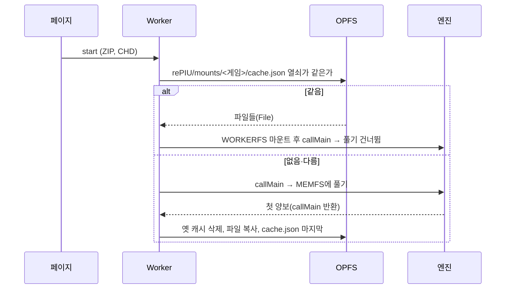
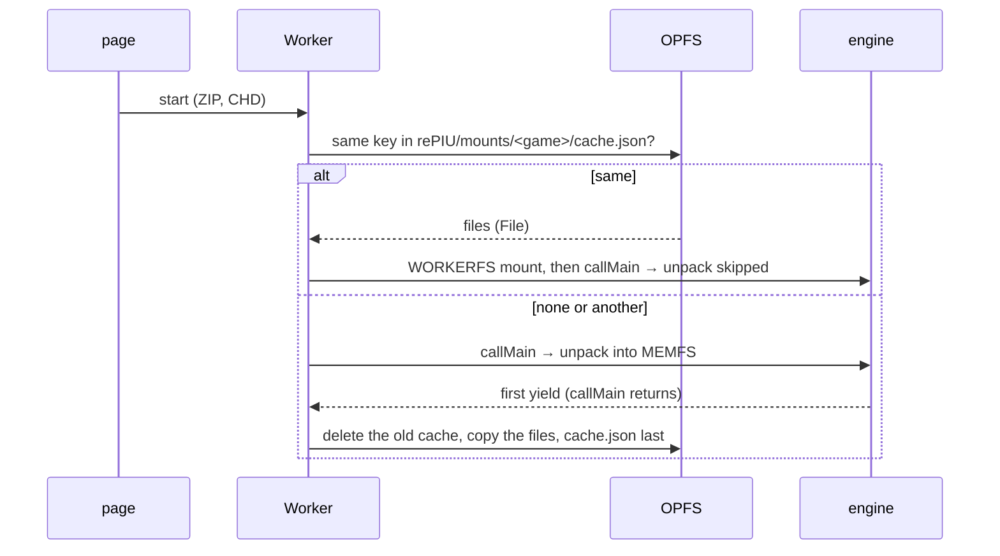

# 설계: 브라우저 저장소(OPFS)에 푼 게임 파일을 남겨 CHD를 한 번만 풀기 (issue #86)

관련: [설계 #72 — 브라우저 페이지](20261016-i072-browser-page.md)(결정 2: 우선 메모리, 영구 저장은 단위 3)

## 배경

브라우저 페이지는 시작할 때마다 로더가 CHD에서 게임 파일을 MEMFS에 다시 풉니다(pumpitea 736개, 428,909,991 B, 약 55초).
확인한 사실(2026-10-17, main `978e267`):

| 사실 | 영향 |
|---|---|
| 게임은 푼 폴더(`build/runtime_mounts/<게임>`)에 쓰지 않음. 네이티브 캐시는 9월 20일에 푼 뒤 수많은 실행에도 표시 파일보다 새 파일이 없음 | 캐시를 읽기 전용으로 마운트해도 됨 |
| 엔진(`PreparePiuChdMount`)은 `.chd-identity` 첫 줄이 CHD의 정체와 같고 `PIU/PIU.EXE`가 있을 때만 재사용. 아니면 폴더를 지우고 다시 풂 | 맞지 않는 캐시를 읽기 전용으로 마운트하면 엔진이 지우지 못해 실패 → 페이지가 같은 CHD일 때만 마운트해야 함 |
| WORKERFS는 `File`을 `FileReaderSync`로 필요한 범위만 읽음. OPFS의 `getFile()`도 `File` | OPFS 파일을 그대로 WORKERFS로 마운트 가능, 메모리에 올리지 않음 |
| Asyncify 빌드에서 `callMain`은 엔진의 첫 양보에서 돌아옴. 그때는 풀기가 끝나 있음 | 복사를 시작할 때를 Worker가 앎 |

## 결정

1. **엔진은 바꾸지 않는다.** 캐시는 페이지와 Worker의 일입니다. 엔진은 지금처럼 표시 파일로 재사용을 판단합니다.
2. **저장 위치와 열쇠:** OPFS의 `rePIU/mounts/<게임>/` 아래에 푼 파일을 같은 경로로, `cache.json`에 열쇠(CHD 파일 이름, 크기, 수정
   시각)와 파일 수·바이트를 둡니다. `cache.json`은 복사가 다 끝난 뒤 마지막에 씁니다. 그래서 `cache.json`이 있으면 캐시는 완전합니다.
3. **첫 실행(캐시 없음 또는 열쇠가 다름):** 지금처럼 MEMFS에 풉니다. `callMain`이 돌아오면(첫 양보) Worker가 옛 캐시를 지우고
   `/build/runtime_mounts/<게임>`의 파일을 하나씩 OPFS에 복사합니다(동기 접근 핸들, 파일마다 한 번 이벤트 고리에 차례를 넘겨 게임이
   계속 돎). 진행은 페이지 상태 줄에.
4. **다음 실행(열쇠가 같은 완전한 캐시):** 엔진을 시작하기 전에 OPFS 파일을 모아 WORKERFS로 `/build/runtime_mounts/<게임>`에 마운트합니다.
   엔진은 표시 파일을 보고 풀기를 건너뜁니다.
5. **페이지:** 롬을 고르면 그 게임의 캐시 상태(있음과 크기, 또는 없음)를 보여 주고, "Clear cache" 버튼으로 지웁니다. Start에서
   `navigator.storage.persist()`를 요청해 브라우저가 저장소를 임의로 비우지 않게 합니다(거절되어도 동작은 같음).

## 바꾸지 않는 것

엔진, HLE, 네이티브의 캐시(`build/runtime_mounts`), 게임이 쓰는 `nvram`·`cfg`(여전히 메모리, 별도 작업).

## 검증

1. 브라우저(headless Chrome, 같은 프로필로 두 번 실행): 첫 실행에 복사 완료 상태, 두 번째 실행 로그에 `mount cache reused: true`와
   풀기 없이 시작, 화면이 나옴.
2. 열쇠가 다를 때(다른 CHD) 캐시를 쓰지 않음. "Clear cache" 뒤 다시 풂.
3. 엔진을 바꾸지 않으므로 네이티브 회귀는 웹 빌드와 core probe로 충분.

## 확인 필요 (구현 중)

| 항목 | 왜 |
|---|---|
| OPFS 동기 접근 핸들로 428 MB를 쓰는 시간 | 게임이 도는 동안 얼마나 끊기는지 |
| 저장소 할당량(`navigator.storage.estimate()`) | 모자라면 복사를 하지 않고 이유를 보여 줌 |

---

# Design: keep the unpacked game files in the browser's storage (OPFS) so the CHD is unpacked once (issue #86)

Related: [design #72 — the browser page](20261016-i072-browser-page.md) (decision 2: memory first, persistence in unit 3)

## Background

On every start of the browser page the loader unpacks the game files from the CHD into MEMFS again (pumpitea: 736 files,
428,909,991 B, about 55 s). Facts found (2026-10-17, main `978e267`):

| Fact | Consequence |
|---|---|
| The game does not write into the unpacked folder (`build/runtime_mounts/<game>`): the native cache, unpacked on 20 September, has no file newer than its mark after many runs | the cache can be mounted read-only |
| The engine (`PreparePiuChdMount`) reuses the folder only when the first line of `.chd-identity` is the CHD's identity and `PIU/PIU.EXE` exists; otherwise it deletes the folder and unpacks again | a mismatching cache mounted read-only would fail the engine's delete → the page must mount only for the same CHD |
| WORKERFS reads a `File` on demand through `FileReaderSync`, and OPFS's `getFile()` is a `File` | OPFS files can be mounted as they are with WORKERFS, without loading them into memory |
| In the Asyncify build `callMain` returns at the engine's first yield, by which time the unpack is done | the Worker knows when to start copying |

## Decisions

1. **The engine does not change.** The cache is the page's and the Worker's business; the engine judges reuse by its mark
   file as today.
2. **Location and key:** under OPFS `rePIU/mounts/<game>/`, the unpacked files at the same paths, plus `cache.json` with the
   key (the CHD's file name, size and modification time) and the file count and bytes. `cache.json` is written last, after
   every file, so its presence means the cache is complete.
3. **First run (no cache, or another key):** unpack into MEMFS as today. When `callMain` returns (the first yield) the Worker
   deletes the old cache and copies the files under `/build/runtime_mounts/<game>` to OPFS one by one (synchronous access
   handles, yielding to the event loop after each file so the game keeps running), with progress on the page's status
   line.
4. **Later runs (a complete cache with the same key):** before the engine starts, the OPFS files are gathered and mounted
   with WORKERFS at `/build/runtime_mounts/<game>`; the engine sees its mark and skips the unpack.
5. **Page:** once ROMs are picked, it shows that game's cache state (present and its size, or absent) and a "Clear cache"
   button. On Start it asks `navigator.storage.persist()`, so the browser does not empty the storage on its own (it works
   the same if refused).

## What does not change

The engine, the HLE, the native cache (`build/runtime_mounts`), and the `nvram` and `cfg` the game writes (still in memory,
a separate piece of work).

## Verification

1. Browser (headless Chrome, two runs on the same profile): the first run shows the copy completed; the second run's log
   says `mount cache reused: true`, starts without unpacking, and draws.
2. Another key (another CHD) does not use the cache; after "Clear cache" the unpack happens again.
3. The engine does not change, so the web build and core probe suffice for regressions.

## To be confirmed (during implementation)

| Item | Why |
|---|---|
| The time to write 428 MB through OPFS synchronous access handles | how much the game stutters meanwhile |
| The storage quota (`navigator.storage.estimate()`) | when short, no copy is made and the page says why |
