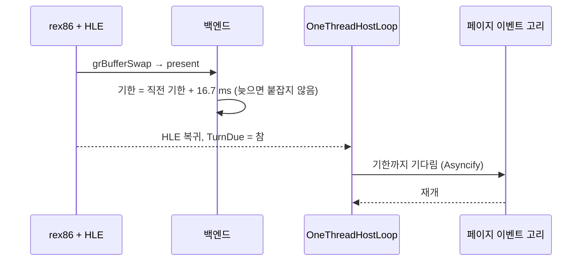
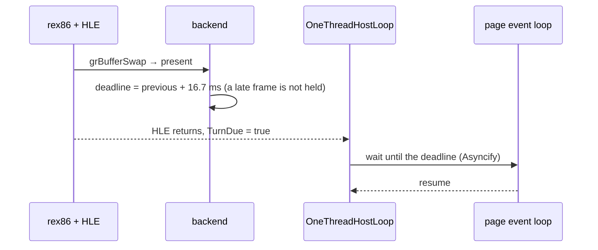

# 설계: 브라우저 빌드의 프레임을 60fps로 묶기 (issue #87)

관련: [설계 #72 — 브라우저 페이지](20261016-i072-browser-page.md)(결정 5·6), Task 745·752(엔진의 스왑 페이서)

## 배경

* 네이티브: 화면 교체는 vsync로 60fps에 묶입니다. 드라이버가 스왑 간격을 거절하면 엔진의 페이서(`PaceSwapAfterPresent`)가 화면
  주사율에 맞춰 잡니다(Task 745). 늦은 프레임은 붙잡지 않고, 한 주기 넘게 늦으면 일정을 지금부터 다시 잡습니다(Task 752).
* 브라우저: 창 구현은 스왑 간격을 "적용됨"으로 답해 페이서가 꺼지고(Worker에서 바쁜 대기를 피하려고), 실제로 기다리는 곳이
  없습니다. #79 이후 가벼운 장면에서 60fps를 넘으며, 게임에는 60fps vsync에 맞춰 도는 부분이 있습니다(사용자).
* 화면 교체(`grBufferSwap`)는 rex86 실행 중 HLE에서 일어나 그 자리에서는 Asyncify로 양보할 수 없습니다. 그러나 HLE가 돌아온 직후
  단일 스레드 루프가 호스트 차례 여부를 묻습니다(#64·#72).

## 결정

1. **기한은 네이티브 페이서와 같은 규칙으로 계산한다.** 브라우저 창 구현은 "기다림을 호스트 루프에 맡김"이라고 답하고
   (`GlideHostWindow::DefersSwapWait()`), 백엔드는 페이서를 60 Hz(16,667 us)로 켭니다. `PaceSwapAfterPresent`는 이때 잠들지 않고
   다음 기한만 기록합니다(`frame_hold_until`).
2. **기다림은 호스트 차례에서 페이지 이벤트 고리로.** 기록된 기한이 있으면 `OneThreadHostLoop::TurnDue`가 곧바로 차례를 주고,
   `TakeTurn`이 남은 시간만큼 플랫폼의 `WaitInHostEventLoop(us)`로 기다립니다(웹: Asyncify로 `setTimeout`, 그동안 페이지는 화면
   커밋·입력·소리를 처리). 그 기다림이 그 프레임의 페이지 양보를 겸합니다.
3. **네이티브는 바뀌지 않는다.** SDL 창은 기다림을 맡기지 않으므로 지금처럼 vsync나 제자리 페이서. Win32·Linux의 `WaitInHostEventLoop`는
   아무것도 하지 않습니다.

## 검증

* 브라우저(headless Chrome): 프레임 로그(`REPIU_GLIDE_FRAME_RATE_LOG`, worker.js에서 켤 수 있게)로 초당 화면 교체가 60을 넘지 않음.
* Win32 Release·Debug·`emulated`, Linux, Node: 빌드, core probe(네이티브 페이서 경로가 그대로인지).

---

# Design: hold the browser build's frames to 60 fps (issue #87)

Related: [design #72 — the browser page](20261016-i072-browser-page.md) (decisions 5 and 6), Tasks 745 and 752 (the
engine's swap pacer)

## Background

* Natively the swaps are held to 60 fps by vsync. When the driver refuses the swap interval, the engine's pacer
  (`PaceSwapAfterPresent`) sleeps to the display's refresh rate (Task 745); a late frame is not held, and a frame more than a
  period late starts the schedule again from now (Task 752).
* In the browser the window implementation answers the swap interval as "applied", which turns the pacer off (to avoid a
  busy wait in a Worker), and nothing waits. Since #79 light scenes exceed 60 fps, and parts of the game run in step with a
  60 fps vsync (the user).
* The swap (`grBufferSwap`) happens in the HLE while rex86 runs, where an Asyncify yield is not possible; right after the HLE
  returns, though, the single-threaded loop asks whether a host turn is due (#64, #72).

## Decisions

1. **The deadline follows the native pacer's rules.** The browser window implementation says it leaves the wait to the host
   loop (`GlideHostWindow::DefersSwapWait()`), and the backend turns the pacer on at 60 Hz (16,667 us). `PaceSwapAfterPresent`
   then does not sleep; it records the next deadline (`frame_hold_until`).
2. **The wait happens at the host turn, in the page's event loop.** With a deadline recorded, `OneThreadHostLoop::TurnDue`
   gives a turn at once, and `TakeTurn` waits for what remains through the platform's `WaitInHostEventLoop(us)` (the web: a
   `setTimeout` through Asyncify, while the page commits the picture and handles input and sound). That wait doubles as the
   frame's yield to the page.
3. **Native builds do not change.** An SDL window does not defer the wait, so vsync or the in-place pacer apply as today;
   `WaitInHostEventLoop` does nothing on Win32 and Linux.

## Verification

* Browser (headless Chrome): with the frame log (`REPIU_GLIDE_FRAME_RATE_LOG`, made settable from worker.js) the swaps never
  exceed 60 a second.
* Win32 Release, Debug and `emulated`, Linux, Node: build, core probe (the native pacer path unchanged).
