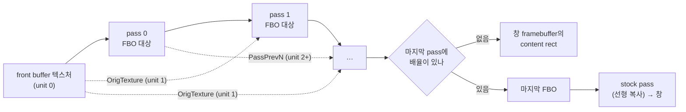

# 설계: 다단계 화면 shader(`.glslp`)와 내장 업스케일러 `fsr`·`scalefx`·`anime4k` (issue #90)

관련: [Task 768 설계](20261004-768-post-process-shaders.md) (단일 pass 후처리),
[kb: libretro GLSL 형식](../kb/libretro-glsl-post-shaders.md) ·
re2DJ의 같은 작업: [re2DJ #26 설계](https://github.com/reexec/re2DJ/blob/main/docs/design/20261025-i026-fsr-screen-shader.md),
[re2DJ #27 설계](https://github.com/reexec/re2DJ/blob/main/docs/design/20261025-i027-multipass-screen-shaders.md)

## 한국어

### 1. 배경

Task 768의 후처리는 한 파일, 한 pass를 창에 바로 그립니다. re2DJ는 #26·#27에서 libretro preset(`.glslp`)의
부분집합을 받아 pass를 잇고, 그 위에 업스케일러 셋을 내장했습니다: `fsr`(AMD FSR 1의 EASU+RCAS), `scalefx`(ScaleFX),
`anime4k`(Anime4K v3.2 Upscale CNN x2 (S)). FSR의 둘째 단계(RCAS)는 EASU의 출력을 다시 읽어야 하고, ScaleFX는 다섯
pass가 경계 정보를 주고받으며, Anime4K는 작은 신경망의 층마다 pass 하나와 부동소수점 중간 결과가 필요하므로 셋 다
다단계 없이는 들어오지 못합니다. 이 작업은 re2DJ의 구조와 shader 파일을 rePIU로 **같게** 옮깁니다(처음에는
`anime4k`만이었고, 사용자 요청으로 `fsr`·`scalefx`를 같은 작업에 넣었습니다).

### 2. 요구사항

1. 내장 `fsr`·`scalefx`·`anime4k`를 런처·`--post-shader`·`REPIU_POST_SHADER`·OSD에서 고를 수 있다.
2. `shaders/`의 `.glslp` 파일도 같은 길로 돌며, 그 안의 상대 경로 shader 파일을 preset 옆에서 읽는다.
3. 단일 pass shader(`crt`, `scanline`, 사용자 `.glsl`)와 `none`의 동작은 바뀌지 않는다.
4. 네이티브(GL 3.3 core)와 브라우저(WebGL2 = ES 3.0)가 같은 코드다.

### 3. 구조

* **`post_shader_preset.{h,cpp}`** (엔진, GL 없음): `PostShaderPass`(경로·텍스트·배율 방식·배율·필터·float·
  `to_window`), `ParsePostShaderPreset`(`shaders`, `shaderN`, `scale_typeN`/`_x`/`_y`, `scaleN`/`_x`/`_y`,
  `filter_linearN`, `float_framebufferN`; 파일은 호출자가 넘긴 reader로 읽음), `SinglePassPreset`,
  `PostShaderPassSize`. libretro와 같은 규칙: 접미사 없는 키가 `_x`/`_y`보다 우선, 배율 방식 없는 `scaleN`은
  무시, 따옴표 밖의 `#`은 주석, UTF-8 BOM은 건너뜀. 배율이 없는 마지막 pass는 창에 바로 그립니다(`to_window`).
* **카탈로그**: 내장이 파일 하나가 아니라 **포함된 파일 묶음**(`kPostShaderBuiltinFiles`: 이름과 텍스트)과
  시작 파일(`crt.glsl`, `fsr/fsr.glslp`, …)이 됩니다. CMake가 `REPIU_POST_SHADER_BUILTIN_NAMES`의 파일 열다섯을
  읽어 12000바이트 조각의 raw 문자열로 생성 헤더에 넣습니다(MSVC의 리터럴 한도 아래). `LoadPostShaderText`는
  `LoadPostShaderPreset`으로 바뀌어, preset의 상대 경로를 내장 묶음(preset의 디렉터리 기준으로 `..`·`.` 접기)이나
  preset 옆 파일에서 읽습니다. 디렉터리 목록에 `.glslp`도 들어갑니다. id 규칙은 그대로입니다(내장은 이름만,
  파일은 확장자 포함). 내장 순서는 `crt`, `scanline`, `fsr`, `scalefx`, `anime4k`입니다.
* **`GlidePostProcess`**: pass마다 프로그램·uniform 위치·FBO 대상(`RGBA8` 또는 `RGBA16F`, 크기가 바뀌면 다시
  만듦). `Apply`가 체인 전부를 그립니다: 마지막 전의 pass는 각자의 대상에, 마지막 pass는 창 framebuffer의
  content rect에. 마지막 pass에 배율이 있으면 내장 stock pass(선형 복사)가 창에 그립니다. 텍스처 unit: 0
  `Texture`, 1 `OrigTexture`, 2부터 `PassPrevN`. `OrigTexture`의 필터는 첫 pass의 것입니다(같은 텍스처
  객체이므로). 매개변수는 체인이 이름으로 공유합니다(먼저 선언한 pass의 범위). 모든 pass 텍스트는 Task 768과 같이
  `AdaptLegacyGlslStage`로 문맥의 방언(3.30 core / ES 3.00)으로 옮깁니다. **`Apply`는 bool을 돌려줍니다**:
  pass 대상을 만들 수 없으면(예: 부동소수점 대상을 지원하지 않는 WebGL2) 아무것도 그리지 않고 shader를 내리고
  `last_error`를 두고 거짓을 돌려주며, `GlideFramebufferPair::Present`는 그때 Task 768 이전의 평범한 그리기로
  그 프레임을 냅니다. 화면이 검게 되는 실패를 만들지 않습니다.
* **`AdaptLegacyGlslStage`의 보강**: libretro `glsl-shaders`의 `#version 130` 스타일(`COMPAT_*` 매크로가
  `__VERSION__ >= 130`에서 `in`/`out`/`texture`와 자기 `out vec4 FragColor`를 고름)은 머리말이 3.30/3.00을 주면
  그 가지를 타므로, 본문이 `vec4` 출력을 스스로 선언하면 변환기가 `repiuFragColor` 출력을 더하지 않습니다. ES는
  layout 위치 없는 출력 둘을 거부하기 때문입니다. 1.20 스타일(내장 `crt`·`scanline`·`fsr`·`anime4k`)은 전과
  같습니다.
* **내장 preset** (re2DJ의 파일 그대로, 머리말의 프로젝트 이름만 바꿈)
  * `fsr/`: `easu.glsl`(`scale_type viewport 1.0`, nearest) → `rcas.glsl`(창에, `FSR_SHARPNESS` 스톱). 둘 다
    `ffx_fsr1.h`의 알고리즘을 GLSL 1.20 pass로 옮긴 것. 2 pass, 매개변수 1.
  * `scalefx/`: libretro glsl-shaders의 다섯 pass 파일 **그대로**(MIT, `#version 130`), preset은 같은 값으로
    다시 씀. 네 pass는 1배(앞 둘은 float), 마지막은 3배 → stock pass. pass 2는 `PassPrev2Texture`, pass 4는
    `PassPrev5Texture`(게임 그림)를 읽음. 5 pass, 매개변수 3(`SFX_CLR`, `SFX_SAA`, `SFX_SCN`).
  * `anime4k/`: bloc97의 `Anime4K_Upscale_CNN_x2_S.glsl`(mpv 훅 다섯 개)을 변환한 것. 네 합성곱 층은 1배
    float(`conv0`~`conv3`, `TEX_OFF`로 이웃 표본, 두 번째 층부터 ReLU 쌍 `go_0`/`go_1`), 마지막
    `depth-to-space`는 2배로 `OrigTexture`(선형)에 luma 세부를 더함. mpv의 y는 아래로, 우리 텍스처의 y는 위로
    커서 오프셋의 y와 사분면 선택이 뒤집혀 있음. 가중치는 원본 그대로. 5 pass, 매개변수 없음.
* **단일 pass 경로**: 한 pass이고 창에 그리는 shader는 Task 768과 같이 unit 0만 쓰고, `OrigTexture`와
  `PassPrev1Texture`를 선언하면 둘 다 unit 0을 가리킵니다(비어 있는 unit을 읽지 않음). preset이
  `filter_linear0`을 말하면 그 필터를, 아니면 전처럼 선형입니다.

| 이름(pass i) | 뜻 |
|---|---|
| `Texture`, `InputSize`, `TextureSize` | 앞 pass의 출력(pass 0은 게임 그림)과 그 픽셀 크기 |
| `OutputSize` | 이 pass가 그리는 크기 |
| `OrigTexture`, `OrigTextureSize`, `OrigInputSize` | 게임 그림과 그 크기 |
| `PassPrevNTexture`, `PassPrevNTextureSize`, `PassPrevNInputSize` | N개 앞 pass의 출력(N = 1은 입력, N = i + 1은 게임 그림) |

**`InputSize`/`TextureSize`의 뜻**: Task 768은 단일 pass에 게임의 논리 해상도(640×480)를 주었고, 그대로입니다.
다단계에서는 pass 0의 입력 크기도 논리 해상도이고, 그 뒤 pass의 크기는 `PostShaderPassSize`가 그 입력 크기에서
구합니다. 그래서 `anime4k`의 합성곱과 `scalefx`의 경계 분석은 창 배율과 무관하게 640×480 격자에서 돌고
(`source 1.0`), 마지막 pass는 1280×960(anime4k)·1920×1440(scalefx)을 만들어 stock pass가 창에 맞춥니다. `fsr`의
EASU는 `viewport 1.0`이라 content rect 크기로 그립니다. front buffer 텍스처의 실제 픽셀 크기는 content rect지만,
pass 0이 `TextureSize`로 보는 값은 논리 해상도이므로 한 "픽셀" 오프셋은 논리 픽셀 하나입니다. 게임이 창 배율대로
그린 그림을 논리 격자로 표본하는 것으로, re2DJ(게임이 논리 해상도로 그림)와 결과가 같습니다. 단, ScaleFX의
`textureOffset`(정수 texel 오프셋)은 실제 텍스처의 texel을 세므로, pass 0만 창 배율이 1이 아닐 때 이웃을 논리 픽셀이
아니라 실제 픽셀 단위로 봅니다. pass 0은 그 다음 pass들(1배 FBO, 실제 크기 = 논리 크기)에 넘길 metric을 만드는
단계라 결과 화질에 미치는 영향은 작고, 이는 확인 항목으로 둡니다(작업 로그).

### 4. 하지 않는 것

* `srgb_framebuffer`, `wrap_mode`, `mipmap_input`, `alias`, LUT 텍스처, `PrevTexture`(이전 프레임), slang,
  mpv 훅 형식 직접 읽기.
* Anime4K의 큰 모델(M·L·VL·UL)과 Restore·Deblur 체인.
* OSD 매개변수 저장.

### 5. 위험

| 위험 | 완화 |
|---|---|
| WebGL2에서 `RGBA16F` 색 첨부는 `EXT_color_buffer_float`이 있어야 함 | 페이지가 확장을 기본으로 켬(`enableExtensionsByDefault`). 없으면 FBO가 불완전해 `Apply`가 거짓을 돌려주고 평범한 그리기로 내려가며 OSD·로그에 이유가 남음 |
| ES는 GLSL 1.30이 허용하는 정수→실수 암시 변환 등을 거부 | 그런 shader는 브라우저에서 컴파일 오류로 거부되고(`none`으로 실행, 이유가 OSD에) 네이티브에서만 돎. 내장 셋이 ES에서 컴파일되는지는 확인 항목 |
| 체인이 매 프레임 FBO 여러 개 + 창에 그림 | 선택할 때만. re2DJ 측정(4K 전체 화면 vsync off): `none` 799, `fsr` 688, `scalefx` 538, `anime4k` 565fps |
| 생성 헤더가 커짐(약 70 KB 더) | 12000바이트 조각으로 나눠 MSVC 한도 아래 |

### 6. 검증

1. `repiu_aot_probe --post-shader`: preset 파서(키·배율 방식·오류·libretro 규칙·단일 pass·크기), 내장 다섯의
   순서, 각 preset의 pass 수(1·1·2·5·5)와 마지막 pass의 `to_window`, 모든 pass가 조립됨, 매개변수 유무, 각 파일의
   고지, `anime4k`의 pass 모양, 임시 디렉터리의 `.glslp` 목록과 상대 경로 읽기·깨진 preset.
2. `repiu_glide_render_probe --opengl-post-shader`(Win32, 실제 GL): `fsr`·`scalefx`·`anime4k`를 골라 각 pass가
   컴파일되고(2·5·5, 매개변수 1·3·0), 흰 그림이 밝게 나오며, 기존 `scanline`·`crt`·`none`·letterbox·상태 복원
   검사가 그대로 통과.
3. 빌드: Win32 Debug·Release, WSL Linux x64, 웹(가능하면; 브라우저에서 셋의 컴파일 확인).
4. 실제 실행: `repiu pumpitea --post-shader <id>`로 로그에 `[repiu-post] shader: fsr (2 passes, 1 parameters)` 등과
   OSD에서 전환.

---

# Design: multi-pass screen shaders (`.glslp`) and the built-in upscalers `fsr`, `scalefx` and `anime4k` (issue #90)

Related: [Task 768 design](20261004-768-post-process-shaders.md) (single-pass post-processing),
[kb: the libretro GLSL format](../kb/libretro-glsl-post-shaders.md); the same work in re2DJ:
[re2DJ #26 design](https://github.com/reexec/re2DJ/blob/main/docs/design/20261025-i026-fsr-screen-shader.md),
[re2DJ #27 design](https://github.com/reexec/re2DJ/blob/main/docs/design/20261025-i027-multipass-screen-shaders.md)

## English

### 1. Background

Task 768's post-processing draws one file, one pass, straight into the window. re2DJ's #26 and #27 accept a subset
of libretro presets (`.glslp`) to chain passes and, on top of that, built in three upscalers: `fsr` (AMD FSR 1's
EASU and RCAS), `scalefx` (ScaleFX) and `anime4k` (Anime4K v3.2 Upscale CNN x2 (S)). FSR's second step (RCAS) must
read EASU's output again, ScaleFX's five passes hand edge data to one another, and Anime4K needs a pass per layer of
its small network with floating-point results between them, so none of the three comes in without multi-pass. This
task carries re2DJ's structure and shader files to rePIU **unchanged in behaviour** (it began with `anime4k` alone;
at the user's request `fsr` and `scalefx` joined the same task).

### 2. Requirements

1. The built-in `fsr`, `scalefx` and `anime4k` can be chosen in the launcher, with `--post-shader`,
   `REPIU_POST_SHADER` and the OSD.
2. A `.glslp` in `shaders/` runs the same way, its relative shader paths read beside the preset.
3. Single-pass shaders (`crt`, `scanline`, user `.glsl`) and `none` behave as before.
4. Native (GL 3.3 core) and the browser (WebGL2 = ES 3.0) share the code.

### 3. Structure

The flowchart above: the front buffer's texture (unit 0) goes through pass 0, 1, … each into a framebuffer target
of its own, every pass able to read the picture as `OrigTexture` (unit 1) and earlier outputs as `PassPrevN` (unit 2
onwards); an unscaled last pass is drawn into the window framebuffer's content rect, a scaled one ends in a framebuffer
that the stock pass copies to the window linearly.

* **`post_shader_preset.{h,cpp}`** (engine, no GL): `PostShaderPass` (path, text, scale types, scales, filter,
  float, `to_window`), `ParsePostShaderPreset` (`shaders`, `shaderN`, `scale_typeN`/`_x`/`_y`, `scaleN`/`_x`/`_y`,
  `filter_linearN`, `float_framebufferN`; files come through a reader the caller passes), `SinglePassPreset`,
  `PostShaderPassSize`. libretro's rules: the unsuffixed key wins over `_x`/`_y`, a `scaleN` without a scale type is
  ignored, `#` outside quotes starts a comment, a UTF-8 BOM is skipped. An unscaled last pass draws into the window
  (`to_window`).
* **The catalog**: a built-in is a **set of embedded files** (`kPostShaderBuiltinFiles`: name and text) and a main
  file (`crt.glsl`, `fsr/fsr.glslp`, …). CMake reads the fifteen files in `REPIU_POST_SHADER_BUILTIN_NAMES` into raw
  string pieces of 12000 bytes in the generated header (under MSVC's literal limit). `LoadPostShaderText` becomes
  `LoadPostShaderPreset`, resolving a preset's relative paths in the embedded set (folding `..` and `.` against the
  preset's directory) or beside the preset. Directory listings include `.glslp`. The id rule stays (a bare name for
  a built-in, the file name with its extension for a file). The built-in order is `crt`, `scanline`, `fsr`,
  `scalefx`, `anime4k`.
* **`GlidePostProcess`**: per pass a program, uniform locations and a framebuffer target (`RGBA8` or `RGBA16F`,
  remade when the size changes). `Apply` draws the whole chain: every pass but the last into its own target, the last
  into the window framebuffer's content rect; a scaled last pass gets the built-in stock pass (a linear copy) for
  that. Texture units: 0 `Texture`, 1 `OrigTexture`, 2 onwards `PassPrevN`; `OrigTexture` takes the first pass's
  filter (it is the same texture object). Parameters are shared by name across the chain (the first pass to declare
  one gives the range). Every pass text goes through `AdaptLegacyGlslStage` to the context's dialect (3.30 core / ES
  3.00) as in Task 768. **`Apply` returns bool**: when a pass target cannot be made (a WebGL2 without floating-point
  targets, say) it draws nothing, drops the shader, sets `last_error` and returns false, and
  `GlideFramebufferPair::Present` then draws that frame the plain way of before Task 768. No failure turns the
  screen black.
* **`AdaptLegacyGlslStage` extended**: libretro `glsl-shaders`' `#version 130` style (the `COMPAT_*` macros choosing
  `in`/`out`/`texture` and their own `out vec4 FragColor` under `__VERSION__ >= 130`) takes that branch once the
  header says 3.30/3.00, so when the body declares a `vec4` output itself the adapter adds no `repiuFragColor`
  output, as ES refuses two outputs without layout locations. The 1.20 style (the built-in `crt`, `scanline`, `fsr`
  and `anime4k`) is handled as before.
* **The built-in presets** (re2DJ's files, only the project name in the headers changed)
  * `fsr/`: `easu.glsl` (`scale_type viewport 1.0`, nearest) → `rcas.glsl` (into the window, `FSR_SHARPNESS` in
    stops), both the algorithms of `ffx_fsr1.h` ported into GLSL 1.20 passes. 2 passes, 1 parameter.
  * `scalefx/`: libretro glsl-shaders' five pass files **unchanged** (MIT, `#version 130`), the preset written anew
    to the same values: four passes at 1x (the first two float), the last at 3x and so the stock pass; pass 2 reads
    `PassPrev2Texture` and pass 4 `PassPrev5Texture` (the picture). 5 passes, 3 parameters (`SFX_CLR`, `SFX_SAA`,
    `SFX_SCN`).
  * `anime4k/`: bloc97's `Anime4K_Upscale_CNN_x2_S.glsl` (five mpv hooks) converted: four convolution layers at 1x
    in float (`conv0` to `conv3`, neighbours sampled through `TEX_OFF`, the ReLU pair `go_0`/`go_1` from the second
    layer on), and `depth-to-space` at 2x adding luma detail to `OrigTexture` (linear). mpv's y runs down and our
    textures' up, so the offsets' y and the quadrant choice are turned over; the weights are the original's. 5
    passes, no parameters.
* **The single-pass path**: a one-pass shader into the window uses unit 0 only as in Task 768, and `OrigTexture`
  and `PassPrev1Texture`, when declared, both point at unit 0 (no unit nothing is bound on is read). A preset's
  `filter_linear0` sets the filter; otherwise linear as before.

The uniform table above: `Texture` with `InputSize`/`TextureSize` (the previous pass's output, the picture for pass
0, and its pixel size), `OutputSize` (the size this pass draws), `OrigTexture` with `OrigTextureSize`/`OrigInputSize`
(the picture and its size), `PassPrevNTexture` with `PassPrevNTextureSize`/`PassPrevNInputSize` (the output N
passes back; N = 1 the input, N = i + 1 the picture).

**What `InputSize`/`TextureSize` mean**: Task 768 gave the single pass the game's logical resolution (640×480), and
that stays. In a chain pass 0's input size is the logical resolution too, and later passes take their size from
`PostShaderPassSize` applied to that. So `anime4k`'s convolutions and `scalefx`'s edge analysis run on the 640×480
grid whatever the window scale (`source 1.0`), and the last pass makes 1280×960 (anime4k) or 1920×1440 (scalefx) for
the stock pass to fit to the window; `fsr`'s EASU is `viewport 1.0` and draws at the content rect's size. The front
buffer texture's real pixel size is the content rect, but pass 0 sees the logical resolution as `TextureSize`, so a
one-"pixel" offset is one logical pixel: the picture the game drew at the window's scale is sampled on the logical
grid, which gives the same result as re2DJ, where the game draws at the logical resolution. One exception: ScaleFX's
`textureOffset` (integer texel offsets) counts the real texture's texels, so pass 0 alone sees its neighbours in real
rather than logical pixels when the window scale is not 1. Pass 0 only prepares metrics for the passes after it (1x
targets, whose real size is the logical size), so the effect on the result is small; it is a check item (the work
log).

### 4. Out of scope

* `srgb_framebuffer`, `wrap_mode`, `mipmap_input`, `alias`, lookup textures, `PrevTexture` (the previous frame),
  slang, reading mpv hook files directly.
* Anime4K's larger models (M, L, VL, UL) and its Restore and Deblur chains.
* Saving OSD parameters.

### 5. Risks

| Risk | Mitigation |
|---|---|
| An `RGBA16F` colour attachment in WebGL2 needs `EXT_color_buffer_float` | The page enables extensions by default (`enableExtensionsByDefault`); without it the FBO is incomplete, `Apply` returns false, the plain draw takes over, and the reason reaches the OSD and the log |
| ES refuses what GLSL 1.30 allows, such as implicit int-to-float conversion | Such a shader is refused with a compile error in the browser (runs as `none`, the reason in the OSD) and runs natively only; whether the three built-ins compile under ES is a check item |
| The chain draws several FBOs and the window every frame | Only when chosen; re2DJ's measurement (fullscreen 4K, vsync off): `none` 799, `fsr` 688, `scalefx` 538, `anime4k` 565 fps |
| A larger generated header (about 70 KB more) | 12000-byte pieces, under MSVC's limit |

### 6. Verification

1. `repiu_aot_probe --post-shader`: the preset parser (keys, scale types, errors, libretro's rules, the single
   pass, sizes), the five built-ins in order, each preset's pass count (1, 1, 2, 5, 5) and its last pass's
   `to_window`, every pass assembling, parameters present or not, each file's notice, `anime4k`'s pass shape, and
   `.glslp` in a temporary directory's listing with relative-path reads and a broken preset.
2. `repiu_glide_render_probe --opengl-post-shader` (Win32, a real GL): `fsr`, `scalefx` and `anime4k` selected
   compile every pass (2, 5, 5; parameters 1, 3, 0) and turn a white picture out bright, with the existing
   `scanline`, `crt`, `none`, letterbox and state-restore checks still passing.
3. Builds: Win32 Debug and Release, WSL Linux x64, the web when possible (the three compiling in a browser).
4. A real run: `repiu pumpitea --post-shader <id>` logs `[repiu-post] shader: fsr (2 passes, 1 parameters)` and the
   like, and the OSD switches them.
