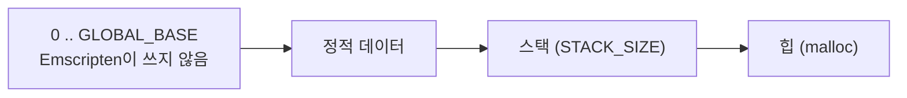
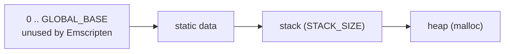

# Emscripten 선형 메모리 배치와 Node 실행

관련: [설계 #67](../design/20261015-i067-emscripten-headless.md),
[작업 로그 #67](../work-logs/20261015-i067-emscripten-headless.md)

## 선형 메모리는 하나의 32비트 주소 공간

wasm32 모듈의 메모리는 0부터 시작하는 바이트 배열 하나입니다. 포인터는 그 안의 오프셋이고 4바이트입니다. 페이지
보호가 없으므로 범위 안의 모든 주소는 읽고 쓸 수 있고, 범위 밖 접근은 복구할 수 없는 trap(`RuntimeError: memory
access out of bounds`)입니다([WebAssembly Core Specification, Memory Instructions](https://webassembly.github.io/spec/core/exec/instructions.html#memory-instructions)).

Emscripten은 이 공간에 정적 데이터, 스택, 힙을 놓습니다. 배치를 정하는 링크 설정은 다음과 같습니다
([Emscripten Compiler Settings](https://emscripten.org/docs/tools_reference/settings_reference.html)).

| 설정 | 기본값 | 뜻 |
|---|---|---|
| `GLOBAL_BASE` | 1024 | 정적 데이터가 시작하는 주소. 그 아래는 Emscripten이 쓰지 않음 |
| `STACK_SIZE` | 64 KB | C 스택 크기. 깊은 호출 사슬이나 큰 지역 변수에는 작음 |
| `INITIAL_MEMORY` | (자동) | 처음 메모리 크기 |
| `ALLOW_MEMORY_GROWTH` | 꺼짐 | 꺼져 있으면 힙이 모자랄 때 `Aborted(OOM)` |
| `MAXIMUM_MEMORY` | 2 GB | 증가의 상한 |

Emscripten 6.0.8은 `wasm-ld`에 `--no-stack-first`를 넘기므로 스택이 데이터 **뒤**에 옵니다(rePIU에서 확인함:
`GLOBAL_BASE=0x10000000`일 때 데이터 `0x10000260`, 스택 `0x1080095c`, 힙 `0x108013c0`). 링커가 정의하는
`__global_base`와 `__heap_base` 심볼의 주소로 실행 중에 배치를 읽을 수 있습니다.

rePIU는 `GLOBAL_BASE`를 `0x10000000`으로 올려 그 아래를 게스트 주소 공간으로 씁니다(identity 매핑).

## 함수 포인터는 테이블 색인

wasm 코드는 선형 메모리에 있지 않습니다. C/C++의 함수 포인터 값은 함수 테이블의 색인이라 작은 정수(1, 2, ...)입니다.
함수 "주소"를 메모리 주소처럼 다루는 코드(게이트 주소, 주소 범위 비교)는 이 점을 알아야 합니다.

## Node에서 실행할 때

| 설정 | 뜻 |
|---|---|
| `NODERAWFS=1` | Emscripten의 가상 파일시스템 대신 Node의 `fs`로 호스트 파일을 그대로 읽고 씀. Node 전용 |
| `NODE_HOST_ENV=1` | `getenv`가 Node의 `process.env`를 그대로 봄. 없으면 Emscripten의 기본 환경(`USER=web_user` 등)만 보임 |
| `EXIT_RUNTIME=1` | `main`이 끝나면 런타임을 내리고 종료 코드를 Node에 넘김 |
| `--pre-js` | 모듈 앞에 붙는 JavaScript. `Module.preRun`에서 `ENV`를 고칠 수 있음 |

스레드(pthreads)를 쓰지 않고 링크하면 `std::thread` 생성은 실행 중에 실패합니다. 브라우저에서 pthreads를 쓰려면
`SharedArrayBuffer`가 필요하고, 그것은 COOP/COEP 헤더가 있는 페이지에서만 쓸 수 있습니다
([MDN, SharedArrayBuffer security requirements](https://developer.mozilla.org/en-US/docs/Web/JavaScript/Reference/Global_Objects/SharedArrayBuffer#security_requirements)).

SDL3의 Emscripten 비디오 드라이버는 초기화할 때 브라우저의 `window`를 읽으므로 Node에서는 쓸 수 없습니다. Node에서는
`SDL_VIDEO_DRIVER=dummy`, `SDL_AUDIO_DRIVER=dummy`로 SDL의 dummy 드라이버를 씁니다
([SDL3 hints, SDL_HINT_VIDEO_DRIVER](https://wiki.libsdl.org/SDL3/SDL_HINT_VIDEO_DRIVER)).

---

# Emscripten's linear-memory layout and running under Node

Related: [design #67](../design/20261015-i067-emscripten-headless.md),
[work log #67](../work-logs/20261015-i067-emscripten-headless.md)

## Linear memory is one 32-bit address space

A wasm32 module's memory is a single byte array starting at 0. A pointer is an offset into it, 4 bytes wide. There is
no page protection: every address in range can be read and written, and an access out of range is an unrecoverable trap
(`RuntimeError: memory access out of bounds`)
([WebAssembly Core Specification, Memory Instructions](https://webassembly.github.io/spec/core/exec/instructions.html#memory-instructions)).

Emscripten places static data, the stack and the heap in that space. The link settings that set the layout
([Emscripten Compiler Settings](https://emscripten.org/docs/tools_reference/settings_reference.html)):

| Setting | Default | Meaning |
|---|---|---|
| `GLOBAL_BASE` | 1024 | where static data begins; Emscripten uses nothing below it |
| `STACK_SIZE` | 64 KB | the C stack's size; small for deep call chains or large locals |
| `INITIAL_MEMORY` | (automatic) | the initial memory size |
| `ALLOW_MEMORY_GROWTH` | off | when off, a heap that runs out ends in `Aborted(OOM)` |
| `MAXIMUM_MEMORY` | 2 GB | the cap on growth |

Emscripten 6.0.8 passes `--no-stack-first` to `wasm-ld`, so the stack comes **after** the data (confirmed in rePIU: with
`GLOBAL_BASE=0x10000000`, data at `0x10000260`, stack at `0x1080095c`, heap at `0x108013c0`). The addresses of the
linker-defined symbols `__global_base` and `__heap_base` give the layout at run time.

rePIU lifts `GLOBAL_BASE` to `0x10000000` and uses everything below it as the guest's address space (identity mapping).

## Function pointers are table indices

wasm code is not in linear memory. A C/C++ function pointer's value is an index into the function table, a small
integer (1, 2, ...). Code that treats a function's "address" as a memory address (a gate address, an address-range
comparison) has to know this.

## Running under Node

| Setting | Meaning |
|---|---|
| `NODERAWFS=1` | host files are read and written through Node's `fs` as they are, instead of Emscripten's virtual filesystem; Node only |
| `NODE_HOST_ENV=1` | `getenv` sees Node's `process.env` as it is; without it only Emscripten's default environment (`USER=web_user` and so on) |
| `EXIT_RUNTIME=1` | the runtime shuts down when `main` returns and hands the exit code to Node |
| `--pre-js` | JavaScript placed before the module; `Module.preRun` can change `ENV` |

Linked without threads (pthreads), creating a `std::thread` fails at run time. Using pthreads in a browser needs
`SharedArrayBuffer`, which is available only on a page served with the COOP/COEP headers
([MDN, SharedArrayBuffer security requirements](https://developer.mozilla.org/en-US/docs/Web/JavaScript/Reference/Global_Objects/SharedArrayBuffer#security_requirements)).

SDL3's Emscripten video driver reads the browser's `window` while initialising, so it cannot be used under Node. Under
Node SDL's dummy drivers are used through `SDL_VIDEO_DRIVER=dummy` and `SDL_AUDIO_DRIVER=dummy`
([SDL3 hints, SDL_HINT_VIDEO_DRIVER](https://wiki.libsdl.org/SDL3/SDL_HINT_VIDEO_DRIVER)).
