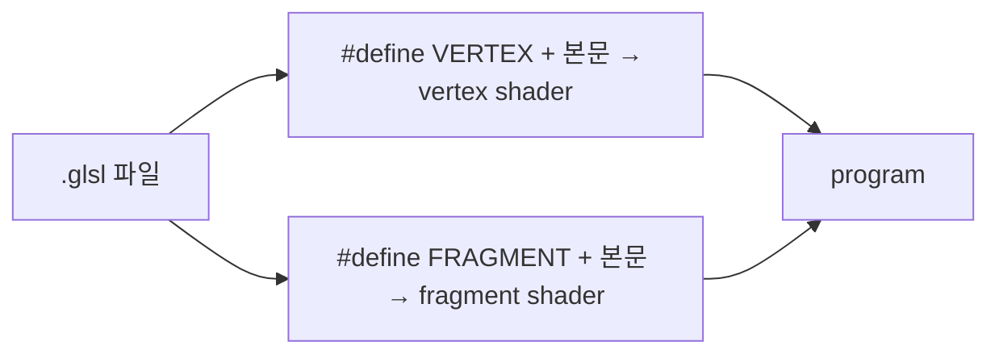

# libretro GLSL 후처리 shader 형식 / The libretro GLSL post-processing shader format

관련: [Task 768 설계](../design/20261004-768-post-process-shaders.md) ·
[후처리 shader 가이드](../guides/post-process-shaders.md)

## 한국어

### 1. 무엇인가

libretro(RetroArch)의 GL 드라이버가 쓰는 shader 형식으로, 에뮬레이터 화면 후처리 자료가
가장 많이 쌓인 형식입니다. 공식 설명은
[libretro docs: GLSL shaders](https://docs.libretro.com/development/shader/glsl-shaders/)에
있습니다. rePIU는 그중 **단일 pass `.glsl`** 부분집합과, issue #90부터 **다단계 preset `.glslp`**의
부분집합(7절)을 읽습니다.

### 2. 한 파일, 두 단계

한 파일이 vertex와 fragment를 모두 담고, 호스트가 같은 텍스트를 두 번 컴파일하면서 맨 앞에
`#define VERTEX` 또는 `#define FRAGMENT`를 넣습니다. GLSL은 `#version`이 첫 문장이어야 하므로
파일이 `#version`으로 시작하면 그 줄 뒤에 넣습니다.



### 3. 호스트가 주는 값

| 이름 | 의미 |
|---|---|
| `VertexCoord`, `TexCoord`, `COLOR` | 꼭짓점 위치, 텍스처 좌표, 색 attribute |
| `MVPMatrix` | 위치를 clip 공간으로 보내는 행렬 |
| `Texture` | 입력 이미지 sampler |
| `InputSize` | 입력 이미지 중 실제 내용의 크기 |
| `TextureSize` | 입력 텍스처의 크기 (2의 거듭제곱으로 키운 텍스처를 쓰는 드라이버에서 `InputSize`와 다를 수 있음) |
| `OutputSize` | 출력 viewport 크기 |
| `FrameCount`, `FrameDirection` | 프레임 번호, 되감기 방향 |

`InputSize`/`TextureSize`는 원래 **에뮬레이터 코어의 원래 해상도**입니다. 그래서 주사선 shader는
`TexCoord.y * TextureSize.y`의 소수부로 "원래 화면의 몇 번째 줄 안의 어디인가"를 구합니다.
rePIU는 게임이 창 배율대로 고해상도로 그리므로, 실제 텍스처 크기가 아니라 게임의 논리
해상도를 이 두 값으로 줍니다(설계 4절).

### 4. `#pragma parameter`

```glsl
#pragma parameter NAME "설명" 기본값 최소 최대 [단계]
#ifdef PARAMETER_UNIFORM
uniform float NAME;
#else
#define NAME 기본값
#endif
```

호스트가 `PARAMETER_UNIFORM`을 정의하면 매개변수는 uniform이 되어 UI에서 조절되고, 정의하지 않으면
상수가 됩니다. GLSL 컴파일러는 모르는 `#pragma`를 무시합니다.

### 5. 정수 배율에서의 주사선 함정

창 배율이 정수 n이면 원래 한 줄이 출력 n줄이 되고, 출력 픽셀 중심은 그 줄 안의
`(i + 0.5) / n` 위치에 놓입니다. **n = 2이면 두 중심(0.25, 0.75)이 줄 가운데(0.5)를 기준으로
대칭**이므로, 줄 가운데에 대칭인 밝기 곡선(사인, 가우시안)은 두 행에 같은 값을 주고 주사선이
보이지 않습니다. 해결은 곡선을 비대칭으로 두거나(줄의 뒤쪽 절반을 틈으로) 빔 중심을 출력 반
픽셀만큼 옮기는 것입니다. rePIU의 내장 `scanline`은 앞의 방법을, `crt`는 뒤의 방법을 씁니다
(Task 768 로그에서 실제 GL로 확인).

### 6. 다단계 preset(`.glslp`)

preset은 `key = value` 줄의 텍스트 파일로, `shaders`가 pass 수이고 pass i마다 `shaderi`(preset 기준 상대 경로),
`scale_typei`(`source`·`viewport`·`absolute`, `_x`/`_y`로 축마다), `scalei`(`_x`/`_y`), `filter_lineari`,
`float_framebufferi`를 둡니다. libretro의 규칙: 접미사 없는 키가 `_x`/`_y`보다 우선하고, 배율 방식 없는 `scalei`는
무시되며, 따옴표 밖의 `#`은 주석입니다. 배율이 없는 마지막 pass는 창에 바로 그립니다. 각 pass는 앞 pass의 출력을
`Texture`로, 원래 그림을 `OrigTexture`로, N개 앞 pass의 출력을 `PassPrevNTexture`로 읽고, 이름마다
`...TextureSize`·`...InputSize`가 있습니다. rePIU는 issue #90부터 이 부분집합을 읽습니다
([가이드](../guides/post-process-shaders.md)의 preset 절). 출처:
[libretro docs: GLSL shaders](https://docs.libretro.com/development/shader/glsl-shaders/),
[RetroArch `gfx/video_shader_parse.c`](https://github.com/libretro/RetroArch/blob/master/gfx/video_shader_parse.c).

### 7. rePIU가 지원하지 않는 것

`PrevTexture` 같은 이전 프레임 입력, LUT 텍스처, `srgb_framebuffer`·`wrap_mode`·`mipmap_input`·`alias`,
Slang(`.slang`, Vulkan 계열) 형식, mpv 훅 형식(Anime4K 원본; 내장 `anime4k`는 손으로 변환한 pass 파일).

libretro `glsl-shaders`의 많은 파일은 `#version 130`으로 시작해 `#if __VERSION__ >= 130`로 `in`/`out`/`texture`와
자기 `out vec4 FragColor`를 고르는 `COMPAT_*` 매크로 형식입니다(내장 `scalefx`). rePIU의 변환기는 `#version` 줄을
문맥의 머리말(3.30 core / 3.00 es)로 바꾸고, 본문이 `vec4` 출력을 스스로 선언하면 자기 출력을 더하지 않습니다(ES는
위치 없는 출력 둘을 거부). 그래서 GLSL 1.20 스타일과 1.30 스타일이 모두 읽힙니다. ES에서는 정수→실수 암시 변환 같은
1.30 허용 사항이 오류이므로, 그런 shader는 브라우저에서 컴파일 오류로 거부되고 네이티브에서만 돕니다.

## English

### 1. What it is

The shader format of libretro's (RetroArch's) GL driver, the format with the largest body of emulator
post-processing material. The official description is
[libretro docs: GLSL shaders](https://docs.libretro.com/development/shader/glsl-shaders/). rePIU reads
its **single-pass `.glsl`** subset and, since issue #90, a subset of its **multi-pass `.glslp`
presets** (section 6).

### 2. One file, two stages

One file holds both the vertex and fragment stages. The host compiles the same text twice, prefixing
`#define VERTEX` or `#define FRAGMENT`; because GLSL requires `#version` to come first, the define goes
after that line when the file starts with one.

### 3. What the host supplies

Attributes `VertexCoord`, `TexCoord`, `COLOR`; uniforms `MVPMatrix`, `Texture`, `InputSize` (the size of
the real content in the input), `TextureSize` (the input texture's size, which may differ from
`InputSize` on drivers that pad to powers of two), `OutputSize` (the output viewport),
`FrameCount` and `FrameDirection`. `InputSize`/`TextureSize` are meant to be **the emulated core's
native resolution**, which is why a scanline shader takes the fraction of `TexCoord.y * TextureSize.y`
as "where inside which original line". rePIU's game draws at a high resolution matching the window
scale, so it reports the game's logical resolution in both rather than the real texture size (design
section 4).

### 4. `#pragma parameter`

`#pragma parameter NAME "description" initial minimum maximum [step]`, paired with an
`#ifdef PARAMETER_UNIFORM` block that declares a uniform or falls back to a constant. A host that
defines `PARAMETER_UNIFORM` gets UI-adjustable uniforms; GLSL compilers ignore unknown pragmas.

### 5. The scanline trap at integer scales

At an integer scale n, one original line becomes n output rows whose pixel centres sit at
`(i + 0.5) / n` within the line. **At n = 2 the two centres (0.25 and 0.75) are symmetric about the
line's middle**, so any brightness profile symmetric about the middle (sine, Gaussian) gives both rows
the same value and no scanline shows. The fixes are an asymmetric profile (the back half of the line as
the gap) or shifting the beam centre by half an output pixel. rePIU's built-in `scanline` uses the
first and `crt` the second, confirmed in a real GL context in the Task 768 log.

### 6. Multi-pass presets (`.glslp`)

A preset is a text file of `key = value` lines: `shaders` is the pass count, and pass i has `shaderi`
(a path relative to the preset), `scale_typei` (`source`, `viewport`, `absolute`; `_x`/`_y` per axis),
`scalei` (`_x`/`_y`), `filter_lineari` and `float_framebufferi`. libretro's rules: the unsuffixed key
wins over `_x`/`_y`, a `scalei` without a scale type is ignored, and `#` outside quotes starts a
comment. An unscaled last pass draws straight into the window. Each pass reads the one before as
`Texture`, the original picture as `OrigTexture` and the output N passes back as `PassPrevNTexture`,
each with `...TextureSize` and `...InputSize`. rePIU reads this subset since issue #90 (the preset
section of the [guide](../guides/post-process-shaders.md)). Sources:
[libretro docs: GLSL shaders](https://docs.libretro.com/development/shader/glsl-shaders/),
[RetroArch `gfx/video_shader_parse.c`](https://github.com/libretro/RetroArch/blob/master/gfx/video_shader_parse.c).

### 7. What rePIU does not support

Previous-frame inputs such as `PrevTexture`, LUT textures, `srgb_framebuffer`, `wrap_mode`,
`mipmap_input` and `alias`, the Slang (`.slang`, Vulkan-family) format, and mpv hook files (Anime4K's
own; the built-in `anime4k` is pass files converted by hand).

Many files in libretro's `glsl-shaders` open with `#version 130` and pick `in`/`out`/`texture` and
their own `out vec4 FragColor` through `COMPAT_*` macros behind `#if __VERSION__ >= 130` (the built-in
`scalefx`). rePIU's adapter replaces the `#version` line with the context's header (3.30 core / 3.00
es) and adds no output of its own when the body declares a `vec4` output itself (ES refuses two
outputs without locations), so both the GLSL 1.20 and the 1.30 style are read. Under ES, what 1.30
allowed but ES does not, such as implicit int-to-float conversion, is an error, so such a shader is
refused with a compile error in the browser and runs natively only.
