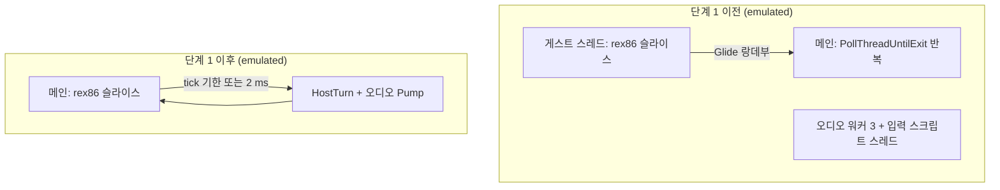
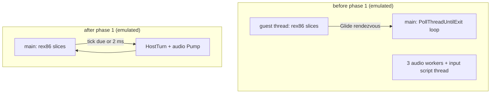

# 작업 로그: 브라우저 호스트 단계 1 — `emulated` 모델의 단일 스레드 호스트 루프 (issue #64)

설계: [20261015-i064](../design/20261015-i064-browser-host-single-thread-loop.md) ·
작업 지시: [20261015-i064](../work-orders/20261015-i064-browser-host-single-thread-loop.md)

## 2026-10-15 — 단계 1 구현과 검증

브랜치 `web-browser-host`(main `0b613c8`, v0.0.219에서). rex86은 로컬 `../rex86`의 v0.0.34 tag(`1694dc4`)를
`FETCHCONTENT_SOURCE_DIR_REX86`으로 썼습니다. 측정 PC는 #61과 다른 4코어 Windows 10 PC입니다.

### 구현



* **실행 모델 질문** `RunsHostOnOneThread()`: `emulated`만 참(`bbfa5b2`).
* **오디오·입력 스크립트를 단계로:** YMZ280B, PIU10 MP3, CD 오디오 워커의 반복 몸통을 `Step()`으로 뽑았습니다.
  스레드 모델은 스레드가 `Step()`과 잠을 되풀이하고, 한 스레드에서는 워커를 띄우지 않고 호스트 차례가
  `Pump()`로 부릅니다. 입력 스크립트 재생기는 시각 기반 상태 기계(`Advance`)가 되었고, 한 스레드에서는 Glide
  백엔드의 `PumpEvents`가 `Pump()`를 부릅니다(`bbfa5b2`).
* **호스트 차례:** `PollThreadUntilExit`의 반복 몸통을 `src/engine/execution/host_turn.cpp`의 `HostTurn`으로
  옮겼습니다. 원본에서 뽑아 그대로 옮겼고, 바뀐 곳은 게스트 스레드가 없을 때(null) 스레드 종료 질문과 바깥에서
  스레드를 표본하는 두 census(위치 census, native phase sampler)를 건너뛰는 것뿐입니다. 폴링 루프에는 "차례 →
  기다림"만 남았습니다(`e69aa56`).
* **단일 스레드 루프:** `RunGuestOnThisThread`가 `GuestEmulatedThreadProc`을 메인 스레드에서 부르고,
  `EmulatedRun::Run`은 멈춤마다 `OneThreadHostLoop::TurnDue`를 물어 다음 tick 기한이나 2 ms 상한이 되면 호스트
  차례를 가집니다. 차례가 정지를 돌려주면 `kStopped`로 끝납니다(`e69aa56`).
* **양보:** `YieldToHost(context, ms)`. INT 21h getch의 1 ms 잠을 이것으로 바꿨습니다.
* **교착 방지:** 한 스레드에서 Glide 명령이 호스트 스레드로 넘겨져야 하는 경로(동기 랑데부, 비동기 back pressure)에
  닿으면 한 줄을 남기고 멈춥니다(`RefuseCrossThreadCommandOnOneThread`).
* **종료:** 한 스레드에서는 시간 제한·창 닫기 뒤의 인터럽트·재시도·join을 건너뜁니다. 메시지는
  `... the one-thread loop stopped the guest`.

작업 지시는 2단계(호스트 차례 추출)를 단독으로 검증한 뒤 커밋하라고 했습니다. 실제로는 진행 중이던 빌드가
반쯤 바뀐 트리를 컴파일해 따로 떼어 검증하지 못했고, 전체를 함께 빌드해 검증했습니다. 대신 커밋은 펌프 분리와
단일 스레드 루프 둘로 나눴습니다.

### 설계의 "확인 필요"에 대한 답

| 항목 | 결과 |
|---|---|
| `PollThreadUntilExit`에서 반복을 넘어 이어지는 상태 | 30여 개 지역 변수와 tick 일정 람다. `HostTurn::Impl`이 같은 이름으로 가짐(확인됨) |
| CD 오디오 워커 | 다른 둘과 같은 "단계 → 잠" 구조, `SDL_AudioStream` 출력. `Step()`으로 뽑음(확인됨) |
| SEH·vectored handler | `GuestEmulatedThreadProc`에는 처음부터 없음. 단일 스레드에서도 필요 없음(확인됨) |
| 호스트 차례 간격 | 2 ms 상한으로 360초에 143,892회(평균 약 2.5 ms). 아래 처리량 참고 |
| live 텔레메트리 | 같은 `HostTurn`이 쓰므로 같은 값. `guest_thread_id`는 메인 스레드 id |

Glide 랑데부가 모든 경로에서 즉시 실행되는지는 교착 방지 줄로 확인했습니다. 아래 모든 `emulated` 실행에서
이 줄은 한 번도 나오지 않았습니다.

### 결과

| 확인 | 결과 |
|---|---|
| Win32 `direct` Release | 빌드, core probe 44/44, pumpitea(`dynamic`) 70초에 3,600프레임(약 55fps), 정상 teardown |
| Win32 `emulated` Release | 빌드, core probe 44/44 |
| Linux x64 (WSL) | 빌드, core probe 통과 |
| Linux i386 (WSL) | 아래 #61 후속 수정 뒤 빌드, core probe 통과 |
| HLE 경계 trace (30초, 단계 1 전후) | 진입 ECX(호출 상태 구조체 주소: 게스트 스레드 스택 → 메인 스레드 스택)를 같은 이름으로 바꾸면 **처음 41개 디스패치가 완전히 같음**. 42번째의 차이는 그 사이 `INT 21h AH=2Ch`가 돌려준 초(DH 42 대 13), 즉 벽시계 |
| 입력 | `pumpitea_play.txt` 40초: 24개 이벤트를 밀어 넣었고 JAMMA 타임라인 edge 24 |
| 창 닫기 | `WM_CLOSE` 뒤 1초 안에 `reason=exit-requested`, `the one-thread loop stopped the guest` |
| 시간 제한 | 30·40·60·360초 실행 모두 `stop requested`로 정상 정지 |
| 교착 방지 줄 | 모든 실행에서 0회 |

**처리량 (360초, pumpitea, 같은 PC):**

| | 단계 1 이전 | 단계 1 이후 |
|---|---|---|
| 실행 단계 | 1,373,607,044 (약 3.8 MIPS) | 973,092,466 (약 2.7 MIPS) |
| HLE 디스패치 | 326,680 | 331,757 |
| `grBufferSwap` | 504 | 504 |
| tick 전달(due/injected) | 71,944 / 63,750 | 73,965 / 66,013 |

| 경과(초) | 10 | 30 | 60 | 120 | 180 | 240 | 300 | 350 |
|---|---|---|---|---|---|---|---|---|
| 이전 디스패치 누적 | 5,716 | 5,958 | 6,330 | 97,723 | 138,252 | 179,305 | 220,888 | 257,129 |
| 이후 디스패치 누적 | 5,724 | 6,032 | 9,237 | 100,499 | 143,519 | 184,392 | 226,091 | 259,174 |

**실행 단계는 29% 줄었지만 게임의 진행은 줄지 않았습니다.** 화면 교체 수는 같고, HLE 진행은 모든 시점에서
같거나 앞섭니다(추정 해석: 줄어든 단계는 게스트가 tick이나 상태를 기다리며 도는 대기 루프입니다. 이전에는 GL
출력과 MP3 디코드가 다른 코어에서 도는 동안 게스트도 계속 돌았고, 이제는 그 시간에 게스트가 돌지 않습니다).
따라서 **실행 단계/초는 `emulated`의 진행을 재는 지표로 맞지 않습니다.** #61의 "프레임당 약 125만 명령"과
"75 MIPS"도 대기 루프가 섞인 값이므로, 실제 필요량은 그보다 작을 수 있습니다(미확정).

이 PC의 `emulated`는 #61의 PC(약 9.3 MIPS, 360초에 2,506프레임)보다 훨씬 느려서, 360초 안에 타이틀에 닿지
않습니다(504프레임). 그래서 **타이틀·데모 플레이 도달과 소리는 이 작업에서 확인하지 못했습니다.** 화면 캡처도 이
셸에서는 되지 않았습니다(`CopyFromScreen`이 멈춤). 사용자의 직접 실행으로 확인할 항목으로 남깁니다.

### #61 후속: Linux i386 빌드 깨짐

`src/platform/linux/host_cpu_entry_state.cpp`(v0.0.219)가 `_mm_getcsr()`를 불러 i386 빌드(`-msse` 없음)에서
`target specific option mismatch`로 컴파일되지 않았습니다. CI가 Win32만 빌드해 드러나지 않았습니다. 같은 파일의
다른 레지스터 읽기처럼 인라인 어셈블리 `stmxcsr`로 바꿨습니다.

### 사용자 확인 (2026-10-15)

사용자가 단일 스레드 `emulated` Release로 pumpitea를 직접 실행해 **로고, 오프닝 영상, 음악 출력**을 확인했습니다.
이 PC에서는 느려서 게임(타이틀·데모 플레이)까지는 가지 못했습니다. 속도는 따로 볼 문제로 두고, 단계 1은 정상으로
처리했습니다.

### 남은 것

* 이 PC에서 타이틀·데모 플레이 도달(속도 문제), 코인·시작 입력에 대한 게임의 반응.
* **종료 중 힙 손상 크래시 — [#65](https://github.com/reexec/rePIU/issues/65).** 사용자 실행(`emulated`, 음악 뒤
  종료)이 `ThreadContext` 파괴 중 `ntdll!RtlFreeHeap`에서 쓰기 접근 위반으로 끝났습니다. 같은 조건의 재현 시도
  (`emulated` 시간 제한 5회·창 닫기 1회, `direct` 시간 제한 4회·창 닫기 2회)에서는 나지 않았고, 게스트가 1 MB 아래
  호스트 페이지를 건드린다는 가설은 측정으로 기각했습니다. 다음 작업에서 손상 지점을 잡습니다.
* `direct` 1회가 56초에 Task 736 모양(타이머 ISR 중첩으로 게스트 스택이 넘침, `0x0402AB87` 프레임 반복)으로 끝났습니다.
  호스트 차례는 규칙을 그대로 옮겼으므로 이 작업의 회귀는 아닌 것으로 봅니다(추정). #65에서 함께 봅니다.
* 장면별 "대기 루프를 뺀" 필요 처리량 측정(위 해석의 확인).
* 단계 2(Emscripten 빌드, Node 헤드리스 실행)부터는 각자 작업 지시로.

### 재현

```bash
cmake -S . -B build/win32_x86_emulated -G "Visual Studio 18 2026" -A Win32 \
  -DREPIU_EXECUTION_MODEL_OVERRIDE=emulated -DFETCHCONTENT_SOURCE_DIR_REX86=C:/workspace/git/rex86
cmake --build build/win32_x86_emulated --config Release --target repiu repiu_core_probe -- -m
# PowerShell: $env:REPIU_EXECUTION_TIMEOUT_MS="360000"; build\win32_x86_emulated\Release\repiu.exe pumpitea
# trace: $env:REPIU_HLE_BOUNDARY_TRACE="trace.txt"
# 입력: $env:REPIU_INPUT_SCRIPT="scripts/input_scripts/pumpitea_play.txt"
```

---

# Work log: browser host phase 1 — a single-threaded host loop for the `emulated` model (issue #64)

Design: [20261015-i064](../design/20261015-i064-browser-host-single-thread-loop.md) ·
Work order: [20261015-i064](../work-orders/20261015-i064-browser-host-single-thread-loop.md)

## 2026-10-15 — phase 1 implemented and verified

Branch `web-browser-host` (main `0b613c8`, from v0.0.219). rex86 was the local `../rex86` at the v0.0.34 tag
(`1694dc4`) through `FETCHCONTENT_SOURCE_DIR_REX86`. The measuring PC is a 4-core Windows 10 PC, not #61's.

### Implementation



* **Execution model question** `RunsHostOnOneThread()`: true on `emulated` only (`bbfa5b2`).
* **Audio and input script as steps:** the loop bodies of the YMZ280B, PIU10 MP3 and CD audio workers became
  `Step()`. On threaded models the thread repeats `Step()` and its sleep; on one thread no worker starts and the host
  turn calls `Pump()`. The input script player became a timed state machine (`Advance`), whose `Pump()` the Glide
  backend's `PumpEvents` calls on one thread (`bbfa5b2`).
* **The host turn:** the body of `PollThreadUntilExit`'s iteration moved to `HostTurn` in
  `src/engine/execution/host_turn.cpp`, extracted from the source as it was; the only changes skip, when there is no
  guest thread (null), the thread-exit question and the two censuses that sample the thread from outside (the position
  census and the native phase sampler). The poll loop keeps only "turn, then wait" (`e69aa56`).
* **The single-threaded loop:** `RunGuestOnThisThread` calls `GuestEmulatedThreadProc` on the main thread, and
  `EmulatedRun::Run` asks `OneThreadHostLoop::TurnDue` at every stop, taking a host turn when the next tick is due or
  2 ms have passed; a turn that returns a stop ends the run with `kStopped` (`e69aa56`).
* **Yield:** `YieldToHost(context, ms)`, replacing INT 21h getch's 1 ms sleep.
* **Deadlock guard:** on one thread, reaching a path that hands a Glide command to the host thread (the synchronous
  rendezvous, the asynchronous back pressure) leaves a line and stops (`RefuseCrossThreadCommandOnOneThread`).
* **Exit:** on one thread the interrupt, retries and join after a timeout or window close are skipped; the message is
  `... the one-thread loop stopped the guest`.

The work order said to verify step 2 (the host-turn extraction) alone before committing it. In practice a build in
flight compiled a half-changed tree, so it could not be checked separately and everything was verified built
together; the commits were still split in two, the pump split and the single-threaded loop.

### Answers to the design's "to be confirmed"

| Item | Result |
|---|---|
| State of `PollThreadUntilExit` that carries across iterations | thirty-odd locals and the tick-schedule lambda, held by `HostTurn::Impl` under the same names (confirmed) |
| The CD audio worker | the same "step, then sleep" shape as the other two, output to an `SDL_AudioStream`, taken out as `Step()` (confirmed) |
| SEH and the vectored handler | never in `GuestEmulatedThreadProc`; not needed on one thread either (confirmed) |
| The host-turn gap | with the 2 ms cap, 143,892 turns in 360 s (about 2.5 ms apart); see throughput below |
| Live telemetry | written by the same `HostTurn`, so the same values; `guest_thread_id` is the main thread's id |

Whether the Glide rendezvous runs in place on every path was checked by the deadlock-guard line: it never appeared in
any `emulated` run below.

### Results

| Check | Result |
|---|---|
| Win32 `direct` Release | build, core probe 44/44, pumpitea (`dynamic`) 3,600 frames in 70 s (about 55 fps), clean teardown |
| Win32 `emulated` Release | build, core probe 44/44 |
| Linux x64 (WSL) | build, core probe passes |
| Linux i386 (WSL) | build after the #61 follow-up fix below, core probe passes |
| HLE boundary trace (30 s, before and after phase 1) | with the entry ECX (the call-state address: guest thread stack → main thread stack) named alike, **the first 41 dispatches match exactly**; the 42nd differs in the seconds `INT 21h AH=2Ch` returned in between (DH 42 against 13): the wall clock |
| Input | `pumpitea_play.txt` for 40 s: 24 events pushed, 24 JAMMA timeline edges |
| Closing the window | within 1 s of `WM_CLOSE`: `reason=exit-requested`, `the one-thread loop stopped the guest` |
| Timeout | the 30, 40, 60 and 360 s runs all stopped cleanly with `stop requested` |
| Deadlock-guard line | 0 in every run |

**Throughput (360 s, pumpitea, same PC):**

| | before phase 1 | after phase 1 |
|---|---|---|
| Steps run | 1,373,607,044 (about 3.8 MIPS) | 973,092,466 (about 2.7 MIPS) |
| HLE dispatches | 326,680 | 331,757 |
| `grBufferSwap` | 504 | 504 |
| Tick delivery (due/injected) | 71,944 / 63,750 | 73,965 / 66,013 |

| Elapsed (s) | 10 | 30 | 60 | 120 | 180 | 240 | 300 | 350 |
|---|---|---|---|---|---|---|---|---|
| Dispatches before | 5,716 | 5,958 | 6,330 | 97,723 | 138,252 | 179,305 | 220,888 | 257,129 |
| Dispatches after | 5,724 | 6,032 | 9,237 | 100,499 | 143,519 | 184,392 | 226,091 | 259,174 |

**The steps fell by 29% but the game's progress did not.** The buffer swaps are equal, and the HLE progress is equal or
ahead at every point. (An inference: the steps that went are the guest's wait loops for a tick or a state; before, the
guest kept running them while the GL output and the MP3 decoding ran on other cores, and now it does not run during
that time.) **Steps per second is therefore not a measure of `emulated`'s progress.** #61's "about 1.25 million
instructions a frame" and "75 MIPS" include wait loops too, so the real need may be smaller (unresolved).

This PC runs `emulated` far slower than #61's (about 9.3 MIPS, 2,506 frames in 360 s) and does not reach the title
within 360 s (504 frames). **Reaching the title and the demo play, and the sound, were therefore not checked in this
work.** Screen capture did not work from this shell either (`CopyFromScreen` hung). They are left for the user's
hands-on run.

### #61 follow-up: the Linux i386 build was broken

`src/platform/linux/host_cpu_entry_state.cpp` (v0.0.219) called `_mm_getcsr()`, which does not compile in the i386
build (no `-msse`): `target specific option mismatch`. CI builds only Win32, so it went unseen. It now reads MXCSR with
inline `stmxcsr`, like the file's other register reads.

### Confirmed by the user (2026-10-15)

The user ran pumpitea on the single-threaded `emulated` Release and confirmed **the logo, the opening video and the
music**. On this PC it was too slow to reach the game (the title and the demo play). Speed is left as a matter of its
own, and phase 1 is treated as working.

### Remaining

* Reaching the title and the demo play on this PC (the speed problem), and the game's response to coin and start input.
* **A heap-corruption crash in teardown — [#65](https://github.com/reexec/rePIU/issues/65).** A user run (`emulated`,
  ended after the music) ended in a write access violation in `ntdll!RtlFreeHeap` while `ThreadContext` was destroyed.
  Reproductions under the same conditions (`emulated`: five timeouts and one window close; `direct`: four timeouts and two
  closes) did not crash, and the guess that the guest touches host pages below 1 MB was ruled out by measurement. The
  next task catches the corrupting write.
* One `direct` run ended at 56 s in the shape of Task 736 (the timer ISR nesting until the guest stack overflows,
  `0x0402AB87` frames repeating). The host turn moved its rules unchanged, so this is taken not to be a regression of this
  work (inferred); #65 looks at it too.
* Measuring the per-scene need with the wait loops taken out (to confirm the inference above).
* Phase 2 on (the Emscripten build, the headless run under Node), each with its own work order.

### Reproducing

```bash
cmake -S . -B build/win32_x86_emulated -G "Visual Studio 18 2026" -A Win32 \
  -DREPIU_EXECUTION_MODEL_OVERRIDE=emulated -DFETCHCONTENT_SOURCE_DIR_REX86=C:/workspace/git/rex86
cmake --build build/win32_x86_emulated --config Release --target repiu repiu_core_probe -- -m
# PowerShell: $env:REPIU_EXECUTION_TIMEOUT_MS="360000"; build\win32_x86_emulated\Release\repiu.exe pumpitea
# trace: $env:REPIU_HLE_BOUNDARY_TRACE="trace.txt"
# input: $env:REPIU_INPUT_SCRIPT="scripts/input_scripts/pumpitea_play.txt"
```
